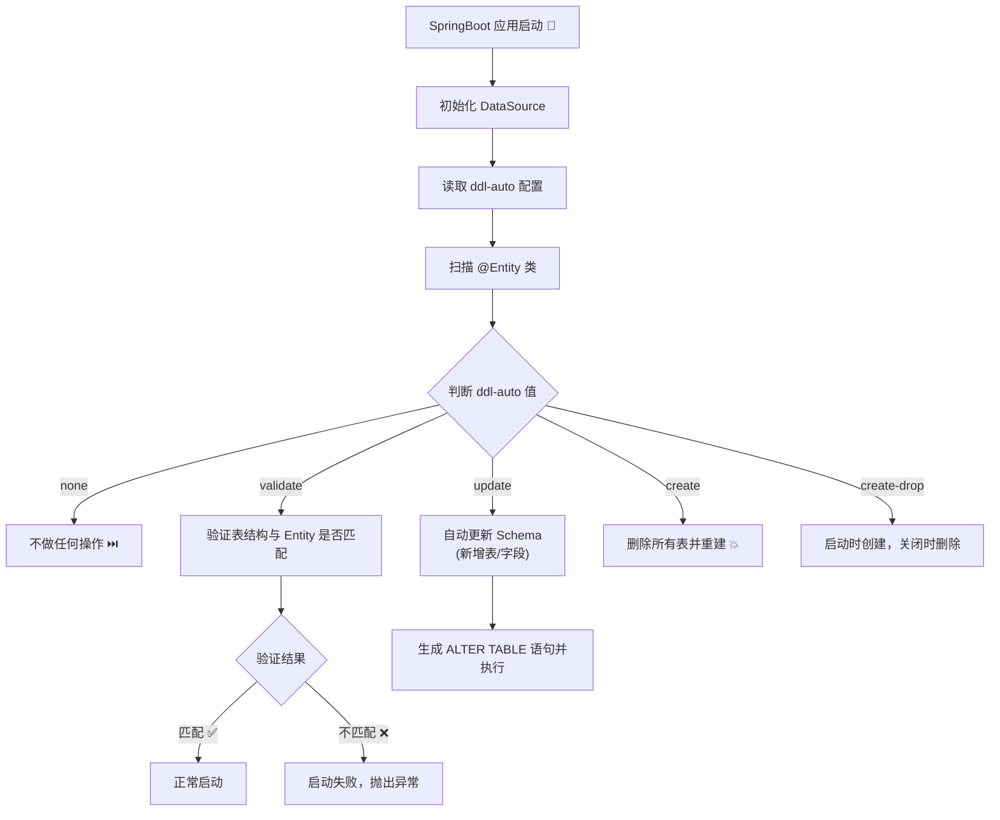

# SpringBoot 实体类新增字段对已有数据的影响及自动 DDL 同步机制详解 🔄

本文档深入分析 SpringBoot + JPA 项目在已有数据的情况下，修改 Entity 类（新增字段）对数据库表和已有数据的影响。核心聚焦 `spring.jpa.hibernate.ddl-auto` 配置的四种模式，解析「数据会不会丢失」「SpringBoot 如何同步实体结构到数据库表」等关键问题，并提供生产环境的安全操作指南 🛡️

<!-- English Abstract -->

This document analyzes the impact of adding new fields to Entity classes on database tables and existing data in SpringBoot + JPA projects. It focuses on the `spring.jpa.hibernate.ddl-auto` configuration's four modes, addressing key questions like "will data be lost" and "how SpringBoot syncs entity structures to database tables", while providing safe operating guidelines for production environments 🛡️

---

## 术语表 / Terminology

| 术语 / Term            | 说明 / Description                                                          |
| ---------------------- | --------------------------------------------------------------------------- |
| **ORM**                | Object-Relational Mapping，对象关系映射，将 Java 对象与数据库表建立映射关系 |
| **JPA**                | Java Persistence API，Java 持久化 API 标准规范                              |
| **Hibernate**          | JPA 规范的流行实现，Spring Boot 默认的 ORM 框架                             |
| **DDL**                | Data Definition Language，数据定义语言（CREATE, ALTER, DROP 等）            |
| **Schema**             | 数据库模式，描述表结构、字段、约束等元数据                                  |
| **Entity**             | JPA 实体类，通过注解与数据库表映射的 Java 类                                |
| **ddl-auto**           | `spring.jpa.hibernate.ddl-auto` 配置，控制 Hibernate 自动 DDL 行为          |
| **Migration**          | 数据库迁移，通过版本化脚本管理数据库结构变更                                |
| **Flyway / Liquibase** | 流行的数据库版本迁移工具                                                    |
| **ALTER TABLE**        | SQL DDL 语句，用于修改已存在的表结构                                        |

---

## 章节阅读路线图 🗺️ / Chapter Reading Roadmap

1. **问题背景与核心困惑** 🤔 / Problem Background → 阐述场景：运行中的项目已有数据，修改 Entity 后会发生什么
2. **spring.jpa.hibernate.ddl-auto 全解析** ⚙️ / ddl-auto Complete Analysis → 逐条拆解五种模式的行为、适用场景与风险
3. **不同模式下新增字段的数据安全分析** 🔐 / Data Safety Analysis → 分析「数据会不会丢失」这个核心问题
4. **安全新增字段的最佳实践** ✅ / Best Practices for Adding Fields → 从开发到生产的安全操作流程
5. **生产环境推荐策略与迁移工具** 🏭 / Production Strategy → 为什么大厂不用 ddl-auto 而用 Flyway/Liquibase
6. **总结** 📝 / Summary → 核心要点回顾与速查表

---

## 1. 问题背景与核心困惑 🤔 / Problem Background

> 📖 **Note:** 本章阐述 SpringBoot 项目的典型场景——已有生产数据后修改 Entity 类，以及开发者最关心的数据安全问题 / This chapter describes the typical scenario—modifying Entity classes after production data exists—and the data safety concerns developers care about most.

### 1.1 典型场景描述 🎯 / Typical Scenario

想象一下这个场景：你的 SpringBoot 项目已经上线运行了半年，数据库里积累了大量用户数据。现在业务需求变了——需要在 User 表里增加一个 `phone_number` 字段。于是你修改了 User 实体类，添加了一行 `private String phoneNumber;`，然后重启了应用。

这时候，你的脑子里会冒出几个关键问题：💭

- 启动后数据库表会自动加上这个字段吗？
- **表里已有的几千条数据会消失吗？**
- SpringBoot 到底是怎么同步 Entity 到数据库的？
- 我要不要提前备份数据？

这些问题不是杞人忧天——在生产环境中，理解 ddl-auto 的工作机制是每个 SpringBoot 开发者的必修课。选择错误的配置，轻则导致启动失败，重则造成数据丢失甚至生产事故。⚡

### 1.2 SpringBoot 自动 DDL 的触发机制 🔄 / How Auto DDL Works

要理解实体类修改后数据库的反应，首先需要知道 SpringBoot 在启动时做了什么：

```java
// 以下为概念性流程，非实际代码 / Conceptual flow, not actual code

// ① Spring Boot 启动后，初始化 DataSource
// ② Hibernate 读取 spring.jpa.hibernate.ddl-auto 配置
// ③ Hibernate 使用 SchemaManagementTool 检查所有 @Entity 注解的类
// ④ 对比实体类的字段/注解与数据库中现有的表结构
// ⑤ 根据 ddl-auto 的值执行对应操作：创建/更新/验证/忽略
```

**核心流程** 🧩：



**关键点**：这个同步行为**只在应用启动时发生一次**。运行时修改 Entity 不会立即触发 DDL——需要重启应用才能生效。⏱️

### 1.3 ddl-auto 的默认值 🏠 / Default Value

很多人不知道的一个细节：SpringBoot 会根据数据库类型自动选择 ddl-auto 的默认值：

- **内嵌数据库**（H2、HSQL、Derby）→ 默认 `create-drop`
- **非内嵌数据库**（MySQL、PostgreSQL、Oracle 等）→ 默认 `none`

```yaml
# Spring Boot 的自动选择逻辑（概念性伪代码）
if (DataSource.getUrl().contains("h2") || DataSource.getUrl().contains("hsql") || DataSource.getUrl().contains("derby")): ddl-auto = "create-drop" # 内嵌数据库默认 create-drop
else: ddl-auto = "none" # 生产数据库默认 none
```

也就是说，**如果你的项目连接的是 MySQL/PostgreSQL 等实际数据库，又没有显式配置 ddl-auto，那么默认行为就是 none——Hibernate 根本不会碰数据库结构**。但在实际项目中，很多开发者在开发阶段会显式设置为 `update` 来方便开发。🚀

这个默认值设计是 SpringBoot 的安全保障——避免在连接生产数据库时意外执行 DDL 操作。但很多开发者并不知道这个默认行为，在切换环境时容易出问题。

**参考资料：**

- [Spring Boot官方文档：Initialize a database using Hibernate -- Spring](https://docs.spring.io/spring-boot/docs/1.1.0.M1/reference/html/howto-database-initialization.html)
- [How does spring.jpa.hibernate.ddl-auto property exactly work -- StackOverflow](https://stackoverflow.com/questions/42135114/how-does-spring-jpa-hibernate-ddl-auto-property-exactly-work-in-spring) ⭐值得阅读
- [Spring Boot 参考指南：创建和删除 JPA 数据库 -- GitBook](https://jack80342.gitbook.io/spring-boot/iv.-spring-boot-features/29.-working-with-sql-databases/29.3.-jpa-and-spring-data/29.3.3.-creating-and-dropping-jpa-databases)
- [Spring Data JPA 中文文档 -- SpringDoc](https://springdoc.cn/spring-data-jpa/)
- [SpringBoot中使用Spring Data JPA -- 博客园](https://www.cnblogs.com/daimenglaoshi/p/16950787.html)

---

## 2. spring.jpa.hibernate.ddl-auto 全解析 ⚙️ / Complete Analysis of ddl-auto

> ⚙️ **Note:** 本章逐条拆解五种模式的行为、适用场景与风险 / This chapter breaks down the behavior, use cases, and risks of each of the five ddl-auto modes.

### 2.1 五种模式速览 📋 / Quick Overview

| 值              | 启动时行为               | 对表结构                   | 对现有数据      |
| --------------- | ------------------------ | -------------------------- | --------------- |
| **none**        | 不做任何操作             | 不修改                     | 完全保留 ✅     |
| **validate**    | 验证 Entity 与表是否匹配 | 不修改，不匹配则抛异常退出 | 完全保留 ✅     |
| **update**      | 自动添加缺少的表和字段   | 仅新增，不删除不修改       | 完全保留 ✅     |
| **create**      | 先删表再重建             | 完全重建                   | **全部清空** 💥 |
| **create-drop** | 启动时创建，关闭时删除   | 启动创建，关闭删除         | **全部清空** 💥 |

### 2.2 none：完全托管模式 🛡️ / No Schema Management

```yaml
# 完全禁用 Hibernate 的自动 DDL 功能 🛡️
spring:
  jpa:
    hibernate:
      ddl-auto: none
```

**行为**：Hibernate 不做任何 Schema 管理。不会创建表、不会修改表、不会验证表。**这是生产环境最安全的选择**。

**适用场景**：

- ✅ 生产环境 🏭
- ✅ 使用 Flyway、Liquibase 等版本迁移工具的项目
- ✅ 由 DBA 或专门的脚本管理数据库变更

**优点**：

- 完全可控，不会意外修改数据库结构
- 和数据库迁移工具配合最佳

**缺点**：

- Developer 需要手动管理数据库变更
- 如果忘记执行 DDL 脚本，启动时查询会报错

### 2.3 validate：验证模式 🔍 / Schema Validation

```yaml
# Hibernate 启动时验证表结构是否与 Entity 匹配 🔍
spring:
  jpa:
    hibernate:
      ddl-auto: validate
```

**行为**：Hibernate 启动时会检查数据库表结构是否与 Entity 注解完全匹配。**如果发现不一致，直接抛出异常，应用启动失败**。

```java
// 假设 Entity 中有 phoneNumber 字段 🧩
@Entity
@Table(name = "users")
public class User {
    @Id
    private Long id;
    private String name;
    private String phoneNumber;  // 💥 如果数据库表没有这个字段，启动报错！
}
```

```log
# 验证失败时的异常日志示例 📋
org.hibernate.tool.schema.spi.SchemaManagementException:
Schema-validation: missing column [phone_number] in table [users]
```

**适用场景**：

- ✅ 预上线环境（Staging），在部署前发现不匹配问题
- ✅ CI/CD Pipeline 中作为 Schema 一致性检查
- ✅ 生产环境（配合 Migration 工具一起使用）

**优点**：

- 提前发现 Entity 和表的差异，避免运行时查询报错
- 不修改数据库，安全可控

**缺点**：

- 不自动创建或修改表，需要配合 Migration 工具使用
- 验证失败会导致应用无法启动

### 2.4 update：自动更新模式 🔄 / Auto Schema Update

```yaml
# Hibernate 自动更新 Schema 以匹配 Entity 变更 🔄
spring:
  jpa:
    hibernate:
      ddl-auto: update
```

**行为**：Hibernate 会比较 Entity 类和现有表结构，然后自动执行必要的 DDL 语句来让数据库表与 Entity 保持一致。具体来说：

| Entity 状态 vs 数据库表   | update 的反应                                            |
| ------------------------- | -------------------------------------------------------- |
| Entity 有字段，表没有该列 | ✅ **自动 ADD COLUMN**                                   |
| Entity 没有字段，表有该列 | ❌ **不会删除**（安全设计）                              |
| Entity 修改了字段类型     | ⚠️ **可能尝试修改**（有风险）                            |
| Entity 修改了字段名       | ⚠️ **不会重命名**，会当做旧字段删除+新字段创建（有风险） |
| Entity 新增了索引注解     | ✅ **自动创建索引**（但有风险，见事故案例）              |
| Entity 删除了索引注解     | ⚠️ **可能会删除索引**（有真实事故案例）                  |

```java
// 原始实体类 🧩
@Entity
public class User {
    @Id
    private Long id;
    private String name;
}

// 新增字段后的实体类
@Entity
public class User {
    @Id
    private Long id;
    private String name;
    private String phoneNumber;  // ✨ 新增字段
}
```

```sql
-- Hibernate 自动生成的 DDL（update 模式下）🚀
ALTER TABLE user ADD COLUMN phone_number VARCHAR(255);
```

> 💡 `update` 模式的设计核心原则是 **「避免数据丢失」**——所以它永远不会主动删除数据库中的字段。即使你把 Entity 里的属性删了，Hibernate 也不会删除数据库表对应的列。这一设计的基本逻辑是：**宁保留，勿丢失**。

**适用场景**：

- ✅ **开发环境**：快速迭代，减少手动建表工作
- ✅ **本地学习项目**：方便快捷
- ❌ **生产环境**：有风险，不推荐

**缺点与风险** ⚠️：

1. **不可预测性**：自动生成的 DDL 可能导致意外操作（如重建索引）
2. **大表性能问题**：在大表上执行自动 DDL 可能长时间锁表
3. **不支持复杂变更**：字段改名、类型变更等复杂操作无法正确处理
4. **索引操作风险**：真实线上事故——Hibernate 在 update 模式下曾自动删除并重建千万级大表的索引，导致生产环境宕机 🔥

**📖 真实事故案例**：某公司在生产环境使用 `spring.jpa.hibernate.ddl-auto=update`，新服务上线时 Hibernate 自动对千万级数据表执行了 DROP INDEX 再 CREATE INDEX 的操作。在索引删除到重建的间隙，大量写请求插入了重复数据，导致索引重建失败，最终造成线上服务停机十几分钟。教训惨痛！

**参考资料：**

- [【Spring错误笔记】spring.jpa.hibernate.ddl-auto=update造成删除索引的线上事故 -- CSDN](https://blog.csdn.net/SnailMann/article/details/103733230) ⭐值得阅读
- [Spring Boot中Hibernate数据库Schema自动更新问题咨询 -- 火山引擎](https://www.volcengine.com/article/829021)

### 2.5 create：重建模式 💥 / Schema Recreation

```yaml
# ⚠️ 危险！每次启动都会删除并重建所有表
spring:
  jpa:
    hibernate:
      ddl-auto: create
```

**行为**：每次应用启动时，Hibernate 先**删除所有已存在的表**，然后根据 Entity 注解**重新创建**。

**影响**：

- 所有表被删除 🗑️
- **所有数据永久丢失** 💥
- 创建全新的空表

```sql
-- Hibernate 自动执行的操作序列
DROP TABLE IF EXISTS user;  -- 先删
DROP TABLE IF EXISTS role;
-- ... 删除所有表

CREATE TABLE user (...);    -- 再重建（空表）
CREATE TABLE role (...);
```

**适用场景**：

- ✅ 学习 JPA / 快速原型验证
- ✅ Demo 项目，不需要持久化数据
- ❌ **开发环境也要慎用**（频繁重启会丢失数据）
- ❌ **生产环境绝对禁止** 🚫

### 2.6 create-drop：临时模式 ⏳ / Temp Schema

```yaml
# 仅用于测试：启动创建，关闭销毁 ⏳
spring:
  jpa:
    hibernate:
      ddl-auto: create-drop
```

**行为**：启动时创建所有表，**应用正常关闭时删除所有表**。

**适用场景**：

- ✅ 单元测试 / 集成测试（每个测试方法独立 Schema）
- ✅ 嵌入数据库（H2）的测试场景
- ❌ **生产环境绝对禁止** 🚫

```java
// SpringBoot 测试中常用的配置 ⚗️
@TestPropertySource(properties = "spring.jpa.hibernate.ddl-auto=create-drop")
@SpringBootTest
class UserRepositoryTest {
    // 每个测试方法都有干净的数据库环境 ✅
}
```

### 2.7 五种模式对比表 📊 / Comparison Table

| 维度         | none          | validate            | update             | create  | create-drop |
| ------------ | ------------- | ------------------- | ------------------ | ------- | ----------- |
| 自动建表     | ❌            | ❌                  | ✅                 | ✅      | ✅          |
| 自动加字段   | ❌            | ❌                  | ✅                 | ✅      | ✅          |
| 验证结构     | ❌            | ✅                  | ❌                 | ❌      | ❌          |
| 删除数据     | ❌            | ❌                  | ❌                 | **✅**  | **✅**      |
| 启动失败风险 | ❌            | ✅（验证不通过）    | ⚠️（DDL 执行失败） | ❌      | ❌          |
| 生产环境适用 | ✅ 推荐       | ✅ 推荐             | ❌ 不推荐          | ❌ 禁止 | ❌ 禁止     |
| 开发环境适用 | ❌ 需手动管理 | ⚠️ 需配合 Migration | ✅ 推荐            | ⚠️ 慎用 | ❌ 不适合   |

**参考资料：**

- [Understanding Hibernate ddl-auto in Spring Boot -- DEV Community](https://dev.to/ayshriv/understanding-hibernate-ddl-auto-in-spring-boot-when-to-use-create-update-validate-and-none-5c8n) ⭐值得阅读
- [Mastering spring.jpa.hibernate.ddl-auto in Spring Boot -- Mastering Backend](https://blog.masteringbackend.com/mastering-spring-jpa-hibernate-ddl-auto-in-spring-boot-complete-guide-with-real-world-examples) ⭐值得阅读
- [Automatically Create a Database Schema With Spring Boot -- Baeldung](https://www.baeldung.com/springboot-jpa-automatically-create-database-schema) ⭐值得阅读
- [springdata jpa之ddl-auto配置的属性 -- 博客园](https://www.cnblogs.com/qingmuchuanqi48/p/11616145.html)
- [Spring中spring.jpa.hibernate.ddl-auto属性的工作原理 -- CSDN](https://blog.csdn.net/qq_29715355/article/details/147587738)
- [springboot data JPA的spring.jpa.hibernate.ddl-auto 的见解思考 -- 掘金](https://juejin.cn/post/6844903911866761224)
- [Database Schema Changes with Hibernate, Spring Boot, and Neon -- Neon](https://neon.com/guides/spring-boot-hibernate)

---

## 3. 不同模式下新增字段的数据安全分析 🔐 / Data Safety Analysis When Adding Fields

> 🔐 **Note:** 本章回答最核心的问题：「修改 Entity 新增字段后，数据库里已有的数据会丢失吗？」/ This chapter answers the core question: "Will existing database data be lost after adding a field to an Entity?"

### 3.1 核心结论 🔑 / Core Conclusion

**直接回答**：✅ **在正确的配置下，已有数据不会丢失。**

但丢失与否取决于 `ddl-auto` 的配置值，以及新增字段的约束条件。下面逐条分析。

### 3.2 各模式下的数据安全性 / Data Safety by Mode

#### none ✅ 最安全

```yaml
spring.jpa.hibernate.ddl-auto: none
```

新增字段后重启：

- ❌ 数据库表**不会**自动增加新字段
- ✅ 应用可能因查询新字段而报错（NoSuchFieldException / 查询时找不到列）
- ✅ **已有数据完全保留**

> ⚠️ 注意：虽然数据安全，但代码会报错。需要在重启前手动执行 ALTER TABLE 语句。

#### validate ✅ 安全但会阻止启动

```yaml
spring.jpa.hibernate.ddl-auto: validate
```

新增字段后重启：

- ❌ 数据库表**不会**自动增加新字段
- ❌ **应用启动失败**，抛出 SchemaManagementException：`missing column [xxx] in table [yyy]`
- ✅ **已有数据完全保留**

> 💡 这其实是一种保护机制——validate 模式强迫你先手动同步数据库，再部署新代码。

#### update ✅ 自动加字段，数据保留

```yaml
spring.jpa.hibernate.ddl-auto: update
```

新增字段后重启：

- ✅ 数据库表**自动**增加新列：`ALTER TABLE user ADD COLUMN phone_number VARCHAR(255)`
- ✅ **已有数据完全保留**（新字段值默认为 NULL）
- ✅ 应用正常启动，可以正常读写新字段

**⚠️ 但 update 模式的其他风险依然存在：**

- 可能意外删除或重建索引（见第 2.4 节的事故案例）
- 字段改名时不会重命名列，而是删除旧列（数据丢失！）
- 复杂变更（如类型修改）可能失败

#### create 💥 数据丢失！

```yaml
spring.jpa.hibernate.ddl-auto: create
```

新增字段后重启：

- ✅ 新表结构正确
- ❌ **所有表被删除重建**
- ❌ **所有已有数据永久丢失** 💀

```sql
-- Hibernate 执行的操作
DROP TABLE IF EXISTS user;   -- 数据全部消失 😱
CREATE TABLE user (
    id BIGINT,
    name VARCHAR(255),
    phone_number VARCHAR(255)  -- 新字段有了，但数据没了
);
```

#### create-drop 💥 数据丢失！

```yaml
spring.jpa.hibernate.ddl-auto: create-drop
```

新增字段后重启：

- ✅ 新表结构正确
- ❌ **所有数据丢失**
- 应用关闭时表也会被删除

### 3.3 新增字段的 NULL / NOT NULL 对数据的影响 / NULL vs NOT NULL

除了 ddl-auto 模式，**新增字段的约束条件**也会影响已有数据的行为：

#### 字段为 nullable（默认）

```java
@Column(name = "phone_number", nullable = true)  // 默认可为空 ✅
private String phoneNumber;
```

```sql
-- Hibernate 生成的 DDL
ALTER TABLE user ADD COLUMN phone_number VARCHAR(255);  -- 允许 NULL
```

- ✅ **已有数据不受影响**
- 已有行的 `phone_number` 字段值为 `NULL`
- 这是最常见的做法，也是最安全的

#### 字段为 NOT NULL（无默认值）⚠️ 危险！

```java
@Column(name = "phone_number", nullable = false)  // ❌ 不允许为空
private String phoneNumber;
```

```sql
-- Hibernate 生成的 DDL
ALTER TABLE user ADD COLUMN phone_number VARCHAR(255) NOT NULL;  -- 已有行没有值！
```

- ❌ **数据库会报错！** 因为新增 NOT NULL 列时，已有行没有值可以填充
- ❌ 即使有的数据库不报错（如 MySQL 严格模式），已有行的值也不确定
- ❌ **应用启动失败** 🚫

#### 字段为 NOT NULL + 默认值 ✅ 最安全

```java
@Column(name = "member_level", nullable = false, columnDefinition = "VARCHAR(20) DEFAULT 'NORMAL'")
private String memberLevel;
```

```sql
-- 数据库执行的 DDL
ALTER TABLE user ADD COLUMN member_level VARCHAR(20) NOT NULL DEFAULT 'NORMAL';
```

- ✅ 已有行的 `member_level` 自动填充为 `'NORMAL'`
- ✅ 数据安全
- ⚠️ 需要 columnDefinition 配合，且不同数据库语法有差异

**参考资料：**

- [JPA设置默认值，字段长度 -- 阿里云开发者社区](https://developer.aliyun.com/article/247941)
- [Problems with adding NOT NULL columns -- Red-Gate](https://www.red-gate.com/hub/product-learning/hub/problems-with-adding-not-null-columns-or-making-nullable-columns-not-null-ei028/)
- [JPA @Column约束 -- 火山引擎](https://www.volcengine.com/article/566576)
- [Unable to add additional column to an existing table -- StackOverflow](https://stackoverflow.com/questions/57307298/unable-to-add-additional-column-to-an-existing-table-in-springboot-hibernate-jpa)
- [Difference between @Column(nullable = false) & @NotNull -- Thorben Janssen](https://thorben-janssen.com/hibernate-tips-whats-the-difference-between-column-nullable-false-and-notnull/)

---

## 4. 安全新增字段的最佳实践 ✅ / Best Practices for Adding Fields Safely

> ✅ **Note:** 本章提供从开发到生产的安全操作流程，确保新增字段时数据零丢失 / This chapter provides safe operational procedures from development to production, ensuring zero data loss when adding new fields.

### 4.1 开发阶段的推荐操作 💻 / Development Stage

开发阶段追求效率，可以适当使用 ddl-auto 的自动化功能：

```yaml
# application-dev.yml - 开发环境配置 🛠️
spring:
  jpa:
    hibernate:
      ddl-auto: update # 开发环境使用 update 自动加字段
  datasource:
    url: jdbc:mysql://localhost:3306/dev_db
```

**操作流程**：

```java
// 1. 在 Entity 类中添加新字段，设定合理的默认值 🧩
@Entity
@Table(name = "users")
public class User {
    @Id
    private Long id;
    private String name;

    // 新增字段：手机号，允许为空（安全） ✅
    @Column(name = "phone_number", nullable = true)
    private String phoneNumber;
}
```

```bash
# 2. 重启应用，观察日志 🚀
# 日志示例：Hibernate: alter table users add column phone_number varchar(255)

# 3. 验证新字段可以正常读写 ✅
# 4. 检查已有数据是否完整
```

### 4.2 预上线环境的推荐操作 🚧 / Staging Stage

预上线环境应模拟生产环境配置：

```yaml
# application-staging.yml - 预上线环境 🚧
spring:
  jpa:
    hibernate:
      ddl-auto: validate # 开启验证，但不自动修改
```

**操作流程**：

```sql
-- 1. 手动编写并执行 DDL 脚本 ✍️
ALTER TABLE users ADD COLUMN phone_number VARCHAR(255) NULL;

-- 2. 验证脚本执行成功
DESC users;
-- 确认 phone_number 列已添加

-- 3. 验证已有数据完整性
SELECT COUNT(*) FROM users;  -- 行数不变
SELECT * FROM users LIMIT 5; -- 数据完整，新列为 NULL
```

```bash
# 4. 启动应用，验证 validate 通过 ✅
# 应用应正常启动，无 Schema 异常

# 5. 执行集成测试 🧪
```

### 4.3 生产环境的推荐操作 🏭 / Production Stage

```yaml
# application-prod.yml - 生产环境 🏭
spring:
  jpa:
    hibernate:
      ddl-auto: validate # 或 none
```

**生产环境操作流程**（严格遵守以下步骤）：

**第 1 步：准备阶段** 📋

```bash
# 1. 备份数据库 💾
mysqldump -u user -p database_name > backup_20260709.sql

# 2. 准备回滚脚本 🔄
# drop_phone_number.sql
-- ALTER TABLE users DROP COLUMN phone_number;
```

**第 2 步：执行数据库变更** 🛠️

```sql
-- 选择业务低峰期执行 ⏰
-- 对大表使用在线 DDL（MySQL 8.0+）⚡
ALTER TABLE users ADD COLUMN phone_number VARCHAR(255) NULL, ALGORITHM=INPLACE, LOCK=NONE;
```

**第 3 步：部署新代码** 🚀

```bash
# 部署新版本（包含新增了 phoneNumber 字段的 Entity）
```

**第 4 步：验证** ✅

```sql
-- 检查应用日志，确认 validate 通过
-- 查询部分数据验证
SELECT id, name, phone_number FROM users LIMIT 10;

-- 测试新字段的读写操作
UPDATE users SET phone_number = '13800138000' WHERE id = 1;
SELECT phone_number FROM users WHERE id = 1;  -- 应返回 '13800138000'
```

### 4.4 新增字段的约束选择指南 / Constraint Choice Guide

| 场景                     | 推荐约束                                               | 对已有数据的影响     |
| ------------------------ | ------------------------------------------------------ | -------------------- |
| 新字段不一定有值         | `nullable = true` ✅                                   | 已有行自动为 NULL    |
| 新字段必须有值           | `nullable = false` + `columnDefinition` 设置默认值 ✅  | 已有行自动填充默认值 |
| 新字段必须有值且无默认值 | ❌ 不推荐，先加 nullable 列，再填充数据后改为 NOT NULL | 会报错               |

**参考资料：**

- [已有数据表如何安全添加新字段 -- CSDN](https://blog.csdn.net/2301_79239314/article/details/159316805) ⭐值得阅读
- [SpringBoot配置文件完全指南 -- 本专栏](f:\BaiduSyncdisk\ZhengEnCi\Note\Knowledge\Knowledges\Java-SpringBoot框架技术\SpringBoot配置文件完全指南-从入门到精通.md)
- [MySQL ALTER TABLE Online DDL -- MySQL官方文档](https://dev.mysql.com/doc/refman/8.0/en/innodb-online-ddl-operations.html)
- [Spring Boot JPA配置ddl-auto实现启动时自动建表与更新字段 -- 阿里云开发者社区](https://developer.aliyun.com/article/1421523)

---

## 5. 生产环境推荐策略与迁移工具 🏭 / Production Strategy and Migration Tools

> 🏭 **Note:** 本章介绍为什么大厂在生产环境中不使用 ddl-auto，而使用 Flyway、Liquibase 等版本迁移工具 / This chapter explains why large companies don't use ddl-auto in production but instead use versioned migration tools like Flyway and Liquibase.

### 5.1 为什么生产环境不推荐使用 ddl-auto？ 🤔 / Why Not ddl-auto in Production

即使 `update` 模式在新增字段时不会丢失数据，生产环境仍然不推荐使用它。原因如下：

| 风险                  | 说明                                                                  |
| --------------------- | --------------------------------------------------------------------- |
| **不可预测的 DDL** 🎲 | 自动生成的 DDL 可能和预期不一样，甚至执行意料之外的操作（如删除索引） |
| **大表性能问题** 🐢   | 对大表执行 ALTER TABLE 可能耗时数分钟甚至数小时，期间表被锁           |
| **无法版本控制** 📦   | 自动 Schema 变更没有版本记录，回滚困难                                |
| **团队协作冲突** 👥   | 多人同时开发时，自动 DDL 可能导致数据库状态混乱                       |
| **复杂变更不支持** ❌ | 字段改名、拆分迁移等复杂操作无法通过自动 DDL 完成                     |

### 5.2 Flyway / Liquibase 迁移工具 🛠️ / Database Migration Tools

大厂主流做法：**Hibernate 负责 ORM，迁移工具负责 Schema 管理**。

```yaml
# 生产环境推荐配置 🏭
spring:
  jpa:
    hibernate:
      ddl-auto: validate # Hibernate 只做验证
  flyway:
    enabled: true # Flyway 管理数据库迁移
    locations: classpath:db/migration
```

**Flyway 迁移示例** 📄：

```sql
-- 📁 src/main/resources/db/migration/V1__init.sql
CREATE TABLE users (
    id BIGINT PRIMARY KEY AUTO_INCREMENT,
    name VARCHAR(255) NOT NULL,
    email VARCHAR(255) UNIQUE
);

-- 📁 src/main/resources/db/migration/V2__add_phone_number.sql
ALTER TABLE users ADD COLUMN phone_number VARCHAR(255) NULL;

-- 📁 src/main/resources/db/migration/V3__add_member_level.sql
ALTER TABLE users ADD COLUMN member_level VARCHAR(20) NOT NULL DEFAULT 'NORMAL';
```

**Flyway 的优势** ✅：

- ✅ **版本控制**：每个变更都有版本号，可追溯
- ✅ **确定性**：手动编写 DDL，确保执行内容完全可控
- ✅ **回滚能力**：提供回滚支持（Flyway Teams / 手动 Undo Migration）
- ✅ **团队协作**：通过 Git 管理迁移文件，团队共享同一套变更历史
- ✅ **CI/CD 集成**：Pipeline 中自动执行迁移

### 5.3 不同环境的推荐配置总结 / Environment Configuration Summary

| 环境                    | ddl-auto 推荐值           | Schema 管理方式                   |
| ----------------------- | ------------------------- | --------------------------------- |
| **本地开发** 💻         | `update`                  | 自动同步，快速迭代                |
| **单元测试** 🧪         | `create-drop`             | 每次测试独立 Schema               |
| **集成测试** ⚗️         | `create` 或 `create-drop` | 干净的测试环境                    |
| **预上线 (Staging)** 🚧 | `validate`                | 手动执行 DDL 脚本 + validate 验证 |
| **生产环境** 🏭         | `validate` 或 `none`      | Flyway/Liquibase 管理 DDL 变更    |

**参考资料：**

- [Database Migrations with Flyway and Spring Boot -- Martinelli](https://martinelli.ch/introduction-to-database-migrations-with-spring-boot-and-flyway/) ⭐值得阅读
- [What is Flyway in Spring Boot? -- Reddit](https://www.reddit.com/r/SpringBoot/comments/1qlbdv8/what_is_flyway_in_spring_boot_and_why_teams_stop/)
- [Hibernate vs Flyway and the Battle for Your Database Schema -- Medium](https://medium.com/@matiesogeoffrey/when-two-masters-fight-hibernate-vs-flyway-and-the-battle-for-your-database-schema-33c8b148f42b)
- [Spring Boot 参考指南：使用 SQL 数据库 -- Spring](https://docs.spring.io/spring-boot/docs/current/reference/html/howto.html#howto.data-initialization)
- [Flyway 官方文档 -- Flyway](https://flywaydb.org/documentation/)

---

## 6. 总结 📝 / Summary

> 📝 **Note:** 核心要点回顾与关键问题速查表 / Key takeaways and quick reference.

### 6.1 核心结论 / Core Conclusion

回到最初的问题**「在已有数据的 SpringBoot 项目中，Entity 新增字段，数据会丢失吗？」**

**结论**：

| ddl-auto 配置 | 数据是否会丢失   | 表结构是否自动更新          |
| ------------- | ---------------- | --------------------------- |
| `none`        | ❌ 不丢失        | ❌ 不自动更新               |
| `validate`    | ❌ 不丢失        | ❌ 不自动更新（但启动失败） |
| `update`      | ❌ **不丢失** ✅ | ✅ 自动 ADD COLUMN          |
| `create`      | 💥 **全部丢失**  | ✅ 自动重建                 |
| `create-drop` | 💥 **全部丢失**  | ✅ 自动重建（关闭时删除）   |

**最重要的三条规则**：

1. **生产环境永远不要使用 `create` 或 `create-drop`** 🚫
2. **`update` 模式下新增字段数据不会丢失，但其他风险仍需警惕** ⚠️
3. **生产环境推荐 `validate` + Flyway/Liquibase 的组合方案** 🏆

### 6.2 关键决策速查 / Quick Decision Reference

| 你的场景           | 推荐做法                                                    |
| ------------------ | ----------------------------------------------------------- |
| 开发环境快速加字段 | 用 `update`，修改 Entity 后重启即可自动加列                 |
| 想确认数据安全     | 用 `validate` 验证后再手动执行 DDL                          |
| 生产环境上线       | `validate` + Flyway：先写 Migration，再部署代码             |
| 不确定当前配置     | 检查 `application.yml` 中的 `spring.jpa.hibernate.ddl-auto` |
| 已有数据绝对不能丢 | **备份！备份！备份！**                                      |

### 6.3 一句话总结 / One-Sentence Summary

> 🔑 **`update` 模式下，Entity 新增字段不会导致已有数据丢失**——Hibernate 生成的 `ALTER TABLE ADD COLUMN` 只会增加新列，已有行的值自动填充为 `NULL`。但生产环境仍推荐使用 `validate` + Migration 工具的组合方案，让 Hibernate 只做 ORM 工作，Schema 变更交给专业工具管理。

---

**最后更新时间**：2026-07-09
