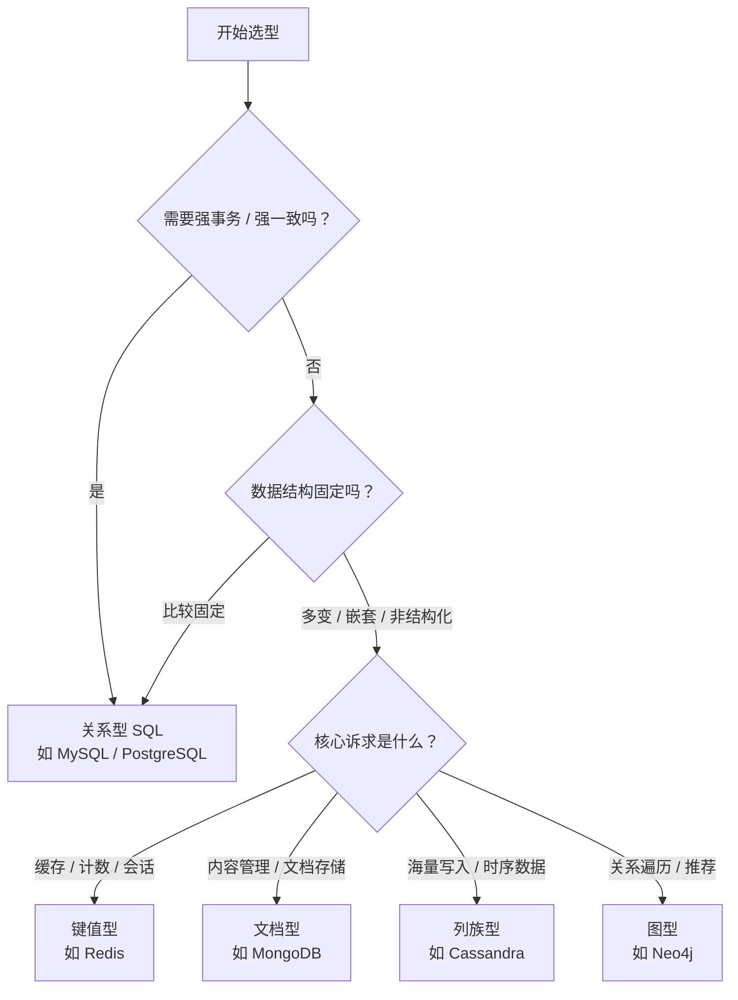

# SQL 与 NoSQL 本质差异完全指南：从数据模型到选型决策的深度剖析

> 本文拆解 SQL（Structured Query Language，结构化查询语言） 与 NoSQL（Not Only SQL，非关系型数据库） 的本质差异：为什么「加个字段」在 MySQL 里要改表结构，在 MongoDB 里却随手就加；为什么银行转账死磕 ACID（原子性/一致性/隔离性/持久性），而点赞数却能「最终一致」地慢半拍；以及 CAP（一致性/可用性/分区容错性） 定理这道「三选二」的选择题，到底该怎么答

---

## 全文摘要

SQL（Structured Query Language，结构化查询语言） 与 NoSQL（Not Only SQL，非关系型数据库） 之争，是每个后端工程师都绕不开的一课 🎓。本文从**数据模型、一致性、扩展方式**三条主线切入，系统梳理两者的本质差异：SQL 以二维表（Table） + 强 schema（模式） 为地基，用 JOIN（连接） 表达关联，靠 ACID（原子性/一致性/隔离性/持久性） 保证「绝对正确」；NoSQL 则分化出文档（Document）、键值（Key-Value）、列族（Column Family）、图（Graph） 四大家族，以灵活 schema 和水平扩展（Horizontal Scaling） 换取体量 🚀。我们进一步拆解 SQL 的 ACID 与 NoSQL 的 BASE（基本可用/软状态/最终一致）、CAP（一致性/可用性/分区容错性） 定理的真实含义——它并非「三选二」，而是网络分区（Network Partition） 发生时「保一致性还是保可用性」的抉择；并用 SQL 与 MongoDB 的 query code 逐条对照（WHERE→\$match、GROUP BY→\$group、JOIN→\$lookup），揭示查询范式的差异 💻。最后落到实战：给出选型决策树（Decision Tree）、场景速查表，以及大厂普遍采用的 Polyglot Persistence（多语言持久化） 混合架构 🌐。核心结论：**SQL 与 NoSQL 不是谁取代谁，而是「精度」与「体量」的两难取舍——选型不看谁更先进，只看你的业务更怕什么** 🎯。

---

## 1. 🏛️ 追根溯源：SQL 与 NoSQL 到底是什么？

先讲一段五十年前的往事 📜。1970 年，IBM 的研究员 **Edgar F. Codd（埃德加·科德）** 发表了一篇论文《A Relational Model of Data for Large Shared Data Banks（大型共享数据库的关系模型）》，提出了一个当时堪称「叛逆」的想法：别再用指针把数据串成链条了，把所有数据放进一张张由行（row）和列（column）组成的二维表（table）里，表与表之间靠**共享的值**——也就是 key（键）——来建立关联 🎯。

这个想法成了后续半个世纪数据库世界的「宪法」。到了 1986 年，ANSI（American National Standards Institute，美国国家标准学会）把查询语言标准化为 SQL（Structured Query Language，结构化查询语言）。顺带一提，它本该念 "sequel"，可标准里偏偏写作 SQL，于是全世界程序员为它到底怎么读吵了四十年，至今没吵出结果 😅。1980 年代起，Oracle、IBM DB2，以及后来的 MySQL、PostgreSQL 把这套理论变成了真正跑在服务器上的软件，关系型数据库（Relational Database，RDBMS） 就此统治数据世界三十年 👑。

那 NoSQL（非关系型数据库） 又是怎么冒出来的？转折点出现在 2000 年代。互联网公司突然发现一个尴尬的事实：**传统关系型数据库就像一台精密的瑞士手表，走时精准，可你没法把二十块手表拆了组装成一台更准的** ⏱️。Google 的 Bigtable、Amazon 的 Dynamo 这类系统另起炉灶——放弃严格的表结构、放弃跨机器强一致，换取「加机器就能扛住更大流量」的水平扩展（Horizontal Scaling） 能力。这股运动被命名为 **NoSQL**，官方解释是 **"Not Only SQL"（不仅仅是 SQL）**，而更直白的潜台词其实是 "Not SQL" 😏。

### 1.1 🧭 一句话看懂两者的「世界观」差异

如果要用一句话概括两派的分歧，我会这么说 💡：

- **SQL 派**：数据的结构必须提前定义清楚，数据库（Database） 负责当「纪律委员」，用 schema（模式） 和约束保证你写进去的每一行都规规矩矩；
- **NoSQL 派**：数据的结构随时可能变，数据库负责当「搬运工」，你怎么存都行，扩展性（Scalability） 和吞吐量（Throughput） 才是第一要务。

我们用一个生活化的比喻来锚定这个差异 🍽️：

| 维度 | SQL（关系型） | NoSQL（非关系型） |
|------|--------------|------------------|
| 数据模型 | 二维表 + 行/列 + 外键（Foreign Key） | 文档（Document）/ 键值（Key-Value）/ 列族（Column Family）/ 图（Graph） |
| schema（模式） | 强 schema，改结构要动表 | 灵活 schema，随时加字段 |
| 关联方式 | JOIN（连接） 跨表查询 | 嵌入（Embedding） 或引用（Referencing），通常避免 JOIN（连接） |
| 扩展方式 | 垂直扩展（Vertical Scaling） 为主 | 水平扩展（Horizontal Scaling） 原生支持 |
| 典型代表 | MySQL、PostgreSQL、Oracle | MongoDB、Redis、Cassandra、Neo4j |

打一个可能不太严谨、但足够好记的比方 🤔：**关系型数据库像一家「标准化中央厨房」，所有菜品必须按统一的菜谱和分量来做，出餐稳定、口味一致，但你临时想加一道新菜就得改整个菜谱；NoSQL 则像一家「自助餐」，食材摆在那儿你随便搭，上新菜毫无压力，可最终能不能搭配出好味道，全看你自己的手艺** 🍜。

**参考资料：**

- [关系型数据库和非关系型数据库有什么区别？该怎么选？-- 博客园](https://www.cnblogs.com/libaike/p/22922447) ⭐值得阅读
- [NoSQL 与 SQL 数据库对比 -- MongoDB](https://www.mongodb.com/zh-cn/resources/basics/databases/nosql-explained/nosql-vs-sql) ⭐值得阅读
- [关系型数据库 vs 非关系型数据库，一文搞懂数据库的类型 -- 腾讯云开发者社区](https://developer.cloud.tencent.com/article/2634401)
- [什么是 NoSQL 数据库？-- Microsoft Azure](https://azure.microsoft.com/zh-cn/resources/cloud-computing-dictionary/what-is-nosql-database)
- [关系数据库与非关系数据库 — 数据库类型之间的区别 -- AWS](https://aws.amazon.com/cn/compare/the-difference-between-relational-and-non-relational-databases/)
- [半个世纪的数据库系统（1960 年代 – 2020 年代）-- 清华大学数据库组](https://dbgroup.cs.tsinghua.edu.cn/jnwang/ai-data-foundation/lectures/1-2%20%E6%95%B0%E6%8D%AE%E5%BA%93%E5%8E%86%E5%8F%B2.pdf) ⭐值得阅读
- [Relational vs NoSQL -- gauravsinghtech](https://gauravsinghtech.com/relational-vs-nosql/)

---

## 2. 🧩 数据模型之争：一张表 vs 四种形态

上一章我们说 SQL 派信奉「万变不离二维表」，那 NoSQL 派到底长什么样？答案会让你有点意外——**NoSQL 不是一个数据库，而是一群性格迥异的数据库抱团取暖的统称** 🐧。你问「NoSQL 怎么存数据」，就像问「不是足球的运动怎么玩」，我只能反问你一句：你说的是乒乓球还是保龄球？😄

### 2.1 📊 NoSQL 的四张面孔

按数据模型（Data Model） 划分，NoSQL 家族主要有四个分支 🍀：

| 类型 | 英文名 | 代表产品 | 数据长什么样 | 一句话适用场景 |
|------|--------|----------|--------------|----------------|
| 键值型 | Key-Value | Redis、Memcached | 一把钥匙配一把锁，key（键）→ value（值） | 缓存（Cache）、会话（Session）、计数器（Counter） |
| 文档型 | Document | MongoDB、CouchDB | JSON 风格的文档，字段能嵌套 | 内容管理、用户画像、快速迭代的业务 |
| 列族型 | Column Family | Cassandra、HBase | 按列族（Column Family） 组织的宽表 | 海量写入、时序（Time-Series） 数据、日志分析 |
| 图型 | Graph | Neo4j、JanusGraph | 节点（Node）+ 边（Edge） 织成的关系网 | 社交网络、风控反欺诈、知识图谱（Knowledge Graph） |

打个比方帮你记住这四兄弟 🏠：

- **键值型**像小区门口的快递柜，凭取件码取包裹，速度全场最快，但你没法问它「所有重量超过 5 公斤的包裹有哪些」📦；
- **文档型**像一个 JSON（JavaScript Object Notation，JS 对象表示法） 版的文件柜，每个抽屉里塞的纸张格式可以各不一样，非常自由 🗂️；
- **列族型**像一个超大的 Excel（电子表格） 表格墙，横着写不完、纵着也写不完，专门用来吞下标配的海量数据 📈；
- **图型**像一张人物关系网，它最擅长回答的问题不是「有多少」，而是「谁和谁之间隔了几层」🕸️。

顺便说个反直觉的冷知识 🧊：图数据库跑「统计所有用户数」这类批量统计反而很慢，因为它的强项是**关系遍历**（traverse），不是**全表扫描**（full scan）——用图数据库做统计，好比开着法拉利去菜市场拉大白菜，车是好车，但有点屈才 🏎️🥬。

### 2.2 📦 文档模型的两个灵魂拷问：嵌入还是引用？

如果说关系型数据库的核心技能是 JOIN（连接），那文档型数据库（以 MongoDB 为代表）的核心决策就只有一个：**相关数据到底「塞进同一个文档」，还是「另开一张集合再关联」** 🤔？

- **嵌入（Embedding）**：把关联数据直接写进主文档内部，形成嵌套结构。这属于反范式化（Denormalization） 思路，官方文档称其为「嵌入式数据模型（Embedded Data Model）」——一次查询（query） 就能把数据全捞回来，读性能（Read Performance） 拉满 ⚡；
- **引用（Referencing）**：把关联数据放进另一个集合（Collection），只存一个 ObjectId（对象标识符） 指过去，查询时用 `$lookup` 操作符做类似 JOIN（连接） 的关联。好处是文档更小、不重复，代价是要多跑几次查询 🐢。

选择逻辑其实不复杂 💡：

| 场景 | 推荐策略 | 理由 |
|------|----------|------|
| 实体之间是「包含」关系（如文章包含评论） | 嵌入（Embedding） | 天然一体，读的时候一次拿完 |
| 一对多但「多」的数量有限（如订单含少量商品） | 嵌入（Embedding） | 文档不会撑爆，读取高效 |
| 一对多且「多」会无限增长（如用户含海量日志） | 引用（Referencing） | 避免单个文档无限膨胀 |
| 多对多（如学生与课程） | 引用（Referencing） | 两边都可能被独立复用 |
| 数据会被多处重复引用、更新频繁 | 引用（Referencing） | 避免「改一处、漏十处」的更新异常 |

这里埋着一个新手最容易踩的坑 ⚠️：**MongoDB 单个文档有 16 MB 的硬上限** 📏。如果你一时冲动把用户三年来发的所有朋友圈都塞进他的用户文档里，某一天这位用户成为话痨本痨，写入就会直接报错——数据库不会提醒你「该优化了」，它只会冷冷地拒绝你 🧊。

### 2.3 🧱 范式化 vs 反范式化：什么时候该「抄近路」？

关系型数据库的传统美德是**范式化（Normalization）**：拆表、去冗余，一份数据只存一个地方，改的时候只改一处，干净利落 🧼。而 NoSQL 的做法往往是**反范式化（Denormalization）**：宁可多存几份，也要让读取一次到位 📖。

这背后其实是一场经典的工程权衡（Trade-off） ⚖️：

- **范式化**追求**写入正确性**——数据永不矛盾，代价是查询要频繁 JOIN（连接），表一多就慢；
- **反范式化**追求**读取速度**——数据冗余换来一次查询，代价是更新时得多处同步，且存在不一致（Inconsistency） 风险。

我常把这比作记账方式 🧾：**范式化像正规会计做复式记账，每一笔都能追溯、绝不出错，但你查一笔账要翻好几本账本；反范式化像你自己在手机备忘录里到处记，随手一翻就找得到，可时间一长，三份备忘录里的数字对不上了，你也不知道哪个才是真相** 🤯。

**参考资料：**

- [键值/文档/列族/图：NoSQL 四种类型的技术本质与适用场景全解析 -- 腾讯云开发者社区](https://cloud.tencent.com/developer/article/2741655) ⭐值得阅读
- [一文读懂非关系型数据库（NoSQL）-- 腾讯云开发者社区](https://cloud.tencent.com/developer/article/1030365)
- [相关技术 -- Nebula Graph 官方手册](https://docs.nebula-graph.com.cn/3.1.3/1.introduction/0-2.relates/)
- [主流 NoSQL 及应用场景详解 -- CSDN](https://blog.csdn.net/qq_22201881/article/details/142483999)
- [深入解析 NoSQL 数据库：从文档存储到图数据库的全场景实践 -- SegmentFault 思否](https://segmentfault.com/a/1190000046128942)
- [Data Model Design -- MongoDB Docs](https://www.mongodb.com/docs/v5.0/core/data-model-design/) ⭐值得阅读
- [数据模型设计 -- MongoDB 数据库手册](https://www.mongodb.com/zh-cn/docs/v6.0/core/data-model-design/)
- [MongoDB Embedding vs Referencing \| Denormalization -- geekyscript](https://geekyscript.com/tutorial/mongodb/mongodb-embedding-vs-referencing-denormalization) ⭐值得阅读

---

## 3. ⚖️ 一致性三角：ACID、BASE 与 CAP 定理

如果前两章聊的是「长什么样」，这一章聊的就是「靠不靠谱」——**当数据库被拆到好几台机器上、网络还时不时抽风的时候，你的数据到底还能不能信** 🤔？这是 SQL 与 NoSQL 分野最深的地方，也是面试时最容易翻车的地方（毕竟「CAP 三选二嘛」这句话，说出来就显得有点外行了 😅）。

### 3.1 🏦 ACID：SQL 的「四大护法」

关系型数据库最引以为傲的招牌，就是 **ACID（Atomicity / Consistency / Isolation / Durability，原子性 / 一致性 / 隔离性 / 持久性）** 这四大护法 🛡️：

- **原子性（Atomicity）**：一个事务（Transaction） 要么全做完，要么全不做——就像转账，扣款和到账必须打包，绝不允许出现「钱扣了但对方没收到」的中间状态 💸；
- **一致性（Consistency）**：事务执行前后，数据库都必须处于合法状态，比如「余额不能为负」这条规则永远不会被打破；
- **隔离性（Isolation）**：多个事务并发执行时互不干扰，就像几个会计同时做账，但彼此看不到对方写到一半的草稿 📝；
- **持久性（Durability）**：事务一旦提交（commit），哪怕机房下一秒停电，数据也已经在硬盘上躺好了 🔌。

一句话概括：**ACID 追求的是「绝对正确」，宁可慢一点、宁可不可用，也不能让数据出错** 🎯。这也是为什么银行系统宁可停机维护，也不肯让账户余额出现「99% 概率正确」这种玄学状态。

### 3.2 🍃 BASE：NoSQL 的「佛系」哲学

NoSQL 阵营走的是另一条路，它信奉 **BASE（Basically Available / Soft state / Eventually consistent，基本可用 / 软状态 / 最终一致性）** 🍃：

- **基本可用（Basically Available）**：系统保证「大体上能用」，允许响应时间（Response Time） 变慢、允许降级，但不轻易整体宕机；
- **软状态（Soft state）**：允许数据存在中间状态，不要求任意时刻都一致；
- **最终一致性（Eventual Consistency）**：这是精髓——**现在不一致没关系，只要给我一点时间，大家最终会达成一致** ⏳。

用生活场景打个比方 🍜：ACID 像「坐在餐厅等菜上齐才动筷」，BASE 像「自助餐厅吃到一半，后厨还在源源不断补菜，你快吃完时发现想吃的都补齐了」——**体验上有点不够完美，但胜在从不让你饿着肚子干等** 😋。

| 维度 | ACID（关系型） | BASE（NoSQL） |
|------|---------------|---------------|
| 核心理念 | 强一致性，绝对正确 | 最终一致性，可用优先 |
| 一致性强度 | 强一致性（Strong Consistency） | 最终一致性（Eventual Consistency） |
| 可用性优先级 | 较低（宁停不错） | 极高（宁错不停机） |
| 典型代表 | MySQL、PostgreSQL、Oracle | Cassandra、DynamoDB、Redis |

### 3.3 🔺 CAP 定理：分布式世界的「不可能三角」

来了，重头戏 🎬。**CAP 定理（CAP Theorem）** 说的是：在一个分布式系统（Distributed System） 里，下面三者你**最多只能同时满足两个** 😲：

- **一致性（Consistency）**：任何时刻，所有节点读到的都是同一份最新数据；
- **可用性（Availability）**：只要节点没挂，请求就一定能得到响应，绝不超时拒绝；
- **分区容错性（Partition Tolerance）**：当网络分区（Network Partition） 把节点隔成几座「孤岛」时，系统依然能继续运行 🏝️。

这个理论最早是加州大学伯克利分校的 **Eric Brewer** 在 2000 年 PODC 会议上提出的一个猜想，2002 年由 MIT 的 **Seth Gilbert** 和 **Nancy Lynch** 给出了严格证明，猜想就此「转正」为定理 📜。

### 3.4 🗺️ CP 还是 AP？「三选二」其实是个美丽的误会

很多教程会告诉你「CAP 三选二，做不到三个都要」。这句话对，但**它容易把人带沟里** 🕳️。因为在一个真正的分布式系统里，网络分区（Network Partition） 是**客观存在、无法避免**的——机器之间的网络说断就断，你根本没得选。所以「P」不是一道可以放弃的选项，而是**默认必须接受的前提**。

换句话说，CAP 的真实选择题不是「三选二」，而是：**当网络分区发生时，你要保一致性（C）还是保可用性（A）** 🤔？

- **CP（Consistency + Partition Tolerance，一致性优先）**：宁可不响应，也不返回可能过期的数据。典型代表：HBase、ZooKeeper，以及开启多数派读写的 MongoDB；
- **AP（Availability + Partition Tolerance，可用性优先）**：宁可返回一个可能过期的数据，也不拒绝请求。典型代表：Cassandra、DynamoDB、CouchDB。

我常把这道选择题比作**停电时的电梯** 🛗：CP 好比「检测到供电不稳就直接停运，安全第一，乘客先等着」；AP 好比「继续运行，但可能中途卡在某一层，等电力恢复再校准」——**两种都不是最优解，只是面向不同业务的最不坏解** 🎭。

⚠️ 有个必须纠正的常见误区：**NoSQL ≠ 一定没有 ACID**。比如 MongoDB 从 4.0 版本起就支持跨文档的多文档事务（Multi-Document Transaction），而一些 NewSQL（新型关系型数据库） 如 TiDB、Google Spanner 更是想「既要分布式扩展，又要 ACID 强一致」——所以「SQL 讲 ACID、NoSQL 讲 BASE」只是一个**大方向上的倾向，不是数据库的身份证** 🪪。

**参考资料：**

- [CAP 和 BASE 理论学习 -- 博客园](https://www.cnblogs.com/arnoyi/p/18822762)
- [深入浅出：分布式、CAP 和 BASE 理论 -- 腾讯云开发者社区](https://cloud.tencent.com/developer/article/2345617) ⭐值得阅读
- [分布式一致性协议 - CAP、BASE、NWR -- 腾讯云开发者社区](https://cloud.tencent.com/developer/article/1752382)
- [分布式理论：CAP 是三选二吗？-- CSDN](https://blog.csdn.net/wireless_com/article/details/79153643) ⭐值得阅读
- [Perspectives on the CAP Theorem -- MIT CSAIL](https://groups.csail.mit.edu/tds/papers/Gilbert/Brewer2.pdf?trk=article-ssr-frontend-pulse_little-text-block) ⭐值得阅读
- [A Critique of the CAP Theorem -- University of Cambridge](https://www.cl.cam.ac.uk/research/dtg/archived/files/publications/public/mk428/cap-critique.pdf)
- [CAP Theorem -- UC Berkeley](https://people.eecs.berkeley.edu/~istoica/classes/cs294/11/notes/06-peter-cap.pdf)

---

## 4. 💻 代码实战：同一条 query，SQL 与 MongoDB 怎么写？

前面聊了三章理论，现在动手写点 code 吧 ⌨️。这一章我拿 MongoDB 当 NoSQL 的代表（毕竟它是最流行的文档型数据库），看看同一条需求，两种数据库的写法差多远 🏁。

### 4.1 🗺️ 术语对照：表、行、列在 MongoDB 里叫什么

先过一遍「翻译表」，跨数据库沟通时这张表能救命 🆘：

| SQL 概念 | MongoDB 概念 | 说明 |
|----------|--------------|------|
| table（表） | collection（集合） | 存放同类文档的容器 |
| row（行） | document（文档） | 一条 JSON/BSON 记录 |
| column（列） | field（字段） | 文档里的一个键值对 |
| primary key（主键） | _id | MongoDB 自动生成，全局唯一 |
| table joins（表连接） | \$lookup / 嵌入文档 | 关联方式 |

顺便说一句，MongoDB 的查询语法可不是拍脑袋设计出来的，它有个正式名字叫 **MQL（MongoDB Query Language，MongoDB 查询语言）** 📖。

### 4.2 🔍 基础查询：SELECT / WHERE / ORDER BY

需求：查出所有「18 岁以上、居住在北京」的用户，按年龄降序排，取前 10 条。

SQL 写法：

```sql
SELECT name, age
FROM users
WHERE age >= 18 AND city = 'Beijing'
ORDER BY age DESC
LIMIT 10;
```

MongoDB 写法：

```javascript
db.users.find(
  { age: { $gte: 18 }, city: "Beijing" },   // 过滤条件：$gte 相当于 >=
  { name: 1, age: 1, _id: 0 }               // 投影（Projection）：只返回 name 和 age
).sort({ age: -1 })                          // 排序：-1 表示降序
 .limit(10);                                 // 限制返回 10 条
```

你会发现 MongoDB 的语法本质上就是**把 SQL 子句拆成链式方法调用** 🔗——WHERE 变成 find() 的第一个参数（过滤文档），SELECT 变成第二个参数（投影），ORDER BY 变成 .sort()，LIMIT 变成 .limit()。

常用操作符（Operator） 对照表 📋：

| SQL 操作符 | MongoDB 操作符 | 例子 |
|------------|----------------|------|
| = | \$eq | `{ age: { $eq: 25 } }` |
| != | \$ne | `{ age: { $ne: 25 } }` |
| > | \$gt | `{ age: { $gt: 25 } }` |
| LIKE | \$regex | `{ name: { $regex: "^张" } }` |
| AND | 逗号隐式 / \$and | `{ age: 18, city: "Beijing" }` |
| OR | \$or | `{ $or: [{ a: 1 }, { b: 2 }] }` |

### 4.3 📊 聚合统计：GROUP BY vs Aggregation Pipeline

需求：统计每个客户的订单总金额，按金额降序排。

SQL：

```sql
SELECT cust_id, SUM(price) AS total
FROM orders
GROUP BY cust_id
ORDER BY total DESC;
```

MongoDB 用的是**聚合管道（Aggregation Pipeline）**：

```javascript
db.orders.aggregate([
  { $group: { _id: "$cust_id", total: { $sum: "$price" } } },  // 按 cust_id 分组求和
  { $sort: { total: -1 } }                                     // 按 total 降序
]);
```

「聚合管道」这个名字起得非常形象 🚰：数据像水流进一条管子，经过一个又一个 stage（阶段），上一个 stage 的输出就是下一个 stage 的输入。SQL 的各个子句，在 MongoDB 里被拆成了独立的「管道阶段」📦：

| SQL 子句 | MongoDB 聚合阶段 |
|----------|------------------|
| WHERE | \$match |
| GROUP BY | \$group |
| HAVING | \$match（放在 \$group 之后） |
| SELECT | \$project |
| ORDER BY | \$sort |
| LIMIT | \$limit |
| JOIN | \$lookup |

### 4.4 🔗 跨表关联：JOIN vs \$lookup

关联查询是两者差异最大的地方 👀。SQL 天生就是为 JOIN 而生的：

```sql
SELECT o.order_id, u.name
FROM orders o
JOIN users u ON o.user_id = u._id;
```

MongoDB 里的等价写法，是用 \$lookup「现搭」一个连接：

```javascript
db.orders.aggregate([
  {
    $lookup: {
      from: "users",          // 从 users 集合里找
      localField: "user_id",  // orders 这边的关联字段
      foreignField: "_id",    // users 那边的关联字段
      as: "user_info"         // 结果塞进 user_info 数组
    }
  }
]);
```

不过这里得泼个冷水 🧊：**lookup 虽然能实现 JOIN，但它比 SQL 的原生 JOIN 贵得多** 💸。在 MongoDB 的建模哲学里，JOIN 属于「兜底方案」——更好的做法是在设计数据模型时，就通过**嵌入（Embedding）** 把关联数据塞进同一个文档，从根上避免关联查询。这也是为什么第 2 章要花那么大篇幅讲嵌入 vs 引用 🤔。

我常把这套差异比作两种办事风格 📋：**SQL 是「分工协作型」，每张表只管自己那摊事，需要的时候现场开会对接（JOIN）；MongoDB 是「打包齐全型」，一个文档尽量把需要的资料都带在身上，不用再去隔壁部门跑腿** 🏃。

**参考资料：**

- [SQL 到聚合映射图表 -- MongoDB 官方文档 v6.0](https://www.mongodb.com/zh-cn/docs/v6.0/reference/sql-aggregation-comparison/) ⭐值得阅读
- [SQL to MongoDB Mapping Chart -- MongoDB Docs](https://www.mongodb.com/docs/v7.1/reference/sql-comparison/) ⭐值得阅读
- [SQL to MongoDB: WHERE, ORDER BY, GROUP BY, and JOIN translated -- MacSQL](https://www.macsqlclient.com/blog/72-sql-to-mongodb-where-order-by-group-by-and-join-translated)
- [MongoDB for SQL -- maratib](https://maratib.github.io/guides/node/mongodb/mongodb-sql/) ⭐值得阅读
- [\$group (aggregation) -- MongoDB 数据库手册](https://www.mongodb.com/zh-cn/docs/manual/reference/operator/aggregation/group/)

---

## 5. 🏆 各自优势：谁在什么场景称王？

前面铺垫了这么多，终于到了「夸人」环节 😄。需要先声明一句：**这一章不是要评出谁更好，而是说清楚各自在哪些战场上有压倒性优势**。数据库选型从来不是「找最好的」，而是「找最对的」🎯。

### 5.1 🛡️ SQL 的三大王牌

**王牌一：强一致性与事务（Transaction）** 💳。这是 SQL 最硬的护城河。凡是「钱不能算错、库存不能超卖、订单不能重复」的场景，答错一次可能就是真金白银的损失。ACID（原子性/一致性/隔离性/持久性） 让数据库成了「永远不会算错账的老会计」，这种确定性在金融、电商、企业管理（ERP）领域无可替代 🏦。

**王牌二：复杂查询与关联分析** 🔍。SQL（Structured Query Language，结构化查询语言） 是一门声明式的查询语言（Declarative Language）——你只描述「我想要什么」，不用操心「怎么找」。多表 JOIN（连接）、子查询（Subquery）、窗口函数（Window Function）、聚合（Aggregation），这些能力让 SQL 在**灵活分析型查询**上几乎无敌 📊。相比之下，NoSQL 的查询能力大多受限于它预设的数据模型，临时想搞个复杂分析常常捉襟见肘 🧩。

**王牌三：成熟稳定与生态** 🌳。关系型数据库发展了几十年，索引（Index） 优化、备份恢复、权限管理、监控告警、人才储备，全都有现成的成熟方案。你可以闭着眼睛招一个会写 SQL 的工程师，但你很难随手招一个精通 Cassandra 调优的专家 👨💻。

### 5.2 🚀 NoSQL 的三大杀招

**杀招一：灵活的 schema（模式）** 🧬。互联网业务的需求变得比翻书还快——今天商品详情加个「限时折扣」字段，明天再加个「直播预告」。关系型数据库改表结构（ALTER TABLE）在数据量大时可能要锁表、要停机，而文档型数据库直接往 JSON 里加个字段就行，应用层改完代码即上线 ⚡。这份灵活性，是 NoSQL 最受欢迎的原因之一。

**杀招二：水平扩展（Horizontal Scaling）与高写入吞吐量（Write Throughput）** 📈。当数据量涨到单机扛不住时，关系型数据库的主流路径是垂直扩展（Vertical Scaling）——换更强的机器，但机器总有上限；而 NoSQL 从一开始就为**分布式（Distributed）** 而生，加机器（分片，Sharding）就能线性提升容量和吞吐，天然适合海量数据高并发写入的场景 🌊。

**杀招三：高可用（High Availability）与专用数据模型** 🛰️。以 Cassandra 为代表的列族数据库，即使部分节点宕机也能持续提供服务，容错（Fault Tolerance） 能力出色；而图（Graph）数据库在处理多跳关系查询、时序（Time-Series） 数据库在处理海量时间戳数据时，更是「术业有专攻」的降维打击 🎯。

### 5.3 🎯 场景速查表：对号入座

把上面的优势落到具体场景，就得到这张「对号入座表」📋：

| 业务场景 | 推荐选型 | 核心理由 |
|----------|----------|----------|
| 银行转账、支付、财务记账 | SQL（关系型） | 强一致 + 事务，一分钱都不能错 |
| 电商订单、库存管理 | SQL（关系型） | 事务保证不超卖、不重复扣款 |
| 缓存（Cache）、会话（Session）、计数器 | NoSQL（键值型，如 Redis） | 极致读写速度，内存级响应 |
| 社交点赞、浏览量、评论数 | NoSQL（键值型） | 海量写入，最终一致即可 |
| 内容管理、商品详情（字段多变） | NoSQL（文档型，如 MongoDB） | 灵活 schema，迭代快 |
| 日志采集、监控指标、物联网（IoT） 数据 | NoSQL（列族型，如 Cassandra） | 超高写入吞吐 + 水平扩展 |
| 社交关系、好友推荐、风控反欺诈 | NoSQL（图型，如 Neo4j） | 多跳关系遍历效率碾压 |
| 全文搜索（Full-Text Search） | 专用搜索引擎（如 Elasticsearch） | 倒排索引（Inverted Index） 专为检索而生 |

这里补充一句容易被忽略的实话 🤫：**很多真实系统根本不是「二选一」，而是「全都要」**。一套成熟的电商后台，往往是「MySQL 管订单和用户 + Redis 做缓存 + Elasticsearch 做搜索 + MongoDB 存商品详情」的组合拳 🥊。至于这种「多数据库协同」的架构到底怎么搭，我们放到第 7 章细聊。

**参考资料：**

- [关系型数据库和非关系型数据库有什么区别？该怎么选？-- 博客园](https://www.cnblogs.com/libaike/p/22922447) ⭐值得阅读
- [SQL 与 NoSQL 数据库：关键差异与实践洞见 -- DataCamp](https://www.datacamp.com/zh/blog/sql-vs-nosql-databases) ⭐值得阅读
- [关系型数据库 vs 非关系型数据库，一文搞懂数据库的类型 -- 腾讯云开发者社区](https://developer.cloud.tencent.com/article/2634401)
- [关系型数据库与非关系型数据库各有什么优缺点 -- 腾讯云开发者社区](https://developer.cloud.tencent.com/ask/2202651/answer/2944438)
- [NoSQL and SQL Introspective -- Oracle](https://www.oracle.com/technetwork/database/database-technologies/nosqldb/overview/nosqlandsqltoo-2041272.pdf)
- [SQL vs NoSQL Database Comparison: A Comprehensive Guide -- Robina Li](https://robinali34.github.io/blog_system_design/2025/11/08/sql-vs-nosql-database-comparison/)
- [Comparation of the Performance of SQL and NoSQL Databases -- Database Systems Journal](https://www.dbjournal.ro/archive/36/36_11.pdf)

---

## 6. 🧭 选型决策：给你的系统配一副合适的「引擎」

讲完了理论、代码和优势，最实际的问题来了：**我一个具体项目，到底该用哪个** 🤔？

### 6.1 🧠 核心心法：先看访问模式，再选数据库

有一条被反复强调、却总被忽略的原则，我想放在最前面 🔑：

> **数据库是访问模式（Access Pattern）的结果，而不是起点。**

很多系统设计里最大的坑，就是**先拍板选了个时髦的数据库，再去硬凑业务**。正确的顺序应该是：先写清楚你的访问模式（是点查、范围扫描、复杂 JOIN 还是关系遍历？）、读写比（Read/Write Ratio） 是多少、能容忍多强的延迟、要不要强一致（Strong Consistency），最后**让这些需求自然推导出该选哪个数据库** 🎯。

选型之前，建议先把这四个问题回答清楚 📝：

1. **访问模式**：主要做点查、范围扫描、复杂 JOIN（连接），还是关系遍历？
2. **读写比**：读多写少、写多读少，还是读写均衡？
3. **一致性要求**：读到「旧一点」的数据可以接受吗？写入失败一半能容忍吗？
4. **规模预测**：未来一年数据量和请求量大概涨到多少？

### 6.2 🌳 一张决策树，暴力破解选型难题

如果你嫌上面太啰嗦，那就直接对着这棵决策树（Decision Tree） 走一遍 🌲：



把判断依据展开成一张对照表，会更清晰 📊：

| 评估因素 | 偏向 SQL | 偏向 NoSQL |
|----------|----------|------------|
| 数据结构 | 结构化、字段稳定 | 半结构化 / 非结构化、字段多变 |
| 关系复杂度 | 关系复杂、JOIN（连接） 频繁 | 关系少、倾向反范式化（Denormalization） |
| 一致性要求 | 强一致（ACID） 不可妥协 | 最终一致（Eventual Consistency） 可接受 |
| 扩展需求 | 垂直扩展（Vertical Scaling） 够用 | 需要水平扩展（Horizontal Scaling） |
| 团队经验 | 团队熟悉 SQL | 团队有对应 NoSQL 实战经验 |

### 6.3 ⚠️ 选型的三个常见误区

**误区一：为了「未来可能的高并发」提前上 NoSQL** 🚨。「以后用户破千万怎么办」——于是项目第一天就选了分布式数据库，结果日活一百人，运维复杂度却先破了千万 💀。这是典型的过早优化（Premature Optimization）：**在没到达瓶颈之前，别为想象中的瓶颈买单**。

**误区二：默认 NoSQL 一定比 SQL 快** 🏎️。这是个危险的刻板印象。**快不快取决于场景** 🔬：简单键值读取，Redis 确实快到飞起；但如果是复杂的多条件关联分析，让 NoSQL 去处理反而又慢又别扭。用错场景，再快的引擎也跑不出好成绩。

**误区三：忽视团队的技术栈（Tech Stack）** 👥。一个从没碰过 MongoDB 的团队，为了「架构先进」硬上文档数据库，光是踩坑交的学费可能就够买几台服务器了 💸。**技术的先进性和团队的驾驭能力，必须一起算账**。

**我的判断** 🎯：如果你实在拿不准，**默认先从关系型数据库（PostgreSQL / MySQL）起步**是更稳的选择——它们如今也大多支持 JSON 字段、能处理半结构化数据，实在扛不住了再针对性引入 NoSQL。**从简单开始，按需演进，永远比一步到位更安全** 🌱。

**参考资料：**

- [Storage Choices: SQL vs NoSQL -- Sujeet Jaiswal](https://sujeet.pro/articles/storage-choices-sql-vs-nosql) ⭐值得阅读
- [Choosing a Database -- Event Looped](https://www.eventlooped.com/backend-system-design/choosing-a-database) ⭐值得阅读
- [SQL vs NoSQL Decision Framework -- Dev Docs](https://sharief007.github.io/dev-docs/design-concepts/storage/sql-vs-nosql/) ⭐值得阅读
- [SQL vs NoSQL: An Honest Decision Guide -- DEV Community](https://dev.to/sri2614/sql-vs-nosql-an-honest-decision-guide-5171)
- [SQL vs NoSQL database -- AWS](https://aws.amazon.com/smart-business/resources-for-smb/sql-vs-nosql/)

---

## 7. 🌐 混合架构：为什么大厂从来不只用一种数据库？

如果你去翻大厂的技术博客，会发现一个有趣的现象：**几乎没有任何一家大型互联网公司只用一种数据库** 🏢。不是因为他们「不差钱」，而是因为真实业务的需求本来就是五花八门的——订单要强一致，点赞要扛并发，搜索要快，推荐要算关系，**用一套数据库硬扛所有需求，就像试图用一把瑞士军刀去干木工活：能干，但哪一样都不称手** 🔧。

### 7.1 🧩 Polyglot Persistence（多语言持久化）

这种「因地制宜、给不同数据配不同数据库」的做法，有个专门的术语叫 **Polyglot Persistence（多语言持久化）** 🌍——字面意思是「用多种语言（数据库技术）来持久化数据」。它的核心思想很简单：**让每种数据待在最擅长伺候它的数据库里** 🏡。

- 订单、支付、账务 → 关系型数据库（MySQL / PostgreSQL），要的就是 ACID 🛡️；
- 缓存、会话、排行榜 → 键值型数据库（Redis），要的就是快 ⚡；
- 商品详情、用户画像 → 文档型数据库（MongoDB），要的就是灵活 🗂️；
- 日志、监控、IoT 数据 → 列族型数据库（Cassandra），要的就是能扛 📈；
- 社交关系、推荐、风控 → 图型数据库（Neo4j），要的就是会「爬关系」🕸️。

一个典型的电商系统可以长成这样 🌰：

```
用户下单  →  MySQL（订单 + 库存，强事务）
商品浏览  →  Redis（热点缓存，扛高并发读）
商品详情  →  MongoDB（字段多变，快速迭代）
搜索商品  →  Elasticsearch（全文检索）
「猜你喜欢」→  图数据库 / 推荐引擎（关系遍历）
```

### 7.2 🏗️ Database per Service（每个微服务独立数据库）

在微服务（Microservice） 架构里，Polyglot Persistence 通常和另一个模式搭配使用——**Database per Service（每个微服务独立数据库）** 🧱。它的规矩是：**每个微服务独占自己的数据库，别的服务不许直接访问，只能通过 API（Application Programming Interface，应用程序接口） 交互**，实现「数据和服务的边界对齐」📐。

这么做有三个好处 👍：

1. **隔离故障**：一个服务的数据存储（Data Store） 出问题，不会直接拖垮其他服务 🚧；
2. **按需选型**：每个微服务都能选最适合自己负载（Workload） 的数据库，订单服务用 MySQL、搜索服务用 Elasticsearch，各取所需 🎯；
3. **团队自治**：数据边界清晰，各团队可以独立演进自己的数据模型，不用排队等 DBA 改表 🙌。

当然，天下没有免费的午餐 🍱——**跨服务的关联查询和分布式事务会变麻烦**。数据被拆到多个数据库后，过去一条 JOIN（连接） 就能搞定的事，现在可能要跨服务调用；过去一个本地事务就能保证的一致性，现在要靠分布式事务或事件驱动（Event-Driven） 的最终一致性方案来兜底。这就是「灵活」背后的**复杂度代价** ⚖️。

### 7.3 🎬 真实世界长什么样

看看大厂的实际选择，会更有体感 🍿：

- **Netflix**：用 **Cassandra** 扛海量写入（播放记录、观看行为），用 **MySQL** 处理事务性需求——一个管「量」，一个管「准」🎬；
- **Amazon**：自研 **DynamoDB** 作为高可用键值存储，撑起购物车等核心场景，同时保留关系型数据库处理需要事务的业务 🛒；
- **Microsoft Azure**：官方推荐用 **Azure SQL Database** 管理需要复杂查询和 ACID 事务的数据，同时用 **Azure Cosmos DB** 处理多云分布式的弹性负载——两者组合成 Polyglot Persistence 的范例 ☁️。

### 7.4 🧾 小结：SQL 与 NoSQL，从来不是敌对关系

兜了一大圈，我们回到最初那个问题：**SQL 和 NoSQL 到底谁更好** 🤔？

答案是：**这个问题本身就问错了** ❌。「SQL vs NoSQL」不是一场必须分出胜负的拳击赛，而更像**工具箱里的两把不同的工具** 🧰——一把是精度极高的手术刀（SQL），一把是能快速劈开大片木材的电锯（NoSQL）。你家里两样都该有，关键在于**这一刀这一锯，用在哪块材料上** 🪵。

**我的判断** 🎯：SQL 与 NoSQL 的差异，本质上可以浓缩成三个层面的取舍——

1. **数据模型**：固定的表结构（Table） vs 灵活的多形态（文档 / 键值 / 列族 / 图）；
2. **一致性**：强一致（ACID） 的「绝对正确」 vs 最终一致（BASE） 的「大体靠谱」；
3. **扩展方式**：垂直扩展（Vertical Scaling） 的「升级机器」 vs 水平扩展（Horizontal Scaling） 的「堆机器」。

选择哪一个，**不取决于哪个更先进，而取决于你的业务更怕什么** 💡：如果你更怕「数据算错」，就去拥抱 SQL；如果你更怕「系统扛不住」，就去拥抱 NoSQL；如果你的业务又怕算错又怕扛不住——恭喜你，欢迎来到 Polyglot Persistence 的世界，这里没有标准答案，只有**适合你的那一套组合** 🎨。

**参考资料：**

- [Polyglot Persistence with Azure Cosmos DB and Azure SQL Database -- Microsoft Learn](https://learn.microsoft.com/en-us/azure/architecture/databases/idea/combine-relational-nosql) ⭐值得阅读
- [Cloud-native data patterns -- Microsoft Learn](https://learn.microsoft.com/ms-my/Dotnet/architecture/cloud-native/distributed-data)
- [Java Microservices - Database per Service Pattern -- TutorialsPoint](https://www.tutorialspoint.com/java_microservices/java-microservices-database-per-service.htm) ⭐值得阅读
- [Polyglot Persistence: Database Per Service Pattern -- DataExpert](https://www.dataexpert.io/blog/polyglot-persistence-database-per-service-pattern)
- [An Approach to Migrate a Monolith Database into Multi-Model Polyglot Persistence -- MDPI](https://mdpi-res.com/d_attachment/applsci/applsci-12-06189/article_deploy/applsci-12-06189-v2.pdf?version=1655812136)

---

**最后更新时间**：2026-10-14
