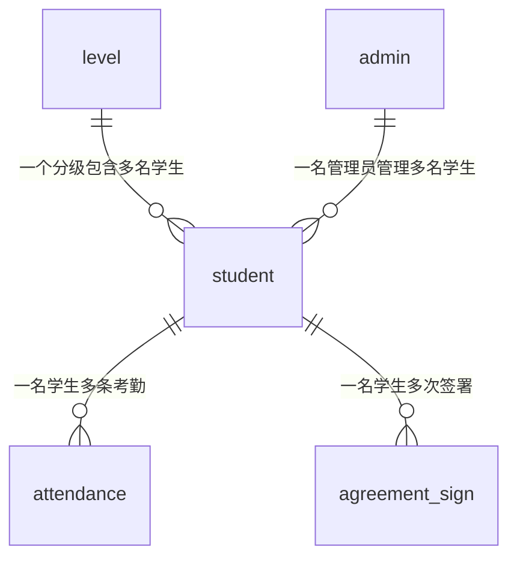

# 学生管理系统数据库设计：6 张表撑起一个能答辩的毕设

## 1. 为什么数据库设计是毕设最容易被追问的环节

答辩现场有个规律：功能演示可以靠提前点好的页面撑过去，数据库设计撑不过去。老师只要打开建表脚本，翻到 DDL（Data Definition Language，数据定义语言），三个问题就够用了：学号重复了怎么办、删掉学生以后考勤记录去哪了、这个状态字段里的 0 和 1 分别代表什么。

演示证明的是"能跑"，数据库设计证明的是"跑得对不对"。前者可以排练，后者只能靠建表语句自证。很多同学的库里一条约束都没有，全靠 Service（业务服务层）里几个 `if (exists)` 兜着。判断只在代码路径上生效：换个入口、多一个并发线程、手工改一条数据，就绕过去了。

这篇只讲一件事：哪些规则必须写进 DDL，让数据库自己执行。

## 2. 六张表的职责边界

表怎么分，标准只有一句：一张表只回答一个问题。学生表答"这个人是谁"，考勤表答"他哪天来过"，签署表答"他签没签"。答不了这个问题的字段，不该放进来。

| 表名 | 职责 | 关键字段 | 不该装的东西 |
| --- | --- | --- | --- |
| `student` | 学生主数据 | 学号、姓名、手机号、分级 ID、归属管理员 ID | 考勤统计、签署内容 |
| `admin` | 管理员账号与角色 | 登录名、密码哈希、角色 | 学生名单 |
| `attendance` | 单次签到事实 | 学生 ID、签到日期、签到时间、状态 | 学生姓名、班级名称 |
| `level` | 分级字典（年级或培养层次） | 层级编码、层级名称 | 具体学生 |
| `agreement_sign` | 行为守则签署行为 | 学生 ID、守则版本、签署状态、签名图路径 | 守则全文 |
| `attachment` | 附件元数据 | 业务类型、业务 ID、存储路径、大小 | 文件二进制内容 |

最容易出问题的是 `attendance`。不少同学把姓名、班级名冗余进考勤表，理由是"查询快、不用 JOIN（连接）"。学生改一次名字，历史考勤里就多出"查无此人"的旧名字。姓名属于 `student`，考勤表只留 `student_id`。

`attachment` 不该和业务表混在一起。签名图片、导入名单、导出报表共用一张表，用业务类型加业务 ID 挂靠，加新业务不用改表结构。

## 3. 表关系与主外键设计

六张表的关系画成一张图，答辩时投影出来，比讲十分钟都管用。



图中不含 `attachment`，它靠业务 ID 逻辑挂靠，没有实线可画。

Foreign Key（外键）永远建在"多"的那一侧：`student` 里放 `level_id` 和 `admin_id`，`attendance` 里放 `student_id`。反过来在 `level` 里存一列学生 ID，这一列迟早会变成逗号分隔的字符串，然后所有查询都得靠 `LIKE`。

索引要跟着查询走。考勤表有两类高频查询：查某个学生某月的记录、查某天全班的签到情况。前者需要 `(student_id, attend_date)`，后者需要 `(attend_date, student_id)` 的 Composite Index（复合索引）。顺序不能反，复合索引只能从最左列开始匹配。一条索引同时伺候两种查询，通常两种都不快。

`attachment` 是唯一的例外：它用业务类型加业务 ID 挂靠，无法指向一张确定的表，所以不建外键，改为写入时校验，并对 `(biz_type, biz_id)` 建普通索引。

## 4. 唯一约束必须落库

先看一个真实的翻车过程。管理员在页面上双击了两次"保存"，两个请求几乎同时进入 Service：都执行 `select count(*)` 并得到 0，都判断"不存在"，都执行 `insert`。

结果库里出现两条学号相同的学生。这不是谁写错了代码，而是 check-then-act（先检查后执行）的 Race Condition（竞态条件）：检查和写入之间有时间窗口，两个请求都钻了过去。

正确的做法是把规则写进 DDL（数据定义语言），让数据库判重：

```sql
ALTER TABLE student
    ADD CONSTRAINT uk_student_no UNIQUE (student_no),
    ADD CONSTRAINT uk_student_phone UNIQUE (phone);
```

有了 UNIQUE（唯一约束），第二个 `insert` 会被数据库拒绝，抛出 1062 错误。Service 层捕获异常，转成"学号已存在"的提示，逻辑反而更短。`if (exists)` 可以留着做友好提示，但它是优化，不是保障。

MySQL 的唯一索引放行多个 `NULL`，因为 `NULL` 不等于 `NULL`，所以"手机号可空但不可重复"一条索引就够。

## 5. 外键级联策略

"管理员删除学生，考勤记录怎么办"这道题，答"删了就删了"会被追问，答"不知道"就结束了。级联策略必须显式声明，因为默认值是 `RESTRICT`（限制），父表有子记录时直接不许删。

| 子表 | 建议策略 | 理由 |
| --- | --- | --- |
| `attendance` | `ON DELETE CASCADE` | 考勤依附于学生存在，学生没了，记录失去主体 |
| `agreement_sign` | `ON DELETE RESTRICT` | 签署是凭证，不能因为删学生就消失 |
| `student`（`level_id`） | `ON DELETE RESTRICT` | 分级字典被引用时不允许删，避免学生悬空 |

写法上就是在外键后面补一句：

```sql
CONSTRAINT fk_attendance_student FOREIGN KEY (student_id)
    REFERENCES student (id) ON DELETE CASCADE ON UPDATE RESTRICT
```

判断只有一条：这条记录是"事实"还是"凭证"。考勤是事实，主体没了，事实就没意义；签署是凭证，价值恰恰在于它曾经发生过，所以只能限制删除。

更稳妥的做法是给 `student` 加 `deleted_at` 做 Soft Delete（逻辑删除），物理删除交给清理脚本。这样"删除学生"只是标记不可见，考勤和签署原样保留。

## 6. 状态字段的三种写法与取舍

`attendance.status` 有三种常见写法，选哪种直接影响答辩时能不能解释清楚。

| 写法 | 示例 | 优点 | 代价 |
| --- | --- | --- | --- |
| 裸数字 | `status tinyint`，0 正常、1 迟到、2 缺勤 | 省空间，随手就写 | 语义只存在于某人脑子里，换人接手就失传 |
| 数字 + 常量类 | `tinyint` + `AttendanceStatus` 枚举 | 存储紧凑，Java 侧有语义，改动集中 | 数据库里看到的仍是数字，需要对照代码 |
| 语义字符串 | `varchar(16)`，存 `NORMAL`、`LATE` | 直接可读，导出报表不用翻译 | 占空间，拼写错误能写进去 |

裸数字最大的问题不是性能，是可维护性。半年后你看 `status = 2`，也得翻代码才知道是缺勤还是请假。语义字符串最舒服，但 `NORMAL`、`Normol`、`normol` 都能进库，因为没有约束拦着。

我更推荐第二种，再补一层 CHECK（检查约束）把范围钉死：

```sql
status TINYINT NOT NULL DEFAULT 0
    CHECK (status IN (0, 1, 2, 3))
```

这样存储紧凑，语义由常量类承载，非法值由数据库兜底。如果状态会频繁增加，比如以后要加"早退""外勤"，`VARCHAR` 反而更省事，因为改 `CHECK` 和改枚举都不便宜。判断标准很简单：状态集合稳定就用数字，会持续膨胀就用字符串。

## 7. 可运行的建表脚本结构说明

`schema.sql` 的顺序有讲究：先字典表（`level`、`admin`），再主表（`student`），最后事实表（`attendance`、`agreement_sign`、`attachment`）。外键要求被引用的表先存在，反了会直接报错。

```sql
CREATE DATABASE IF NOT EXISTS student_mgmt
    DEFAULT CHARACTER SET utf8mb4 COLLATE utf8mb4_0900_ai_ci;
USE student_mgmt;

CREATE TABLE admin (
    id BIGINT UNSIGNED PRIMARY KEY AUTO_INCREMENT,
    username VARCHAR(32) NOT NULL,
    password_hash VARCHAR(100) NOT NULL,
    role TINYINT NOT NULL DEFAULT 1,
    created_at DATETIME NOT NULL DEFAULT CURRENT_TIMESTAMP,
    CONSTRAINT uk_admin_username UNIQUE (username)
) ENGINE = InnoDB;

CREATE TABLE level (
    id BIGINT UNSIGNED PRIMARY KEY AUTO_INCREMENT,
    level_code VARCHAR(16) NOT NULL,
    level_name VARCHAR(32) NOT NULL,
    CONSTRAINT uk_level_code UNIQUE (level_code)
) ENGINE = InnoDB;

CREATE TABLE student (
    id BIGINT UNSIGNED PRIMARY KEY AUTO_INCREMENT,
    student_no VARCHAR(20) NOT NULL,
    name VARCHAR(32) NOT NULL,
    phone VARCHAR(20) NULL,
    level_id BIGINT UNSIGNED NOT NULL,
    admin_id BIGINT UNSIGNED NOT NULL,
    deleted_at DATETIME NULL,
    created_at DATETIME NOT NULL DEFAULT CURRENT_TIMESTAMP,
    CONSTRAINT uk_student_no UNIQUE (student_no),
    CONSTRAINT uk_student_phone UNIQUE (phone),
    CONSTRAINT fk_student_level FOREIGN KEY (level_id)
        REFERENCES level (id) ON DELETE RESTRICT,
    CONSTRAINT fk_student_admin FOREIGN KEY (admin_id)
        REFERENCES admin (id) ON DELETE RESTRICT
) ENGINE = InnoDB;

CREATE TABLE attendance (
    id BIGINT UNSIGNED PRIMARY KEY AUTO_INCREMENT,
    student_id BIGINT UNSIGNED NOT NULL,
    attend_date DATE NOT NULL,
    checkin_time DATETIME NULL,
    status TINYINT NOT NULL DEFAULT 0 CHECK (status IN (0, 1, 2, 3)),
    CONSTRAINT uk_attendance_student_date UNIQUE (student_id, attend_date),
    CONSTRAINT fk_attendance_student FOREIGN KEY (student_id)
        REFERENCES student (id) ON DELETE CASCADE,
    KEY idx_attend_date_student (attend_date, student_id)
) ENGINE = InnoDB;

CREATE TABLE agreement_sign (
    id BIGINT UNSIGNED PRIMARY KEY AUTO_INCREMENT,
    student_id BIGINT UNSIGNED NOT NULL,
    agreement_version VARCHAR(16) NOT NULL,
    sign_status TINYINT NOT NULL DEFAULT 0 CHECK (sign_status IN (0, 1)),
    sign_image_path VARCHAR(255) NULL,
    signed_at DATETIME NULL,
    CONSTRAINT uk_sign_student_version UNIQUE (student_id, agreement_version),
    CONSTRAINT fk_sign_student FOREIGN KEY (student_id)
        REFERENCES student (id) ON DELETE RESTRICT
) ENGINE = InnoDB;

CREATE TABLE attachment (
    id BIGINT UNSIGNED PRIMARY KEY AUTO_INCREMENT,
    biz_type VARCHAR(32) NOT NULL,
    biz_id BIGINT UNSIGNED NOT NULL,
    file_path VARCHAR(255) NOT NULL,
    file_size BIGINT UNSIGNED NOT NULL DEFAULT 0,
    created_at DATETIME NOT NULL DEFAULT CURRENT_TIMESTAMP,
    KEY idx_biz (biz_type, biz_id)
) ENGINE = InnoDB;
```

几个细节值得主动讲：主键统一 `BIGINT UNSIGNED` 自增，避免以后改主键类型；时间用 `DATETIME` 而不是 `TIMESTAMP`，后者跟时区转换，签到时间被悄悄改掉很难排查；字符集用 `utf8mb4`，否则生僻字和表情符号写入失败。

导入脚本用两行命令就够：

```bash
mysql -u root -p -e "CREATE DATABASE IF NOT EXISTS student_mgmt DEFAULT CHARACTER SET utf8mb4;"
mysql -u root -p student_mgmt < schema.sql
```

## 8. 答辩时老师最常追问的 5 个数据库问题

**第一，你的表符合 3NF（Third Normal Form，第三范式）吗？** 姓名只在 `student` 出现，考勤只存 `student_id`，没有传递依赖。若追问"为什么不做 Denormalization（反范式化）"，答数据量小、以写一致性优先。

**第二，索引越多越好吗？** 不是。索引拖慢写入，每次 `insert` 都要维护索引页；复合索引不满足 Leftmost Prefix（最左前缀）就用不上，`like '%张'` 也会失效。

**第三，Transaction（事务）用在哪？** 用在多表写入必须同时成功的场景，比如"新增学生 + 写签署记录 + 存签名附件"，任何一步失败都 Rollback（回滚）。隔离级别用默认的 `REPEATABLE READ`（可重复读）即可。

**第四，为什么主键用自增 `BIGINT` 而不是学号？** 学号是业务字段，可能录错，也可能转专业后重编。主键一旦被外键引用，改动成本极高。用无意义 ID 做技术主键，用唯一索引约束学号。

**第五，互联网公司说不要用外键，你为什么用了？** 这是立场题。外键在分库分表和高并发写入时有开销，大厂通常下沉到应用层。毕设是单库、数据量小、以正确性优先，外键能免费守住完整性。把前提讲清楚，比说"老师教过"好。

## 9. 完整项目与建表脚本获取

前面这些设计落到文件里，就是一份可直接执行的 `schema.sql`。不想从零对字段，可以看这份完整实现。

资源标题：Spring Boot 3 + Vue 3 学生管理系统源码（前后端分离 / JWT 鉴权 / 考勤签到 / MySQL）毕业设计课程设计可用

资源直链：[https://download.csdn.net/download/2301_79239314/93726588](https://download.csdn.net/download/2301_79239314/93726588)

技术栈：后端 Java 21、Spring Boot 3.5、Spring Security + JWT、Spring Data JPA、MySQL 8、Redis、Knife4j、Spring AOP；前端 Vue 3 / Vite / Pinia / Vue Router / Element Plus / Vant / ECharts。

资源属性：0 积分下载、821 个文件、含 `schema.sql`、配置已脱敏。

答辩前先本地导入一遍 `schema.sql`，确认六张表和外键都建成功，再截图放进 PPT。需要的同学可以到这里取：https://download.csdn.net/download/2301_79239314/93726588

## 10. 小结

失分点很少是 SQL 写得不够花哨，而是规则只写在 Service 层，没落进 DDL。学号唯一、手机号唯一、外键归属、级联策略、状态范围，这五件事写进建表语句，老师翻脚本就能看到你的判断。

六张表不算多，但边界要清楚：主数据、账号、事实、字典、凭证、附件，各管一件事。

答辩时被问住不可怕，答不上来"为什么这么设计"才可怕。把每条约束背后的理由讲出来，比多写十个接口更能说明你懂数据库。

**标签**：数据库设计 / 学生管理系统 / 毕业设计 / MySQL / Spring Boot

---

**参考资料：**

- [MySQL 8.4 Reference Manual: FOREIGN KEY Constraints -- MySQL](https://dev.mysql.com/doc/refman/8.4/en/create-table-foreign-keys.html)
- [MySQL 8.4 Reference Manual: CREATE TABLE and CHECK Constraints -- MySQL](https://dev.mysql.com/doc/refman/8.4/en/create-table-check-constraints.html)
- [MySQL 8.4 Reference Manual: Optimization and Indexes -- MySQL](https://dev.mysql.com/doc/refman/8.4/en/optimization-indexes.html)
- [MySQL 8.4 Reference Manual: Optimizing InnoDB Queries -- MySQL](https://dev.mysql.com/doc/refman/8.4/en/optimizing-innodb-queries.html)
- [大厂 MySQL 建表军规：那些评审会上被打回来的坑 -- Walter Fan's Blog](https://www.fanyamin.com/blog/2026-07-18-mysql-design-rules.html)
- [MySQL 表结构设计要注意什么 -- 阿里云开发者社区](https://developer.aliyun.com/article/1064018)
- [Spring Data JPA Reference Documentation -- Spring](https://docs.spring.io/spring-data/jpa/reference/)

**最后更新时间**：2026-10-21
