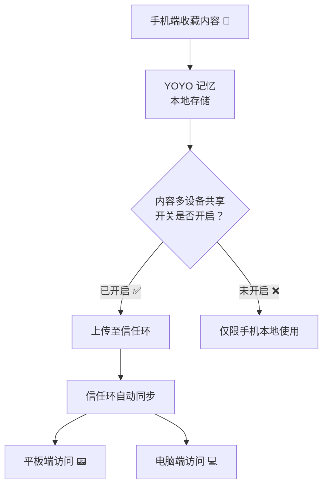
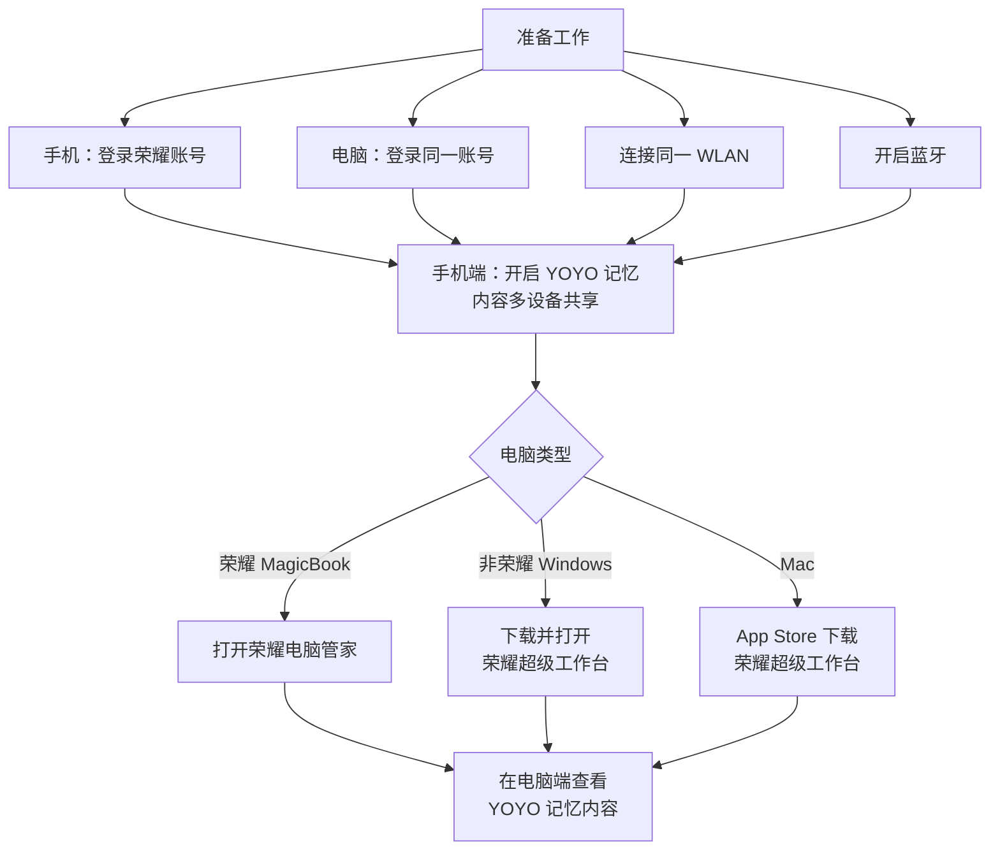

# 荣耀 YOYO 记忆是否可以在电脑上使用 🖥️

本文档全面分析荣耀 YOYO 记忆（YOYO 记忆）功能在电脑端的使用可能性。从 YOYO 记忆的基本概念出发，深入解析荣耀信任环跨设备同步机制，明确电脑端使用的条件、方法和限制，帮助读者判断自己的场景是否支持在电脑上使用 YOYO 记忆 🔄

<!-- English Abstract -->

This document comprehensively analyzes whether Honor's YOYO Memory feature can be used on a computer. Starting from the basic concept of YOYO Memory, it delves into Honor's Trusted Ring cross-device sync mechanism, clarifying the conditions, methods, and limitations for using it on a computer 🔄

---

## 术语表 / Terminology

| 术语 / Term            | 说明 / Description                                          |
| ---------------------- | ----------------------------------------------------------- |
| **YOYO 记忆**          | 荣耀 MagicOS 上的 AI 智能记忆功能，用于收藏、整理和管理信息 |
| **信任环 (MagicRing)** | 荣耀自研的跨设备互联技术，同账号设备自动组网                |
| **荣耀超级工作台**     | 荣耀在电脑端提供的互联办公软件（支持 Windows/macOS）        |
| **全局收藏**           | 通过三指下滑快速收藏内容的功能（MagicOS 8.0 及以上）        |
| **收藏空间**           | 全局收藏内容的集中管理入口，可同步至信任环设备              |
| **智慧互联**           | 荣耀多设备协同功能的总称，基于信任环技术                    |
| **MagicOS**            | 荣耀手机/平板的操作系统                                     |

---

## 章节阅读路线图 🗺️ / Chapter Reading Roadmap

1. **YOYO 记忆简介** 🤖 / YOYO Memory Introduction → 了解 YOYO 记忆是什么、能做什么
2. **信任环与跨设备同步机制** 🔗 / Trusted Ring & Cross-device Sync → YOYO 记忆如何在不同设备间流转
3. **电脑端使用的前提条件** ✅ / Prerequisites for PC Usage → 需要满足哪些条件才能在电脑上使用
4. **电脑端使用的具体方法** 🖱️ / How to Use on PC → 一步步教你如何在电脑上访问 YOYO 记忆
5. **不同电脑类型的支持情况** 💻 / Support by Computer Type → 荣耀笔记本 vs 非荣耀电脑 vs Mac
6. **常见问题与使用限制** ❓ / FAQ & Limitations → 使用时可能遇到的问题
7. **总结** 📝 / Summary → 核心要点一览

---

## 1. YOYO 记忆简介 🤖 / YOYO Memory Introduction

> 🤖 **Note:** 本章介绍 YOYO 记忆是什么、核心功能以及使用场景 / This chapter introduces what YOYO Memory is, its core features, and usage scenarios.

### 1.1 什么是 YOYO 记忆？ / What is YOYO Memory?

YOYO 记忆是荣耀 MagicOS 8.0 及以上版本引入的一项 **AI 智能记忆功能**，被官方称为「你的 AI 烂笔头」。它能够将用户在手机各应用中的收藏、网页、文档、图片等内容自动收录并进行智能整理，生成 AI 摘要，形成一个属于你的个人知识库。🧠

简单来说，YOYO 记忆 = **个人 AI 知识库 + 智能收藏夹**。它帮你做三件事：

- **记**：把各种分散的信息收集在一起
- **理**：自动分类整理、生成 AI 摘要
- **找**：需要时一键搜索，精准找回

### 1.2 核心功能 / Core Features

| 功能                  | 说明                                               |
| --------------------- | -------------------------------------------------- |
| **三指下滑收藏** 📥   | 在任何界面三指下滑，快速收藏当前内容到 YOYO 记忆   |
| **YOYO 对话记忆** 🎙️  | 唤醒 YOYO 智能体直接说「帮我记住 xxx」，自动保存   |
| **AI 摘要生成** 📄    | 对收藏内容自动生成 AI 摘要，精华一目了然           |
| **智能分类整理** 📂   | 自动对收藏内容进行归类和排序                       |
| **跨设备同步** 🔄     | 内容在信任环中的设备间自动流转（手机、平板、电脑） |
| **侧边栏快捷入口** 🚀 | 从屏幕边缘滑动打开侧边栏，快速拖拽内容到 YOYO 记忆 |

### 1.3 与荣耀笔记、收藏空间的关系 / Relationship with Notes & Collection Space

YOYO 记忆和以下两个功能密切相关，但有所不同：

| 功能             | 定位              | 核心能力                           |
| ---------------- | ----------------- | ---------------------------------- |
| **YOYO 记忆** 🧠 | AI 个人知识库     | 智能收藏 + AI 整理 + 跨设备使用    |
| **荣耀笔记** 📝  | 手写/文字笔记工具 | 支持手写、涂鸦、文档编辑、录音笔记 |
| **收藏空间** 🗃️  | 通用收藏工具      | 集中管理全局收藏的各种素材         |

**三者的关系**：

- **收藏空间**是 MagicOS 8.0 之前就有的功能，后来升级为 **YOYO 记忆**
- **YOYO 记忆** = 收藏空间的 AI 增强版
- **荣耀笔记**和 **YOYO 记忆**是互补关系：笔记侧重编辑创作，YOYO 记忆侧重收藏管理

> 💡 YOYO 记忆和荣耀笔记的内容在满足条件时都可以同步到电脑，但同步路径不同——YOYO 记忆通过信任环同步，荣耀笔记通过荣耀云同步。

**参考资料：**

- [YOYO 记忆，你的AI「烂笔头」 -- HONOR 官方](https://www.honor.com/cn/support/content/zh-cn15897421/) ⭐值得阅读
- [YOYO记忆和荣耀笔记有什么区别？ -- HONOR 官方](https://www.honor.com/cn/support/content/zh-cn15886604/)
- [荣耀YOYO记忆有啥用？ -- 什么值得买](https://post.smzdm.com/p/agol9lpw)
- [YOYO（荣耀的语音助手） -- 百科](https://baike.baidu.com/item/YOYO/61621872)
- [真听劝：荣耀MagicOS 8 月升级AI 通话助理、YOYO 记忆 -- IT之家](https://www.ithome.com/0/873/199.htm)

---

## 2. 信任环与跨设备同步机制 🔗 / Trusted Ring & Cross-device Sync

> 🔗 **Note:** 本章介绍 YOYO 记忆跨设备同步的核心技术——荣耀信任环（MagicRing）/ This chapter introduces the core technology behind YOYO Memory's cross-device sync—Honor's Trusted Ring (MagicRing).

### 2.1 什么是信任环？ / What is MagicRing?

荣耀信任环（MagicRing）是荣耀自研的 **多设备互联技术**。登录同一荣耀账号的手机、平板、电脑等设备，可以自动发现彼此并组网连接，形成一个信任环，让服务随用户在不同设备间流转。🔄

信任环的核心特点：

| 特点            | 说明                                       |
| --------------- | ------------------------------------------ |
| **自动组网** 🕸️ | 同账号设备靠近时自动发现并连接             |
| **安全加密** 🔒 | 设备间通信经过加密，保障数据安全           |
| **服务流转** 🔄 | 屏幕共享、通知共享、键鼠共享等服务随人流转 |
| **数据同步** 📡 | 笔记、收藏、YOYO 记忆等内容跨设备同步      |

### 2.2 YOYO 记忆的跨设备同步流程 / How YOYO Memory Syncs Across Devices



**同步流程说明**：

1. 用户在手机端通过三指下滑、YOYO 对话等方式收藏内容到 YOYO 记忆
2. 如果开启了「内容多设备共享」开关，YOYO 记忆会通过信任环将内容同步
3. 信任环中的平板、电脑等设备可以查看和使用这些内容
4. 内容自动流转，无需手动传输

### 2.3 官方对跨设备支持的说明 / Official Statement on Cross-device Support

荣耀官方明确表示：

> 「保存在 YOYO 记忆中的内容可以在信任环中**手机、平板、电脑间自动流转**，跨设备查看、调用、导出。」——荣耀官方支持文档

> 「内容在同账号信任环中的设备间同步，**跨设备一键取用**。自动生成 AI 摘要，内容精华一目了然。**跨设备回顾、创作**，体验更流畅。」——荣耀 Magic V5 产品页面

所以答案是明确的：**YOYO 记忆支持在电脑上使用，但需要满足一定条件**。🎯

**参考资料：**

- [YOYO 记忆，跨设备随心用 -- HONOR 官方](https://www.honor.com/cn/phones/honor-magic-v5/tips/003/) ⭐值得阅读
- [荣耀互联-荣耀超级工作台-荣耀信任环 -- HONOR 官方](https://www.honor.com/cn/tech/connect/) ⭐值得阅读
- [荣耀信任环智能体验 -- HONOR 官方](https://www.honor.com/cn/support/content/zh-cn15868194/)
- [智慧互联，工作和生活更轻松 -- HONOR 官方](https://www.honor.com/cn/support/content/zh-cn15846743/)
- [信任环无法互相发现电脑与荣耀手机/平板问题排查建议 -- 荣耀俱乐部](https://club.honor.com/cn/thread-29973950-1-1.html)

---

## 3. 电脑端使用的前提条件 ✅ / Prerequisites for PC Usage

> ✅ **Note:** 本章详细列出在电脑上使用 YOYO 记忆需要满足的所有条件 / This chapter lists all the prerequisites needed to use YOYO Memory on a computer.

### 3.1 硬件与系统要求 / Hardware & System Requirements

| 条件          | 具体要求                                |
| ------------- | --------------------------------------- |
| **手机端** 📱 | 荣耀手机，MagicOS 8.0 及以上版本        |
| **电脑端** 💻 | Windows 10.0 及以上 / macOS 12.0 及以上 |
| **网络** 🌐   | 手机和电脑连接同一 WLAN 网络            |
| **蓝牙** 📶   | 手机和电脑需要开启蓝牙                  |

### 3.2 账号与软件要求 / Account & Software Requirements

**1️⃣ 荣耀账号**

所有设备必须登录**同一荣耀账号**。这是信任环工作的核心前提。

**2️⃣ 手机端设置**

```text
步骤：设置 > 荣耀 AI & YOYO > YOYO 记忆
需要开启的开关：
  ✅ 显示侧边条
  ✅ 拖拽时启动 YOYO 记忆
  ✅ 内容多设备共享 ← 这是跨设备同步的关键！
```

**3️⃣ 电脑端软件**

根据不同电脑类型，需要安装对应的软件：

| 电脑类型                   | 所需软件              | 下载方式       |
| -------------------------- | --------------------- | -------------- |
| **荣耀 MagicBook** 💻      | 荣耀电脑管家（18.0+） | 系统预装       |
| **非荣耀 Windows 电脑** 🪟 | 荣耀超级工作台        | 荣耀官网下载   |
| **Mac 电脑** 🍎            | 荣耀超级工作台        | App Store 下载 |

### 3.3 信任环连接确认 / Verify Trusted Ring Connection

在满足上述条件后，还需要确认信任环已正常工作：

```text
手机端确认：
1. 从屏幕顶部右侧下滑出控制中心
2. 查看是否有「信任环」卡片
3. 如果无卡片，点击 ✏️ 编辑，选择显示信任环
4. 确保信任环卡片显示已连接状态

电脑端确认：
1. 打开荣耀超级工作台（或荣耀电脑管家）
2. 确认已登录荣耀账号
3. 查看设备列表中是否显示手机设备
```

**参考资料：**

- [荣耀超级工作台 -- HONOR 官方](https://www.honor.com/cn/tech/honor-workstation/) ⭐值得阅读
- [YOYO 记忆，跨设备随心用 -- HONOR 官方](https://www.honor.com/cn/phones/honor-magic-v5/tips/003/)
- [信任环 -- HONOR 官方](https://www.honor.com/cn/support/content/zh-cn15871620/)
- [荣耀电脑YOYO 助理简介 -- HONOR 官方](https://www.honor.com/cn/support/content/zh-cn15858167/)

---

## 4. 电脑端使用的具体方法 🖱️ / How to Use YOYO Memory on a Computer

> 🖱️ **Note:** 本章手把手教你如何在电脑上查看和使用手机端的 YOYO 记忆内容 / This chapter provides step-by-step instructions for viewing and using YOYO Memory content from your phone on a computer.

### 4.1 总体路径概览 / Overall Path Overview

YOYO 记忆在电脑端的使用主要有以下几种方式：

| 方式                          | 说明                                             | 适用场景         |
| ----------------------------- | ------------------------------------------------ | ---------------- |
| **通过荣耀超级工作台访问** 🪟 | 在电脑端查看手机同步的 YOYO 记忆内容             | 日常查看、整理   |
| **通过收藏空间访问** 🗃️       | 在电脑端查看收藏空间的同步内容                   | 查看收藏素材     |
| **通过荣耀笔记访问** 📝       | 如果内容同步到了荣耀笔记，可在电脑端编辑         | 编辑和创作       |
| **通过屏幕共享使用** 📺       | 将手机屏幕共享到电脑，直接操作手机上的 YOYO 记忆 | 需要完整手机体验 |

### 4.2 方式一：荣耀超级工作台（Windows/macOS）🪟 / Method 1: Honor Workspace

**下载与安装**：

```text
Windows 电脑：
1. 访问荣耀官网 https://www.honor.com/cn/tech/connect/
2. 找到「荣耀超级工作台」Windows 版本
3. 下载并安装
4. 登录荣耀账号

Mac 电脑：
1. 打开 App Store
2. 搜索「荣耀超级工作台」
3. 下载并安装
4. 登录荣耀账号
```

**使用步骤**：

```text
第 1 步：确保手机和电脑连接同一 WLAN，登录同一荣耀账号
第 2 步：在手机端打开「内容多设备共享」开关
第 3 步：在电脑端打开荣耀超级工作台
第 4 步：在功能菜单中选择「YOYO 记忆」或「收藏空间」
第 5 步：查看手机同步过来的记忆内容
```

在荣耀超级工作台中，你可以：

- ✅ **查看**所有 YOYO 记忆内容
- ✅ **搜索**特定记忆
- ✅ **导出**内容到电脑本地
- ✅ **拖拽**内容到创作应用中
- ✅ **整理**和**分类**记忆内容

### 4.3 方式二：通过荣耀笔记 / Method 2: Through Honor Notes

如果你的 YOYO 记忆内容同时同步到了荣耀笔记（部分内容类型支持），则可以在电脑端的荣耀笔记中查看和编辑：

```text
1. 在手机端确认内容已同步到荣耀笔记
2. 在电脑端打开荣耀超级工作台
3. 进入「荣耀笔记」模块
4. 查看同步的笔记内容
```

### 4.4 方式三：通过屏幕共享直接操作 / Method 3: Screen Sharing

如果只是想临时在电脑的大屏幕上操作手机端的 YOYO 记忆，可以使用屏幕共享功能：

```text
1. 确保信任环已连接
2. 在电脑端荣耀超级工作台中点击「屏幕共享」
3. 选择你的荣耀手机
4. 手机屏幕会显示在电脑上
5. 直接在电脑上用鼠标操作手机端的 YOYO 记忆
```

### 4.5 操作流程图 / Operation Flowchart



**参考资料：**

- [荣耀超级工作台 - Mac -- App Store](https://apps.apple.com/cn/app/%E8%8D%A3%E8%80%80%E8%B6%85%E7%BA%A7%E5%B7%A5%E4%BD%9C%E5%8F%B0/id6742048745)
- [收藏空间 -- HONOR 官方](https://www.honor.com/cn/support/content/zh-cn15854479/)
- [全局收藏 -- HONOR 官方](https://www.honor.com/cn/support/content/zh-cn15836872/)

---

## 5. 不同电脑类型的支持情况 💻 / Support by Computer Type

> 💻 **Note:** 本章对比分析荣耀笔记本、非荣耀 Windows 电脑和 Mac 电脑在 YOYO 记忆使用上的异同 / This chapter compares and analyzes the similarities and differences in using YOYO Memory across Honor laptops, non-Honor Windows PCs, and Macs.

### 5.1 各类型电脑支持对比 / Comparison by Computer Type

| 维度              | 荣耀 MagicBook 🏆       | 非荣耀 Windows 🪟      | Mac 🍎                      |
| ----------------- | ----------------------- | ---------------------- | --------------------------- |
| **所需软件**      | 荣耀电脑管家（预装）    | 荣耀超级工作台（下载） | 荣耀超级工作台（App Store） |
| **信任环支持**    | ✅ 完整支持             | ✅ 支持（需满足条件）  | ✅ 支持（需满足条件）       |
| **YOYO 记忆查看** | ✅ 通过收藏空间访问     | ✅ 通过收藏空间访问    | ✅ 通过收藏空间访问         |
| **YOYO 助理**     | ✅ 有（荣耀笔记本专属） | ❌ 无                  | ❌ 无                       |
| **屏幕共享**      | ✅ 支持                 | ✅ 支持                | ✅ 支持                     |
| **键鼠共享**      | ✅ 支持                 | ⚠️ 部分版本支持        | ❌ 暂不支持                 |
| **系统要求**      | Windows 10+             | Windows 10.0+          | macOS 12.0+                 |
| **体验完整度**    | ⭐⭐⭐⭐⭐              | ⭐⭐⭐⭐               | ⭐⭐⭐⭐                    |

### 5.2 荣耀 MagicBook：最佳体验 / Honor MagicBook: Best Experience

如果你的电脑是荣耀 MagicBook，体验最为完整：

- 荣耀电脑管家预装，无需额外下载
- 与手机深度融合，信任环体验最优
- 额外支持 YOYO 助理（AI 文档处理功能）
- 支持键鼠共享等更多互联功能

> **建议**：MagicBook 用户只需确保荣耀电脑管家为 18.0 及以上版本，即可获得完整的跨设备体验。

### 5.3 非荣耀 Windows 电脑：良好体验 / Non-Honor Windows: Good Experience

即使你的电脑不是荣耀品牌，也可以通过安装「荣耀超级工作台」来使用 YOYO 记忆：

```text
支持的功能：
✅ YOYO 记忆内容查看
✅ 收藏空间访问
✅ 屏幕共享
✅ 文件互传
✅ 通知共享

注意事项：
- 需要登录荣耀账号
- 需要与手机同网络
- Windows 10.0 及以上版本
- 部分 MagicOS 10 新特性可能需要在特定机型上才支持
```

### 5.4 Mac 电脑：基本可用 / Mac: Basically Usable

Mac 用户通过 App Store 安装「荣耀超级工作台」后，也可以使用：

```text
支持的功能：
✅ YOYO 记忆内容查看
✅ 收藏空间访问
✅ 屏幕共享
✅ 文件互传

注意事项：
- macOS 12.0 及以上版本
- 需要登录荣耀账号
- 需要与手机同网络
- 功能比 Windows 版略少，但核心的跨设备查看 YOYO 记忆是支持的
```

### 5.5 电脑端 YOYO 助理（仅限荣耀笔记本） / YOYO Assistant (Honor Laptop Only)

值得一提的是，荣耀 MagicBook 还有一个 **YOYO 助理** 功能，这是 AI 文档处理工具，与手机端的 YOYO 记忆不同，但相辅相成：

```text
YOYO 助理（电脑端）支持：
- 文档问答（上传 .doc、.docx、.pdf、.txt）
- AI 内容总结
- 单篇文档最大 10MB
- 每天支持 20 篇文档
```

**参考资料：**

- [荣耀电脑YOYO 助理简介 -- HONOR 官方](https://www.honor.com/cn/support/content/zh-cn15858167/)
- [YOYO助理，荣耀超级工作台。跨品牌电脑也能体验荣耀生态 -- Bilibili](https://www.bilibili.com/video/BV1hw8XzoEKp/)
- [非荣耀笔记本使用 超级工作台方法 -- 荣耀俱乐部](https://club.honor.com/cn/thread-29973950-1-1.html)

---

## 6. 常见问题与使用限制 ❓ / FAQ & Limitations

> ❓ **本章回答关于 YOYO 记忆电脑端使用的常见问题 / This chapter answers common questions about using YOYO Memory on a computer.**

### 6.1 常见问题 / FAQ

**Q：YOYO 记忆在电脑上有独立的 App 吗？**

A：YOYO 记忆本身是手机端功能，没有独立的电脑端 App。在电脑上通过**荣耀超级工作台**（或荣耀电脑管家）来访问手机同步过来的 YOYO 记忆内容。

**Q：必须在同一 Wi-Fi 下才能同步吗？**

A：是的。信任环当前要求设备在同一局域网内。荣耀正在扩展远程访问能力，但当前跨设备同步仍需在同 Wi-Fi 网络下。

**Q：为什么我的电脑上看不到 YOYO 记忆内容？**

A：请按以下流程排查：

```text
1. 确认手机和电脑登录了同一荣耀账号 ✅
2. 确认手机和电脑连接了同一 Wi-Fi ✅
3. 确认手机开启了蓝牙 ✅
4. 确认手机端「内容多设备共享」已开启 ✅
5. 确认电脑端已打开荣耀超级工作台 ✅
6. 确认信任环显示已连接 ✅
7. 检查是否为公司内网/校园网，部分网络有特殊限制
```

**Q：YOYO 记忆内容占用电脑存储空间吗？**

A：YOYO 记忆内容主要通过信任环实时同步，不在电脑端占用大量存储空间。需要时从手机端拉取内容。

**Q：非荣耀手机可以用 YOYO 记忆并在电脑上查看吗？**

A：不可以。YOYO 记忆是荣耀 MagicOS 的专属功能，需要荣耀手机 + MagicOS 8.0 及以上版本。

**Q：电脑端可以编辑 YOYO 记忆的内容吗？**

A：电脑端主要通过荣耀超级工作台**查看**和**导出** YOYO 记忆内容。如果需要编辑，建议在手机端编辑后同步，或在电脑端导出到本地再编辑。

### 6.2 已知限制 / Known Limitations

| 限制                  | 说明                                                 |
| --------------------- | ---------------------------------------------------- |
| **需同网络** 🌐       | 电脑和手机需在同一 Wi-Fi 下，不支持远程访问          |
| **仅限荣耀手机** 📱   | YOYO 记忆是 MagicOS 专属功能                         |
| **电脑无独立 App** 💻 | 没有独立的电脑端 YOYO 记忆应用，需通过超级工作台访问 |
| **功能版本差异** 📊   | 非荣耀 Windows 电脑和 Mac 的功能略少于 MagicBook     |
| **延迟问题** ⏱️       | 信任环同步存在短暂的延迟，非实时                     |
| **网络限制** 🚧       | 部分公司内网、校园网可能阻止信任环的发现功能         |

**参考资料：**

- [信任环无法互相发现电脑与荣耀手机/平板问题排查建议 -- 荣耀俱乐部](https://club.honor.com/cn/thread-29973950-1-1.html) ⭐值得阅读
- [荣耀电脑YOYO 助理简介 -- HONOR 官方](https://www.honor.com/cn/support/content/zh-cn15858167/)
- [收藏空间 -- HONOR 官方](https://www.honor.com/cn/support/content/zh-cn15854479/)

---

## 7. 总结 📝 / Summary

> 📝 **本章核心要点一览 / Key takeaways at a glance.**

### 7.1 核心结论 / Core Conclusion

> ✅ **荣耀 YOYO 记忆可以在电脑上使用。** 通过荣耀信任环技术，YOYO 记忆的内容可以在手机、平板、电脑间自动流转。

| 场景                        | 结论                            |
| --------------------------- | ------------------------------- |
| YOYO 记忆能否在电脑上使用？ | ✅ **可以**                     |
| 需要什么软件？              | 荣耀超级工作台 / 荣耀电脑管家   |
| 需要额外付费吗？            | ❌ 免费                         |
| 所有电脑都支持吗？          | ⚠️ Windows 10+ / macOS 12+      |
| 非荣耀电脑能用吗？          | ✅ 可以，安装荣耀超级工作台即可 |

### 7.2 使用条件速查 / Quick Condition Check

```text
☐ 荣耀手机 + MagicOS 8.0+
☐ 电脑安装荣耀超级工作台（或荣耀电脑管家）
☐ 所有设备登录同一荣耀账号
☐ 手机和电脑连接同一 Wi-Fi
☐ 手机开启蓝牙
☐ 手机端开启「内容多设备共享」
☐ 信任环显示已连接
```

全部满足 ✅ → 在电脑上打开荣耀超级工作台，即可查看 YOYO 记忆内容。

### 7.3 一句话总结 / One-Sentence Summary

> 🔑 **YOYO 记忆通过荣耀信任环技术，支持在电脑上跨设备查看和使用**——只需手机和电脑登录同一荣耀账号、连接同一 Wi-Fi，在手机端开启内容多设备共享，即可在电脑端通过荣耀超级工作台访问所有 YOYO 记忆内容。其中荣耀 MagicBook 体验最完整，非荣耀 Windows 电脑和 Mac 电脑也能基本正常使用。

---

**最后更新时间**：2026-07-09
