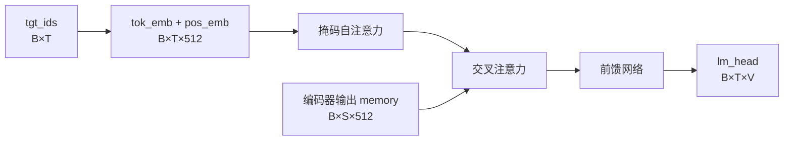

# Transformer 解码器结构详解：掩码自注意力、交叉注意力与残差三件套

解码器不是「编码器加个输出层」。它只比编码器多做两件事：把自注意力改成掩码版，再插一层交叉注意力。本文用一份 60 行的 PyTorch（深度学习框架）脚本把三层结构搭起来，并给出可复算的单层参数量 $4{,}204{,}032$，跑一遍就能看到掩码确实挡住了未来。

> 📦 配套资源：[decoder_demo.py 完整可运行脚本](https://raw.gitcode.com/ZhengEnCi/knoweledges/raw/master/%E6%A0%87%E5%87%86%E6%96%87%E6%A1%A3/resources/X01/code/decoder_demo.py)

---

## 目录

- 1. 解码器到底多了什么（What the Decoder Adds）
- 2. 三个子层的数据流（Data Flow of the Three Sublayers）
- 3. 因果掩码为什么必须存在（Why the Causal Mask）
- 4. 交叉注意力：唯一的信息入口（Cross-Attention as the Only Entrance）
- 5. 一层解码器的实现（Implementing One Decoder Layer）
- 6. 组装完整解码器并跑通（Assembling and Running the Decoder）
- 7. 参数量逐项对账（Parameter Accounting）
- 8. 六个高频坑与解法（Six Common Pitfalls）

---

## 1. 解码器到底多了什么（What the Decoder Adds）

在[编码器结构](https://juejin.cn/post/7641031588095049764)中我们讲过，编码器的每一层只有两个子层：self-attention（自注意力）和前馈网络。解码器保留了这两个，但各改一处，再加一个新的。

| 对比项 | 编码器 | 解码器 |
| --- | --- | --- |
| 第一子层 | 自注意力，看全句 | 自注意力，但加 causal mask（因果掩码），只能看左边 |
| 第二子层 | 无 | cross-attention（交叉注意力），K/V 来自编码器输出 |
| 第三子层 | 前馈网络 | 前馈网络（结构相同） |
| 输出 | 上下文向量序列 | 词表打分，用于逐 token 生成 |

也就是说，每层是「自注意力 → 交叉注意力 → 前馈网络」，各包一个 residual connection（残差连接），骨架沿用至今。



## 2. 三个子层的数据流（Data Flow of the Three Sublayers）

先把张量形状钉死。设批大小 $B$、目标序列长度 $T$、源序列长度 $S$、模型维度 $d = 512$。

- 解码器输入：`tgt_ids` 形状为 $[B, T]$，是整数 token id
- 编码器输出：`memory` 形状为 $[B, S, d]$，是浮点向量
- 每层输出：$[B, T, d]$，长度不变、宽度不变
- 最终投影：$[B, T, V]$，$V$ 是词表大小

注意 $S$ 与 $T$ 可以不等：源句 20 词、译文 12 词是常态，交叉注意力负责吸收这个长度差。

## 3. 因果掩码为什么必须存在（Why the Causal Mask）

打个比方：因果掩码就像考试时用挡板遮住答案页。模型在预测第 5 个词时，只允许看第 1 到第 4 个词；如果把第 5 个词及以后也放进视野，等于让它抄答案——训练 loss 会掉得飞快，推理时却一个字都写不对。

PyTorch 的约定要记牢：**mask 里 `True` 表示「该位置被屏蔽」**，与直觉相反。

$$
\text{mask}_{ij} = \begin{cases} 1, & j > i \\ 0, & j \le i \end{cases}
$$

代码只要一行：

```python
causal = torch.triu(torch.ones(T, T, dtype=torch.bool), diagonal=1)  # 上三角为 True，即屏蔽未来
```

`diagonal=1` 从主对角线上方一格开始置 `True`，主对角线保留可见——预测第 $i$ 个词时，该位置的输入是上一轮已生成的 token，合法。

## 4. 交叉注意力：唯一的信息入口（Cross-Attention as the Only Entrance）

自注意力里 Q、K、V 同源；交叉注意力里 Q 来自解码器，K、V 来自 `memory`，这个不对称是关键：

- Q（查询）问「我这个位置需要什么」，K、V（键与值）答「编码器那边有什么」

可以想象成同声传译：耳朵盯讲者（`memory` 始终不变），笔写译文（解码器状态逐词前进）。删掉这层，解码器退化成纯语言模型。

## 5. 一层解码器的实现（Implementing One Decoder Layer）

采用 pre-norm（前置归一化）：每个子层先做 LayerNorm（层归一化），再进子层，最后加回残差。相比原论文的 post-norm（后置归一化），它更易训练，现代大模型几乎都选它。

```python
def forward(self, x, memory, tgt_mask=None, memory_key_padding_mask=None):
    h = self.norm1(x)                                                    # 先归一化，再进自注意力
    x = x + self.self_attn(h, h, h, attn_mask=tgt_mask, need_weights=False)[0]   # 掩码自注意力 + 残差
    h = self.norm2(x)                                                    # 再归一化，准备进交叉注意力
    x = x + self.cross_attn(h, memory, memory,                          # Q 来自解码器，K/V 来自 memory
                            key_padding_mask=memory_key_padding_mask,
                            need_weights=False)[0]                       # 交叉注意力 + 残差
    x = x + self.ffn(self.norm3(x))                                      # 前馈网络 + 残差
    return x                                                             # 形状仍为 [B, T, d]
```

三点需说明：

1. `need_weights=False` 不只是省事。默认 `True` 会保留 $[B, T, T]$ 的注意力矩阵，长序列训练时显存成倍上涨。
2. `memory_key_padding_mask` 屏蔽源侧 padding 位，避免把补零当成真实 token。
3. 三处残差都写成 `x = x + ...`，为梯度留一条直通路径，这是深层堆叠能收敛的前提。

## 6. 组装完整解码器并跑通（Assembling and Running the Decoder）

完整脚本如下，存成 `.py` 即可运行，只依赖 PyTorch，无需数据集。

```python
import torch                                                        # 张量计算基础库
import torch.nn as nn                                               # 神经网络模块

D_MODEL = 512                                                       # 模型维度 512，与原始论文 base 配置一致
N_HEADS = 8                                                         # 注意力头数 8，每头维度 512 / 8 = 64
D_FF = 2048                                                         # 前馈网络隐藏维度 4 × 512 = 2048
N_LAYERS = 6                                                        # 解码器堆叠 6 层


class DecoderLayer(nn.Module):
    """解码器单层：掩码自注意力 → 交叉注意力 → 前馈网络，三个子层各自带残差"""

    def __init__(self, d_model: int, n_heads: int, d_ff: int, dropout: float = 0.1) -> None:
        super().__init__()                                                          # 初始化父类
        self.self_attn = nn.MultiheadAttention(                                     # Q/K/V 全来自解码器
            d_model, n_heads, dropout=dropout, batch_first=True                     # 输入形状 [B, T, D]
        )
        self.cross_attn = nn.MultiheadAttention(                                    # Q 来自解码器，K/V 来自编码器输出
            d_model, n_heads, dropout=dropout, batch_first=True
        )
        self.ffn = nn.Sequential(                                                   # 对每个位置独立做两层全连接
            nn.Linear(d_model, d_ff),                                               # 升维 512 → 2048
            nn.ReLU(),                                                              # 非线性激活
            nn.Dropout(dropout),                                                    # 抑制过拟合
            nn.Linear(d_ff, d_model),                                               # 降维 2048 → 512
        )
        self.norm1 = nn.LayerNorm(d_model)                                          # pre-norm：自注意力前
        self.norm2 = nn.LayerNorm(d_model)                                          # pre-norm：交叉注意力前
        self.norm3 = nn.LayerNorm(d_model)                                          # pre-norm：前馈网络前

    def forward(self, x, memory, tgt_mask=None, memory_key_padding_mask=None):
        h = self.norm1(x)                                                           # [B, T, D] 归一化
        x = x + self.self_attn(h, h, h, attn_mask=tgt_mask,                          # 掩码自注意力
                               need_weights=False)[0]                                # 取注意力输出
        h = self.norm2(x)                                                           # 归一化后再交叉
        x = x + self.cross_attn(h, memory, memory,                                  # K/V 来自 memory
                                key_padding_mask=memory_key_padding_mask,
                                need_weights=False)[0]                              # 交叉注意力 + 残差
        x = x + self.ffn(self.norm3(x))                                             # 前馈网络 + 残差
        return x                                                                    # [B, T, D]


class Decoder(nn.Module):
    """解码器整体：词嵌入 + 位置嵌入 + N 层 DecoderLayer + 输出投影"""

    def __init__(self, vocab_size: int, d_model: int = D_MODEL, n_heads: int = N_HEADS,
                 d_ff: int = D_FF, n_layers: int = N_LAYERS, max_len: int = 1024,
                 dropout: float = 0.1) -> None:
        super().__init__()                                                          # 初始化父类
        self.tok_emb = nn.Embedding(vocab_size, d_model)                            # token id → 512 维向量
        self.pos_emb = nn.Embedding(max_len, d_model)                               # 位置 id → 512 维向量
        self.layers = nn.ModuleList([                                               # 逐层堆叠
            DecoderLayer(d_model, n_heads, d_ff, dropout) for _ in range(n_layers)
        ])
        self.norm = nn.LayerNorm(d_model)                                           # 末层归一化
        self.lm_head = nn.Linear(d_model, vocab_size, bias=False)                    # 投影到词表打分

    def forward(self, tgt_ids, memory, memory_key_padding_mask=None):
        batch, tgt_len = tgt_ids.shape                                             # [2, 6] → 2 和 6
        pos = torch.arange(tgt_len, device=tgt_ids.device).unsqueeze(0)             # 位置 id [1, 6]
        x = self.tok_emb(tgt_ids) + self.pos_emb(pos)                               # 词向量 + 位置向量
        causal = torch.triu(                                                        # 上三角为 True
            torch.ones(tgt_len, tgt_len, dtype=torch.bool), diagonal=1
        )
        for layer in self.layers:                                                    # 逐层前向
            x = layer(x, memory, tgt_mask=causal,                                   # 每层共用同一掩码
                      memory_key_padding_mask=memory_key_padding_mask)
        return self.lm_head(self.norm(x))                                           # [B, T, V]


if __name__ == "__main__":
    torch.manual_seed(0)                                                           # 固定随机种子
    BATCH, TGT_LEN, SRC_LEN, VOCAB = 2, 6, 9, 1000                                 # 批 2、目标 6、源 9、词表 1000
    model = Decoder(vocab_size=VOCAB, n_layers=1, max_len=64, dropout=0.0)          # 只建 1 层便于对账
    model.eval()                                                                   # 推理模式，保证校验精确
    memory = torch.randn(BATCH, SRC_LEN, D_MODEL)                                  # 模拟编码器输出 [2, 9, 512]
    tgt = torch.randint(0, VOCAB, (BATCH, TGT_LEN))                                # 模拟已生成 token [2, 6]
    logits = model(tgt, memory)                                                    # 前向一次
    print("logits.shape =", tuple(logits.shape))                                    # 期待 (2, 6, 1000)
    layer_params = sum(p.numel() for p in model.layers[0].parameters())             # 单层参数量
    print("decoder layer params =", layer_params)                                   # 期待 4204032
    tgt2 = tgt.clone()                                                              # 复制输入
    tgt2[:, -1] = (tgt2[:, -1] + 1) % VOCAB                                         # 只改最后一个 token
    logits2 = model(tgt2, memory)                                                   # 再前向一次
    prefix_diff = (logits2[:, :-1] - logits[:, :-1]).abs().max().item()             # 前 5 位差值
    last_diff = (logits2[:, -1] - logits[:, -1]).abs().max().item()                 # 最后 1 位差值
    print("prefix max diff =", prefix_diff)                                         # 应为 0.0
    print("last token max diff =", last_diff)                                       # 应大于 0
```

预期输出（数值随版本略有差异）：

```text
logits.shape = (2, 6, 1000)
decoder layer params = 4204032
prefix max diff = 0.0
last token max diff = 0.1688
```

`prefix max diff = 0.0` 是掩码生效的直接证据：改动末位 token，前 5 个位置输出完全不变。若不为 0，说明掩码方向反了或没传进去。

## 7. 参数量逐项对账（Parameter Accounting）

单层参数由四部分组成，全部可按公式复算。设 $d = 512$、$d_{ff} = 2048$：

| 组成 | 计算式 | 参数量 |
| --- | --- | --- |
| 掩码自注意力（4 个 $d \times d$ 矩阵） | $4d^2$ | $1{,}048{,}576$ |
| 交叉注意力（4 个 $d \times d$ 矩阵） | $4d^2$ | $1{,}048{,}576$ |
| 前馈网络（升维 + 降维） | $2d\,d_{ff}$ | $2{,}097{,}152$ |
| 三个 LayerNorm | $3 \times 2d$ | $3{,}072$ |
| 合计（不含 bias） | — | $4{,}197{,}376$ |

再加上 bias（偏置）项：两个注意力各 $4d = 2{,}048$，前馈网络两层共 $d_{ff} + d = 2{,}560$，合计

$$
8d + d_{ff} + d = 4{,}096 + 2{,}048 + 512 = 6{,}656
$$

所以完整单层参数量为

$$
N_{\text{layer}} = 4{,}197{,}376 + 6{,}656 = 4{,}204{,}032
$$

这个数字与脚本打印的 `decoder layer params` 完全一致。结果为 $4{,}197{,}376$ 说明漏算 bias；若是别的数，多半漏了 LayerNorm 的可训练参数 $\gamma$、$\beta$。

## 8. 六个高频坑与解法（Six Common Pitfalls）

| 症状 | 原因 | 解法 |
| --- | --- | --- |
| 训练 loss 掉得飞快，推理却只会重复开头几个词 | 因果掩码方向写反或根本没传，模型训练时能看到未来 | 用 `torch.triu(..., diagonal=1)` 生成掩码，并记住 `True` 表示屏蔽 |
| 改动末位 token 后，前面的输出也变了 | 掩码没广播到所有头，或误用了全零掩码 | 保持掩码形状 $[T, T]$，让 PyTorch 自动广播到 $[B \cdot H, T, T]$ |
| 交叉注意力的梯度始终为 0 | `cross_attn` 的 K/V 误传成了解码器自身输入 | 检查第二、三个实参是否都来自 `memory` |
| 单层参数量与论文对不上 | 漏算 bias 或 LayerNorm 参数 | 按第 7 节四项逐项相加，核对 $4{,}204{,}032$ |
| 序列一长显存就爆 | `need_weights=True` 保留了 $[B, T, T]$ 注意力矩阵 | 显式传 `need_weights=False` |
| 模型完全学不到语序 | 只加了 token embedding，漏了 position embedding | `tok_emb + pos_emb` 逐元素相加后再进第一层 |

六条覆盖了多数「能跑但结果不对」的场景，前两条最隐蔽：程序不报错，只是悄悄学会了作弊。

---

任务是「读一段、生成另一段」，且输出必须逐词因果产生时，用它；只需要理解输入做分类或抽取时，编码器一层就够，交叉注意力纯属白付算力。

配套脚本 `decoder_demo.py` 把三层结构压成能直接跑的最小版本：运行一次会打印输出形状、单层参数量 4204032，以及改动末位 token 后前缀差值为 0 的证据。直链在文章开头，执行 `python decoder_demo.py` 即可复现。

> 下一篇：[SwiGLU激活函数](https://juejin.cn/post/7646233220506075182) —— 本文前馈网络里用的还是 ReLU，那篇拆开讲它为什么被换掉，以及换掉后参数量怎么变。
