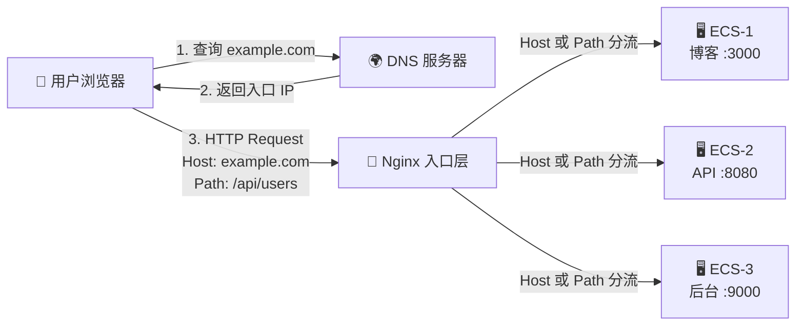
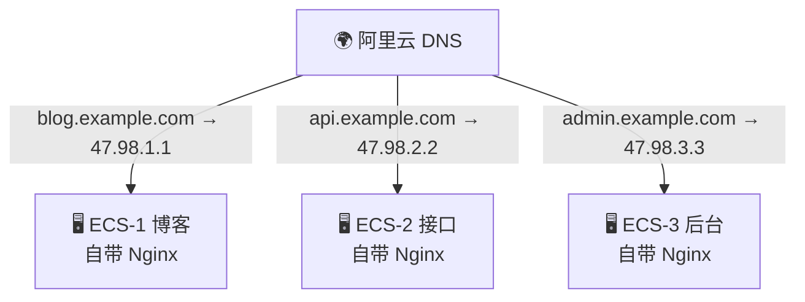
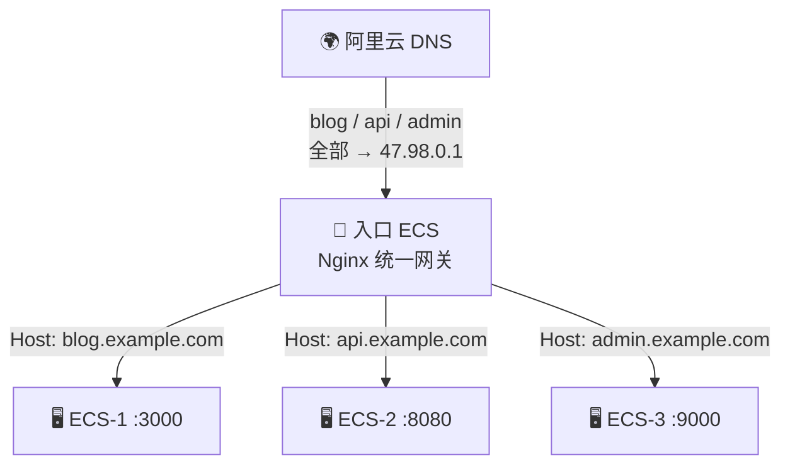
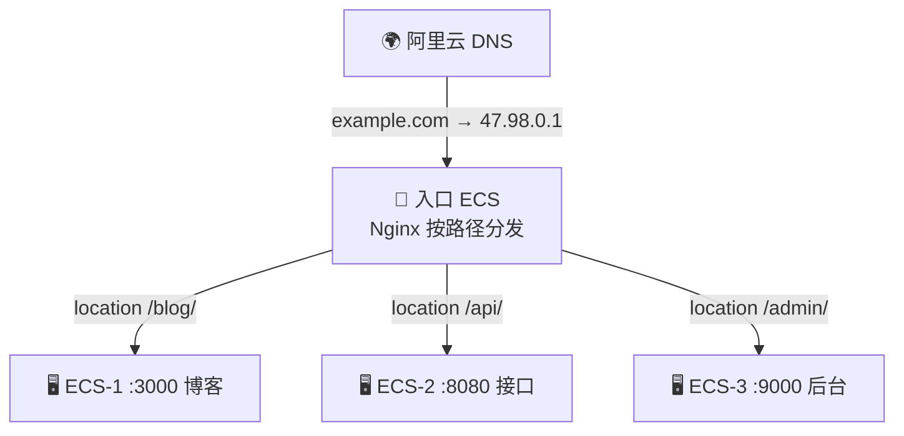
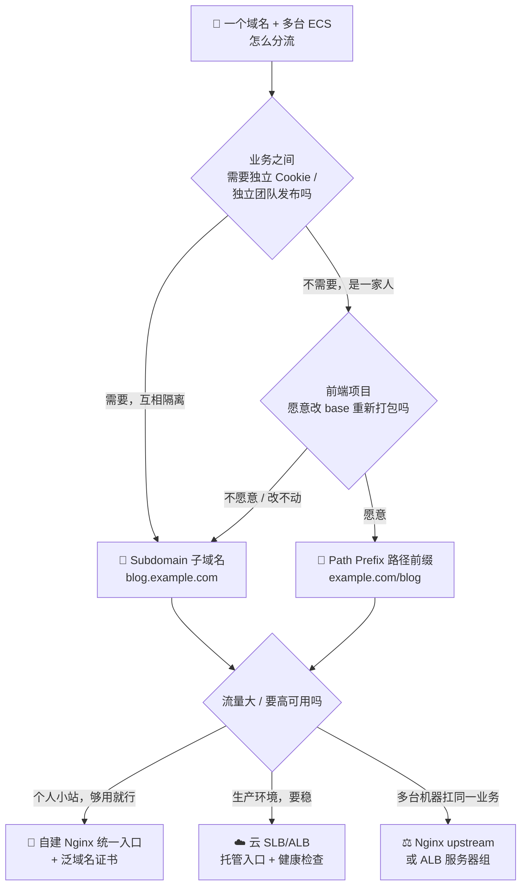

# 一个域名如何访问多台云服务器：子域名、路径前缀与 Nginx 反向代理选型指南 🌐

本文档从 DNS（Domain Name System，域名系统）的职责边界出发，讲清「一个域名 + 多台 ECS（Elastic Compute Service，云服务器）」为什么必须引入入口层，再逐一拆解 Subdomain（子域名）、Path Prefix（路径前缀）、Port（端口区分）与云厂商 SLB（Server Load Balancer，负载均衡）四种分流方案的 DNS Record（解析记录）配置、Nginx Configuration（配置）写法、HTTPS Certificate（证书）成本与适用场景，最后给出选型决策树与备案、DNS 生效、Cookie Path（作用路径）、WebSocket（全双工通信协议）升级等高频踩坑点 🧭

---

## 1. 🌐 问题本质：DNS 只负责「域名 → IP」，多机分流要靠入口层

> 📦 **Note（提示）：** 本章厘清一个核心误区——域名分流不是 DNS 一家能干完的活

### 1.1 DNS 的能力边界 🚧

很多人第一反应是：「我有 3 台 Server（服务器），那我在 DNS 里加 3 条 A Record（地址记录）不就行了？」🤔

这个想法对了一半。DNS 确实支持给同一个 Host Record（主机记录）配置多条 A Record，并采用 Round Robin（轮询）或 Weight（权重）策略返回不同 IP，但它的分发能力极其粗暴：

- **DNS 只看域名，不看 URL Path（路径）** 🔍：`example.com/blog` 和 `example.com/api` 在 DNS 眼里是同一个名字 `example.com`，它压根不知道你想按路径分流
- **DNS 不看 HTTP Header（请求头）** 🙈：它工作在 Application Layer（应用层）之下，连你发的是 GET 还是 POST 都无从知晓
- **DNS Round Robin 没有健康检查** ⚠️：某台 Server 挂了，DNS 依然会把 User（用户）导过去，只能干等 TTL（Time To Live，生存时间）过期

阿里云官方文档对解析记录字段的定义也印证了这一点——Host Record（主机记录）就是 Domain（域名）的前缀部分：`www.example.com` 的主机记录是 `www`，`@` 代表主域名本身，`*` 代表 Wildcard Resolution（泛解析）。也就是说，**DNS 的分流粒度是「域名前缀」，而不是「URL」** ✅

**参考资料：**

- [DNS 的基本概念 -- 阿里云文档](https://help.aliyun.com/zh/dns/basic-concepts-dns2-0) ⭐值得阅读
- [添加解析记录 -- 阿里云文档](https://help.aliyun.com/zh/dns/pubz-add-parsing-record) ⭐值得阅读
- [什么是 DNS A 记录 -- Cloudflare](https://www.cloudflare.com/zh-cn/learning/dns/dns-records/dns-a-record/)
- [什么是 DNS 记录 -- IBM](https://www.ibm.com/cn-zh/think/topics/dns-records)

### 1.2 直观类比：小区门牌号与保安指路 🏘️

把整个链路想象成一个大型小区：

- **Domain（域名）** = 小区名称「幸福里」，写在你导航 App 里
- **DNS** = 导航系统，只能把你带到 **小区正门** 🚪
- **多台 ECS（云服务器）** = 小区里的 1 号楼（博客）、2 号楼（API）、3 号楼（后台管理）
- **Nginx 入口层** = 门口保安 👮，他会看你的 **访客牌（Host Header）** 或 **你要办的业务（URL Path）** ，再告诉你去几号楼

导航（DNS）永远只能送你到门口，进小区之后去哪栋楼，**必须由保安（Nginx）二次分发** ——这就是 Reverse Proxy（反向代理）存在的根本原因 💡



### 1.3 关键技术支点：HTTP Host Header 🔑

为什么一台 Nginx 能同时「扮演」好几个网站？答案藏在 HTTP/1.1 的一个强制字段里—— `Host` Header（主机请求头）📮

浏览器访问 `blog.example.com` 时，实际发出的 Request（请求）长这样：

```http
GET / HTTP/1.1                                  # 请求行：方法 + 路径 + 协议版本
Host: blog.example.com                          # 关键！告诉服务端我要访问哪个虚拟主机
User-Agent: Mozilla/5.0                         # 客户端标识
```

Nginx 拿到这个 Header 后，就能用 `server_name` Directive（指令）做 Virtual Host（虚拟主机）匹配，把请求路由到不同的 Backend（后端）。同理，`location` Directive 可以匹配 URI Path（请求路径），实现按前缀分流 🎯

**一句话总结** 📌：DNS 决定「流量进哪个门」，Nginx 决定「进门后去哪间房」。

**参考资料：**

- [Host 请求标头 -- MDN Web Docs](https://developer.mozilla.org/zh-CN/docs/Web/HTTP/Reference/Headers/Host) ⭐值得阅读
- [Demystifying the HTTP Host header -- DEV Community](https://dev.to/fastly/demystifying-the-http-host-header-dg8) ⭐值得阅读
- [Server names -- nginx 官方文档](http://nginx.org/en/docs/http/server_names.html) ⭐值得阅读
- [Nginx 正/反向代理、配置文件整体说明 -- 博客园](https://www.cnblogs.com/yaopengfei/p/17529721.html)

---

## 2. ⚔️ 四方案全景对比：前缀、后缀、子域名、负载均衡到底怎么选

> 📖 **Note（提示）：** 先看清全貌，再钻细节——本章回答你最初的四个疑问

你问的「加前缀？后缀？子域名？Nginx 转发？」其实混了两个层面的概念，先把它们摆正 🧐：

| 你的说法 | 技术术语 | 分流依据 | 谁来干活 |
|---------|---------|---------|---------|
| 加前缀 / 子域名 | Subdomain（子域名），如 `blog.example.com` | Host Header（主机头） | DNS + Nginx `server_name` |
| 加后缀 | Path Prefix（路径前缀），如 `example.com/blog` | URI Path（请求路径） | 只能靠 Nginx `location` |
| Nginx 转发 | Reverse Proxy（反向代理） | Host / Path / Header | Nginx `proxy_pass` |
| （补充）端口区分 | Port-based（基于端口），如 `example.com:8081` | TCP Port（传输层端口） | 无需 Nginx，但体验极差 |
| （补充）云托管入口 | SLB / ALB（负载均衡 / 应用型负载均衡） | 监听规则 + 转发策略 | 云厂商托管，免运维 |

⚠️ **注意一个反直觉的点**：所谓「加后缀」（`example.com/blog`）在 DNS 层面 **完全无法配置** ❌——DNS 里没有「路径」这个字段。它必须由一台统一入口的 Nginx 来 `location` 匹配转发。而「加前缀」（`blog.example.com`）既能走 DNS（每个子域名指向不同 ECS IP），也能走 Nginx（都指向入口机，再用 `server_name` 分流）✅

### 2.1 五种方案的横向对比表 📊

| 维度 | Subdomain（子域名） | Path Prefix（路径前缀） | Port（端口区分） | SLB/ALB（云负载均衡） | Nginx upstream（自建负载均衡） |
|------|-------------------|----------------------|----------------|---------------------|---------------------------|
| 访问形式 | `api.example.com` | `example.com/api` | `example.com:8081` | `example.com` | `example.com` |
| DNS 配置量 | 每个子域名 1 条 A/CNAME | 只需 1 条 | 只需 1 条 | 1 条 CNAME 指向 SLB | 1 条 A 记录指向入口机 |
| 分流粒度 | Host（主机名） | URI Path（路径） | TCP Port（端口） | 域名 + 路径 + Header | 轮询 / 权重 / IP Hash |
| HTTPS 证书 | 可用 Wildcard Cert（泛域名证书）`*.example.com` 一张搞定 | 单域名证书即可 ✅ 最省 | 单域名证书 | 云厂商托管证书 | 单域名证书 |
| Cookie 隔离 | 天然隔离 ✅（不同 Host） | 共享，需手动设 `Path` ⚠️ | 共享 ⚠️ | 取决于域名 | 取决于域名 |
| 跨域（CORS）问题 | 有，需配置 ⚠️ | 无 ✅ 同源 | 有 ⚠️ | 视域名而定 | 视域名而定 |
| 前端改造成本 | 低 ✅ | 高 ⚠️（需改 `base` / `publicPath`） | 低 | 低 ✅ | 低 ✅ |
| 用户体验 | 好 ✅ | 好 ✅ | 差 ❌（要记端口） | 好 ✅ | 好 ✅ |
| 运维复杂度 | 中 | 中 | 低 | 低 ✅ | 高 ⚠️（入口机单点） |
| 成本 | 免费（DNS 自带） | 免费 | 免费 | 按实例 + 流量计费 💰 | 免费但需自备入口机 |
| 典型场景 | 多业务线、多团队独立部署 | 单一站点下的多模块 | 内网测试、临时调试 | 生产环境高可用 | 中小规模自建集群 |

### 2.2 一句话选型口诀 🎯

- **不同业务、不同团队、需要独立 Cookie 与独立发布** → 选 Subdomain（子域名）🔀
- **同一个站点的多个模块、想让 URL 看起来是一家人** → 选 Path Prefix（路径前缀）📁
- **想要高可用、不想自己守着一台入口机半夜爬起来重启** → 选云 SLB/ALB ☁️
- **只是内网自测、给同事发个链接看看** → 端口区分凑合用，别上生产 🧪

**参考资料：**

- [子域名和子目录哪个更有利 SEO -- 外贸老船长](https://www.ytcaptain.com/archives/portfolio-item/subdomain-subdirectory-seo)
- [深度解析二级域名和子目录如何选择 -- 博客园](https://www.cnblogs.com/ileaves/archive/2013-05-03/3056519.html)
- [Weglot 指南：如何选择子目录还是子域名 -- Weglot](https://www.weglot.com/zh/guides/subdirectory-vs-subdomain)
- [负载均衡 SLB 产品页 -- 阿里云](https://www.aliyun.com/product/slb)
- [配置多域名 HTTPS -- 阿里云文档](https://help.aliyun.com/zh/slb/application-load-balancer/configure-an-alb-instance-to-serve-multiple-domain-names-over-https) ⭐值得阅读

---

## 3. 🔀 方案一：Subdomain（子域名）——最符合直觉的多机分流

> 📦 **Note（提示）：** 本章覆盖 DNS Record（解析记录）配置、Nginx Virtual Host（虚拟主机）写法、Wildcard Certificate（泛域名证书）签发与备案边界

### 3.1 两种拓扑：DNS 直连 vs 统一入口 🏗️

子域名方案有两种截然不同的落地姿势，先想清楚再动手 🤔

**姿势 A：DNS 直连模式（Decentralized，去中心化）** 💡

每个子域名在 DNS 里直接解析到对应 ECS 的 Public IP（公网 IP），**每台 Server 各自跑自己的 Nginx**，互不干扰。



- ✅ 优点：架构极简，没有单点故障（Single Point of Failure），加机器只需加一条 DNS Record
- ⚠️ 缺点：证书要在每台机器上分别申请续期；Nginx 配置散落各处；日志无法集中

**姿势 B：统一入口模式（Centralized，中心化）** 🚪

所有子域名都解析到 **同一台入口 ECS**，由这台机器上的 Nginx 根据 `server_name` 二次分发到后端各机的内网地址。



- ✅ 优点：证书集中管理（一张泛域名证书通吃）、统一 Access Log（访问日志）、统一限流与鉴权
- ⚠️ 缺点：入口机是单点，挂了全线阵亡 😱 → 生产环境建议配合 Keepalived VIP 或直接上云 SLB

> 💡 **选择建议**：机器数量少（2-3 台）、业务彼此独立 → 姿势 A；机器多、需要统一治理 → 姿势 B。

### 3.2 DNS 侧配置：添加解析记录 📝

登录阿里云控制台 → 域名 → 解析设置 → 添加记录，按下表填写（假设三台 ECS 的公网 IP 分别为 `47.98.1.1`、`47.98.2.2`、`47.98.3.3`）：

| 主机记录（Host Record） | 记录类型（Type） | 记录值（Value） | TTL | 说明 |
|----------------------|---------------|--------------|-----|------|
| `@` | A | `47.98.1.1` | 600 秒 | 裸域名 `example.com`，通常指向主站 |
| `www` | A | `47.98.1.1` | 600 秒 | `www.example.com` |
| `blog` | A | `47.98.1.1` | 600 秒 | 博客系统 |
| `api` | A | `47.98.2.2` | 600 秒 | 后端 API 服务 |
| `admin` | A | `47.98.3.3` | 600 秒 | 后台管理系统 |
| `*` | A | `47.98.1.1` | 600 秒 | Wildcard Resolution（泛解析），兜底所有未显式配置的子域名 |

⚠️ **三个必须知道的 DNS 规则** 🚨：

1. **同一主机记录下 A Record 与 CNAME Record 不能共存** ❌：CNAME 表示「我是别人的别名」，A 表示「我就是这个 IP」，两者语义冲突。如果根域名 `@` 已经配了 MX（邮件）或 TXT（域名验证）记录，又想做 CNAME 展平，就得用阿里云的 **ALIAS Record**（企业高级版/旗舰版可用）✅
2. **精确记录优先级高于泛解析** 🎯：`api.example.com` 有独立 A Record 时，绝不会走 `*` 的兜底规则
3. **TTL 决定生效速度** ⏱️：TTL 越短，改完 IP 生效越快，但 DNS Query（查询）频率越高。做 Server 迁移前，建议提前一天把 TTL 调到 60 秒，迁完再调回 600 秒

### 3.3 Nginx 侧配置：`server_name` 虚拟主机 🛠️

以「姿势 B 统一入口」为例，推荐 **一个站点一个配置文件**，放在 `/etc/nginx/conf.d/` 下，主配置用 `include` 自动加载，改起来清爽又不怕误伤 👇

```nginx
# /etc/nginx/conf.d/blog.conf —— 博客站点配置 📝
server {                                                  # 定义一个虚拟主机（Virtual Host）
    listen 80;                                            # 监听 80 端口，接收 HTTP 请求
    server_name blog.example.com;                         # 匹配 Host 头为 blog.example.com 的请求

    location / {                                          # 匹配所有 URI 路径
        proxy_pass http://172.16.0.11:3000;               # 转发到 ECS-1 内网 IP 的 3000 端口
        proxy_set_header Host $host;                      # 保留原始 Host，后端才能识别真实域名
        proxy_set_header X-Real-IP $remote_addr;          # 传递客户端真实 IP，否则后端日志全是入口机 IP
        proxy_set_header X-Forwarded-For $proxy_add_x_forwarded_for;  # 追加代理链路 IP 列表
        proxy_set_header X-Forwarded-Proto $scheme;       # 告知后端原始协议是 http 还是 https
    }
}
```

```nginx
# /etc/nginx/conf.d/api.conf —— API 服务配置 🔌
server {                                                  # 第二个虚拟主机，与博客互不干扰
    listen 80;                                            # 同样监听 80 端口
    server_name api.example.com;                          # 靠 server_name 区分流量走向

    location / {                                          # 匹配全部路径
        proxy_pass http://172.16.0.12:8080;               # 转发到 ECS-2 内网 IP 的 8080 端口
        proxy_set_header Host $host;                      # 透传原始 Host 头
        proxy_set_header X-Real-IP $remote_addr;          # 透传客户端真实 IP
        proxy_read_timeout 60s;                           # 后端响应超时设为 60 秒，防止长请求被掐断
    }
}
```

```nginx
# /etc/nginx/conf.d/00-default.conf —— 兜底站点 🛡️
server {                                                  # 默认服务器块，接住所有没匹配上的域名
    listen 80 default_server;                             # default_server 标记为兜底入口
    server_name _;                                        # 下划线表示「不匹配任何真实域名」

    return 444;                                           # 直接断开连接，不返回任何内容，抵御恶意扫描
}
```

🔧 **改完配置的标准三步走**（千万别直接 restart，配置写错会导致服务起不来）：

```bash
nginx -t                                                  # 测试配置文件语法，输出 syntax is ok 才继续 ✅
nginx -s reload                                           # 平滑重载配置，不中断现有连接 🔄
curl -H "Host: blog.example.com" http://127.0.0.1/ -I     # 本地伪造 Host 头验证分流是否正确 🔍
```

> 💡 `curl -H "Host: xxx"` 是排查虚拟主机问题的神器——不用等 DNS 生效就能验证 Nginx 配置对不对 🎯

### 3.4 泛解析 + 通配 `server_name`：批量子域名的偷懒大法 😴

如果你在做多租户 SaaS（每个客户一个子域名），一个个加 DNS Record 和 `server` 块会累到手抽筋。这时可以「DNS 泛解析 + Nginx 正则 `server_name`」组合拳 👊

```nginx
# /etc/nginx/conf.d/tenant.conf —— 多租户通配配置 🏢
server {                                                  # 单个 server 块服务所有子域名
    listen 80;                                            # 监听 80 端口
    server_name ~^(?<tenant>[^.]+)\.example\.com$;        # 正则捕获子域名前缀，存入 $tenant 变量

    location / {                                          # 匹配所有路径
        proxy_pass http://172.16.0.20:8080;               # 统一转发到租户调度服务
        proxy_set_header X-Tenant $tenant;                # 把捕获到的租户名塞进自定义头传给后端
    }
}
```

访问 `acme.example.com` 时，`$tenant` 就是 `acme`；访问 `globex.example.com` 时就是 `globex` ——后端只需读 `X-Tenant` Header 就知道该查哪个租户的数据 🎪

⚠️ Nginx 官方文档明确了 `server_name` 的匹配优先级：**精确名 > 以星号开头的最长通配名（`*.example.com`）> 以星号结尾的最长通配名（`mail.*`）> 正则表达式**。所以正则块永远是最后兜底的，别指望它抢走精确匹配的流量 📌

### 3.5 HTTPS 证书：Wildcard Certificate（泛域名证书）一张搞定 🔒

子域名方案最爽的一点：**一张 `*.example.com` 的泛域名证书，可以覆盖所有同级子域名**，不用为 `blog`、`api`、`admin` 各申请一张 🎁

但有个硬性前提——Let's Encrypt 规定：**签发泛域名证书必须通过 DNS-01 Challenge（DNS 验证）**，也就是要在你的 DNS 里添加一条 `_acme-challenge.example.com` 的 TXT Record（文本记录）来证明域名所有权。HTTP-01（放文件到网站根目录）那套在泛域名场景下无效 ❌

用 `acme.sh` 配合阿里云 DNS API 可以实现全自动签发与续期 👇

```bash
# 1. 安装 acme.sh（轻量级 ACME 客户端，纯 Shell 实现）📦
curl https://get.acme.sh | sh -s email=my@example.com     # 下载并安装，同时注册邮箱用于到期提醒

# 2. 配置阿里云 DNS 的 API 凭证（用于自动添加 TXT 记录）🔑
export Ali_Key="你的AccessKeyId"                          # 阿里云 RAM 用户的 AccessKey ID
export Ali_Secret="你的AccessKeySecret"                   # 对应的 AccessKey Secret

# 3. 申请泛域名证书 + 主域名证书 🎫
acme.sh --issue --dns dns_ali -d example.com -d '*.example.com'   # --dns 指定用 DNS-01 验证，dns_ali 为阿里云插件

# 4. 安装证书到 Nginx 目录，并注册续期钩子 📂
acme.sh --install-cert -d example.com \                   # 指定要安装的域名
  --key-file       /etc/nginx/ssl/example.com.key \       # 私钥文件输出路径
  --fullchain-file /etc/nginx/ssl/example.com.pem \       # 完整证书链输出路径
  --reloadcmd      "nginx -s reload"                      # 续期成功后自动平滑重载 Nginx
```

对应的 Nginx HTTPS 配置：

```nginx
# /etc/nginx/conf.d/blog-ssl.conf —— HTTPS 站点配置 🔐
server {                                                  # HTTPS 虚拟主机
    listen 443 ssl;                                       # 监听 443 端口并启用 SSL/TLS
    http2 on;                                             # 开启 HTTP/2，多路复用提升加载速度
    server_name blog.example.com;                         # 匹配博客子域名

    ssl_certificate     /etc/nginx/ssl/example.com.pem;   # 证书链文件（含中间证书）
    ssl_certificate_key /etc/nginx/ssl/example.com.key;   # 私钥文件，权限务必设为 600
    ssl_protocols       TLSv1.2 TLSv1.3;                  # 只允许安全的协议版本，禁用 TLS 1.0/1.1

    location / {                                          # 匹配所有路径
        proxy_pass http://172.16.0.11:3000;               # 转发到后端博客服务
        proxy_set_header Host $host;                      # 透传原始 Host
        proxy_set_header X-Forwarded-Proto https;         # 明确告知后端这是 HTTPS 请求
    }
}

server {                                                  # HTTP 强制跳转 HTTPS 的 server 块
    listen 80;                                            # 监听 80 端口
    server_name blog.example.com;                         # 匹配博客子域名的明文请求
    return 301 https://$host$request_uri;                 # 301 永久重定向到 HTTPS，保留原始路径与参数
}
```

⚠️ **Wildcard Hosts ≠ Wildcard Certificates** 🚨：Nginx 里配了 `server_name *.example.com` 只代表「愿意接受这些域名的 HTTP 请求」，跟 TLS 证书毫无关系。想让 `*.example.com` 跑 HTTPS，**必须真的持有一张泛域名证书**，否则浏览器会毫不客气地甩你一个 `NET::ERR_CERT_COMMON_NAME_INVALID` 🙄

### 3.6 备案（ICP Filing）边界：子域名到底要不要单独备案 🇨🇳

这是国内开发者最容易踩的合规坑，阿里云官方 FAQ 给的答案很干脆 ✅：

- **主域名已在阿里云完成 ICP 备案 → 其下所有子域名无需再单独备案** 🎉，直接添加解析记录即可使用
- **主域名有备案号但接入商不是阿里云** → 需要先在阿里云提交 **接入备案**，管局审核通过后才能解析到阿里云内地节点
- **主域名压根没备案** → 未备案域名不能开通网站访问，必须先给主域名提交备案
- **备案不区分端口号** ⚠️：无论用 80/443 标准端口还是 8080/8443 非标端口，只要域名解析指向中国内地 Server，都必须完成备案
- **解析指向中国香港或海外节点** → 无需工信部 ICP 备案（但可能需公安联网备案）

> 🥲 血的教训：备案审核期间域名会被阻断访问，别等到上线当天才想起来这茬。

### 3.7 本章踩坑清单 🕳️

| 现象 | 根因 | 解法 |
|------|------|------|
| 域名解析成功但打不开 | 阿里云安全组（Security Group）没放行 80/443 | 控制台 → ECS → 安全组 → 入方向添加 80、443 端口规则 |
| 只有部分用户访问异常 | 本地 DNS Cache（缓存）未过期 | `ipconfig /flushdns`（Windows）或 `sudo systemd-resolve --flush-caches`（Linux） |
| 访问 `api.example.com` 却打开了博客 | Nginx 没有匹配的 `server` 块，落到 `default_server` | 检查 `server_name` 拼写，用 `curl -H "Host: ..."` 验证 |
| 后端日志里客户端 IP 全是入口机 IP | 没传 `X-Real-IP` / `X-Forwarded-For` | 补上 `proxy_set_header`，后端按 `X-Forwarded-For` 取首个 IP |
| HTTPS 证书报错 invalid common name | 证书只签了 `example.com`，没签 `*.example.com` | 重新用 DNS-01 申请含泛域名的证书 |

**参考资料：**

- [Server names -- nginx 官方文档](http://nginx.org/en/docs/http/server_names.html) ⭐值得阅读
- [泛域名解析 -- 阿里云文档](https://help.aliyun.com/zh/dns/pubz-domain-name-resolution-rules) ⭐值得阅读
- [配置域名解析 -- 阿里云文档](https://help.aliyun.com/zh/dws/getting-started/configure-domain-name-resolution)
- [不同场景下的 ICP 备案说明 FAQ -- 阿里云文档](https://help.aliyun.com/zh/icp-filing/basic-icp-service/product-overview/faq-about-icp-filing-applications-in-different-scenarios) ⭐值得阅读
- [ICP 备案流程 -- 阿里云文档](https://help.aliyun.com/zh/icp-filing/basic-icp-service/user-guide/icp-filing-application-overview)
- [Challenge Types（DNS-01 与泛域名证书）-- Let's Encrypt](https://letsencrypt.org/docs/challenge-types/) ⭐值得阅读
- [acme.sh 自动配置免费 SSL 泛域名证书并续期 -- CSDN](https://blog.csdn.net/liuweilhy/article/details/134751175)
- [Let's Encrypt 配置 HTTPS 免费泛域名证书 -- 阿里云开发者社区](https://developer.aliyun.com/article/1331184)
- [Nginx Server_name Wildcard or Catch-all -- Better Stack](https://betterstack.com/community/questions/nginx-server-name-wildcard-or-catchall/)
- [NGINX Virtual Host: Host Multiple Domains on One Server -- GetPageSpeed](https://www.getpagespeed.com/server-setup/nginx/nginx-virtual-host-multiple-domains)

---

## 4. 🧩 方案二：Path Prefix（路径前缀）——一个域名按「后缀」切蛋糕

> 📦 **Note（提示）：** 本章覆盖 `location` + `proxy_pass` 的尾斜杠拼接规则、`root` vs `alias` 静态托管差异、前端项目 base/publicPath 改造三件套

### 4.1 核心认知：DNS 根本不认识路径 🙈

你问「加后缀行不行」——先泼一盆温柔的冷水 🚿：`example.com/blog/` 和 `example.com/api/` 在 DNS 眼里是 **同一个名字**，解析记录里压根没有「路径」这个字段。路径分流发生在 HTTP 请求到达 Server **之后**，由 Nginx 的 `location` 指令完成。

所以路径前缀方案 **天然是统一入口架构**：域名只解析一条 A Record 指向入口机，剩下的全交给 Nginx 👇



### 4.2 `proxy_pass` 的尾斜杠之谜：一个 `/` 引发的血案 🔪

这是 Nginx 面试与生产事故的双料常客。规则只有一句话 📌：**`proxy_pass` 的 URL 带 URI（哪怕只是一个 `/`）时，会用该 URI 替换掉 `location` 匹配的部分；不带 URI 时，原始路径原封不动透传。**

以请求 `GET /api/user/list` 为例，四种写法结果天差地别 😲：

| `location` 写法 | `proxy_pass` 写法 | 后端实际收到 | 说明 |
|----------------|------------------|------------|------|
| `location /api/` | `proxy_pass http://backend/;` | `/user/list` | 带 `/` → `/api/` 被替换成 `/` |
| `location /api/` | `proxy_pass http://backend;` | `/api/user/list` | 不带 URI → 原样透传 |
| `location /api/` | `proxy_pass http://backend/v2/;` | `/v2/user/list` | 带 URI → `/api/` 被替换成 `/v2/` |
| `location /api` | `proxy_pass http://backend/;` | `//user/list` ⚠️ | location 不带斜杠 + proxy_pass 带斜杠 → 出现双斜杠，多数后端会懵 🤯 |

```nginx
# /etc/nginx/conf.d/path-based.conf —— 路径前缀分发配置 🧩
server {                                                  # 统一入口虚拟主机
    listen 80;                                            # 监听 80 端口
    server_name example.com www.example.com;              # 匹配主域名与 www

    location /blog/ {                                     # 匹配 /blog/ 开头的请求
        proxy_pass http://172.16.0.11:3000/;              # 转发到 ECS-1，尾斜杠剥掉 /blog/ 前缀
        proxy_set_header Host $host;                      # 透传原始 Host
        proxy_set_header X-Real-IP $remote_addr;          # 透传客户端真实 IP
    }

    location /api/ {                                      # 匹配 /api/ 开头的请求
        proxy_pass http://172.16.0.12:8080/api/;          # 转发到 ECS-2，保留 /api/ 前缀（后端路由自带 /api）
        proxy_set_header Host $host;                      # 透传原始 Host
    }
}
```

> 💡 **实战口诀**：后端服务的路由 **自带前缀**（如 Spring Boot 配了 `context-path: /api`）→ `proxy_pass` 原样带上；后端 **不带前缀** → 用尾斜杠把前缀剥掉。改完 `nginx -t` 验证，再 `nginx -s reload` 生效。

### 4.3 静态资源托管：`root` vs `alias` 的灵魂拷问 🤔

如果某台「服务器」只是托管前端构建产物（dist 目录），不需要反向代理，直接用静态文件配置。但 `root` 和 `alias` 的路径拼接逻辑完全不同，配错了就是满屏 404 🕳️：

- **`root`（追加模式）**：最终路径 = `root` + **完整 URI**。`root /var/www;` + 请求 `/blog/index.html` → 找 `/var/www/blog/index.html`
- **`alias`（替换模式）**：最终路径 = `alias` + **URI 去掉 location 匹配部分**。`location /blog/ { alias /var/www/blog/; }` + 请求 `/blog/index.html` → 找 `/var/www/blog/index.html`

```nginx
server {                                                  # 静态站点配置示例 📂
    listen 80;                                            # 监听 80 端口
    server_name example.com;                              # 匹配主域名

    location / {                                          # 主站：SPA 前端
        root /var/www/main;                               # root 追加模式，请求 /assets/app.js → /var/www/main/assets/app.js
        try_files $uri $uri/ /index.html;                 # history 路由兜底：找不到文件就回 index.html
    }

    location /blog/ {                                     # 二级目录：博客前端
        alias /var/www/blog/;                             # alias 替换模式，请求 /blog/post/1 → /var/www/blog/post/1
        try_files $uri $uri/ /blog/index.html;            # 博客 SPA 的 history 路由兜底
    }
}
```

⚠️ **alias 三原则** 🚨：① `location` 与 `alias` **结尾斜杠必须保持一致**（都带或都不带）；② `alias` 只能写在 `location` 里，`root` 可以写在 `server` 层；③ `alias` + `try_files` 组合在部分老版本 Nginx 有兼容坑，遇到诡异 404 优先怀疑这里。

### 4.4 前端项目必须配合改造：base 三件套 🧰

路径前缀方案最容易被忽略的一步：**前端构建产物里的资源引用路径**。默认打包出来的 `index.html` 写的是 `/assets/app.js`（根路径），部署到 `/blog/` 下浏览器就会去请求 `example.com/assets/app.js` —— 完美 404 🎯

各框架的改造姿势 👇

| 框架 | 配置项 | 示例值 |
|------|-------|--------|
| Vue CLI | `vue.config.js` → `publicPath` + `vue-router` → `base`（Vue Router 4 用 `createWebHistory('/blog/')`） | `'/blog/'` |
| Vite | `vite.config.js` → `base` | `'/blog/'` |
| React（CRA） | `package.json` → `homepage` | `'/blog'` |
| Next.js | `next.config.js` → `basePath` | `'/blog'` |

改完 **重新 build** 再部署，资源引用就会变成 `/blog/assets/app.js`，与 Nginx 的 `location /blog/` 严丝合缝 ✅

### 4.5 本章踩坑清单 🕳️

| 现象 | 根因 | 解法 |
|------|------|------|
| 页面能打开但 CSS/JS 全 404 | 前端没配 base/publicPath，资源仍指向根路径 | 按 4.4 改造后重新 build |
| 后端收到 `//user/list` 双斜杠 | `location /api`（无斜杠）+ `proxy_pass .../`（有斜杠） | 两边斜杠保持一致 |
| 转发后路径莫名多了一段 | `proxy_pass` 带了 URI 触发替换，与预期不符 | 对照 4.2 表格推演拼接结果 |
| SPA 刷新子路由报 404 | 静态文件不存在，缺 history 兜底 | 补 `try_files $uri $uri/ /index.html;` |
| 登录后 Cookie 串了 | 同域名下多应用共享 Cookie（见第 8 章） | 设置 Cookie 的 `Path` 属性隔离 |

**参考资料：**

- [nginx 的 location 与 proxy_pass 指令超详细讲解及其有无斜杠结尾的区别 -- 博客园](https://www.cnblogs.com/guzb/p/column-nginx-config_of_location_and_proxy_pass_and_the_difference_of_absence_of_tail_slash.html) ⭐值得阅读
- [proxy_pass url 反向代理的坑 -- Nginx 入门教程](https://xuexb.github.io/learn-nginx/example/proxy_pass.html) ⭐值得阅读
- [Nginx 中 proxy_pass 末尾斜杠的作用 -- 腾讯云开发者社区](https://developer.cloud.tencent.com/article/2741356)
- [Nginx 中 proxy_pass 末尾带斜杠和不带的区别 -- CSDN](https://blog.csdn.net/lihefei_coder/article/details/121033283)
- [Nginx 带不带斜杠的区别最全分析 -- 知乎专栏](https://zhuanlan.zhihu.com/p/680744834)
- [NGINX Alias vs Root: When to Use Which -- GetPageSpeed](https://www.getpagespeed.com/server-setup/nginx/nginx-alias-vs-root) ⭐值得阅读
- [【nginx】静态文件处理：root 和 alias 的区别以及 try_files 用法 -- CSDN](https://blog.csdn.net/be5yond/article/details/122946423)
- [Nginx——一个域名下部署多个 Vue 项目 -- 阿里云开发者社区](https://developer.aliyun.com/article/1564382) ⭐值得阅读
- [vue 多项目部署——二级目录 -- 知乎专栏](https://zhuanlan.zhihu.com/p/242758284)

---

## 5. ⚖️ 进阶玩法：upstream 负载均衡——多台机器扛同一个域名

> 📦 **Note（提示）：** 前几章解决的是「一个域名 **分流** 到多台机器」，本章解决另一个问题：「多台机器 **合力** 扛同一个域名」——即 Load Balancing（负载均衡）

### 5.1 从「分流」到「分摊」：upstream 模块登场 🚀

前面 `proxy_pass` 后面写的都是单台机器的 IP。当某个业务（比如 API）压力大需要多台机器一起扛时，把 `proxy_pass` 的目标换成一个 `upstream` 组即可 👇

```nginx
# /etc/nginx/conf.d/upstream.conf —— 负载均衡配置 ⚖️
upstream api_pool {                                       # 定义后端服务器组，名字随意起
    server 172.16.0.12:8080 weight=3;                     # 高配机器权重 3，多分流量
    server 172.16.0.13:8080;                              # 默认权重 1
    server 172.16.0.14:8080 backup;                       # 备用节点，前两台全挂才启用
}

server {                                                  # 入口虚拟主机
    listen 80;                                            # 监听 80 端口
    server_name api.example.com;                          # 匹配 API 子域名

    location / {                                          # 匹配所有路径
        proxy_pass http://api_pool;                       # 转发到 upstream 组，由调度算法挑一台
        proxy_set_header Host $host;                      # 透传原始 Host
        proxy_set_header X-Real-IP $remote_addr;          # 透传客户端真实 IP
        proxy_next_upstream error timeout http_502;       # 遇错自动换下一台重试，用户无感知
    }
}
```

### 5.2 调度算法：流量怎么分才公平 🎲

| 算法 | 写法 | 分配逻辑 | 适用场景 |
|------|------|---------|---------|
| Round Robin（轮询，默认） | 不写 | 逐台轮流分配 | 机器配置相同、请求耗时均匀 |
| Weighted（加权轮询） | `server ... weight=3;` | 按权重比例分配 | 机器配置有强有弱 💪 |
| IP Hash | `ip_hash;` | 按客户端 IP 哈希，同一 IP 固定打到同一台 | 需要 Session 粘滞（Session Persistence） |
| Least Connected（最少连接） | `least_conn;` | 优先分给当前连接数最少的机器 | 请求耗时差异大（长连接、大文件） |
| Least Time（最短响应） | `least_time header;` | 优先分给响应最快的机器 | ⚠️ NGINX Plus 商业版专属 |

⚠️ **两个细节** 🚨：① `ip_hash` 模式下 `backup` 与 `weight` 不生效；② `max_fails=3 fail_timeout=30s` 可配置被动健康检查——30 秒内失败 3 次就把这台机器暂时踢出池子，到期再放回来试探 🩺

### 5.3 Session 粘滞：负载均衡的经典灵魂拷问 🤔

用户登录态存在 A 机器的内存 Session 里，下一个请求被轮询到 B 机器 → 直接掉线要求重新登录，用户当场血压拉满 😡 三条出路：

1. **`ip_hash`**：最简单，但公司出口 NAT 下所有同事共享一个 IP，流量会倾斜
2. **集中式 Session**：把 Session 存到 Redis，所有机器共享——最正统的方案 ✅
3. **无状态 Token**：登录发 JWT（JSON Web Token），服务端不存 Session，天然免疫负载均衡——现代架构首选 🌟

### 5.4 WebSocket 转发：Upgrade 头必须手动透传 🔌

WebSocket 握手靠 HTTP 的 `Upgrade` 与 `Connection` 头完成协议升级，但它们是 Hop-by-Hop Header（逐跳头），Nginx **默认不会转发**。漏配的表现：连接秒断、前端报 `WebSocket handshake: Unexpected response code: 200` 🕳️

```nginx
# 写在 http 块（如 /etc/nginx/nginx.conf），定义协议升级映射 🗺️
map $http_upgrade $connection_upgrade {                   # 根据客户端是否带 Upgrade 头动态取值
    default upgrade;                                      # 有 Upgrade 头 → Connection 设为 upgrade
    ''      close;                                        # 普通 HTTP 请求 → Connection 设为 close
}

# 写在 server 块的 location 里 🔧
location /ws/ {                                           # 匹配 WebSocket 路径
    proxy_pass http://api_pool;                           # 转发到后端组
    proxy_http_version 1.1;                               # WebSocket 要求 HTTP/1.1（1.29.7+ 版本可省略）
    proxy_set_header Upgrade $http_upgrade;               # 透传协议升级头
    proxy_set_header Connection $connection_upgrade;      # 配合 map 动态设置 Connection
    proxy_read_timeout 3600s;                             # 默认 60 秒无数据就断连，长连接必须调大 ⏱️
}
```

### 5.5 入口机自己挂了怎么办：高可用三选一 🛡️

统一入口模式最大的软肋是 **单点故障**（Single Point of Failure）。三种升级路线，成本从低到高 📈：

| 方案 | 原理 | 成本 | 适用 |
|------|------|------|------|
| DNS 多 A Record 轮询 | 一个域名配多条 A Record 指向多台入口机 | 💰 免费 | 能接受分钟级切换（受 TTL 影响） |
| Keepalived + VIP | 主备两台入口机共享虚拟 IP，主挂了 VIP 秒级漂移 | 💰💰 需同机房 | 自建机房 / 经典主备架构 |
| 云 SLB / ALB | 云厂商托管的负载均衡器，自带高可用 | 💰💰💰 按量付费 | 生产环境省心之选，详见第 6 章 ☁️ |

### 5.6 本章踩坑清单 🕳️

| 现象 | 根因 | 解法 |
|------|------|------|
| 用户频繁掉登录态 | 轮询 + 内存 Session，跨机器丢状态 | 按 5.3 换 Redis Session 或 JWT |
| WebSocket 连接 60 秒准时断 | `proxy_read_timeout` 默认 60s | 调大超时 + 前端心跳保活 |
| WebSocket 握手返回 200 | 没透传 `Upgrade` / `Connection` 头 | 按 5.4 补配置 |
| 一台后端挂了仍收到请求 | 未配被动健康检查 | `max_fails` + `fail_timeout`，或 `proxy_next_upstream` |
| 后端拿到的全是内网 IP | 没传 `X-Real-IP` | 补 `proxy_set_header`，见 3.3 |

**参考资料：**

- [Using nginx as HTTP load balancer -- nginx 官方文档](https://nginx.org/en/docs/http/load_balancing.html) ⭐值得阅读
- [WebSocket proxying -- nginx 官方文档](https://nginx.org/en/docs/http/websocket.html) ⭐值得阅读
- [Nginx 负载均衡——调度算法 weight、ip_hash -- 博客园](https://www.cnblogs.com/ygbh/p/17366002.html)
- [Nginx 负载均衡 -- 知乎专栏](https://zhuanlan.zhihu.com/p/664983050)
- [基于 Nginx 的负载均衡 -- 标点符](https://www.biaodianfu.com/nginx-load-balance/)
- [nginx 反向代理 WebSocket -- 知乎专栏](https://zhuanlan.zhihu.com/p/383598729)
- [生产环境 Nginx 代理 WebSocket 总断连？这几个隐藏配置坑了多少人 -- 腾讯云开发者社区](https://cloud.tencent.com/developer/article/2655436) ⭐值得阅读

---

## 6. ☁️ 方案三 & 方案四：端口区分与云厂商 SLB/ALB

> 📦 **Note（提示）：** 端口方案是「能用但别上生产」的临时工，云 SLB/ALB 是「花钱买省心」的正规军

### 6.1 Port-based（端口区分）：简单粗暴的临时工 🧪

原理毫无技术含量：域名只解析一条 A Record，每台机器的应用监听不同端口，用户直接带着端口号访问——`example.com:8081` 是博客、`example.com:8082` 是后台。

```
example.com:3000  →  🖥️ ECS-1 博客（Node.js）
example.com:8080  →  🖥️ ECS-2 API（Spring Boot）
example.com:9000  →  🖥️ ECS-3 后台管理
```

听起来省事，但生产环境会被现实毒打 👊：

- **用户得记端口号** 🙄：URL 丑且反人类，`example.com:8080` 怎么看都不像一个正经网站
- **安全组必须放行每个端口** 🔓：8080、9000 全部暴露公网，攻击面（Attack Surface）直接翻倍
- **非标端口不能规避备案** ⚠️：ICP 备案看的是「域名解析指向中国内地 Server」这个事实，跟端口号无关，别抱侥幸心理
- **部分企业防火墙封杀非标端口** 🚫：客户在公司网络里打不开你的 `:8080`，你连排查方向都没有

✅ **正确用法**：仅限内网调试、临时联调、给同事发个预览链接。对外服务请老老实实走 80/443 + 反向代理。

### 6.2 云厂商 SLB/ALB：把入口层外包给云 ☁️

阿里云 SLB 家族现在有三位成员，选型别搞混 🧐：

| 产品 | 工作层级 | 分流能力 | 适用场景 |
|------|---------|---------|---------|
| ALB（应用型负载均衡） | Layer 7（HTTP/HTTPS/QUIC） | 域名 + 路径 + Header + Cookie + 查询参数 | Web 应用多域名/多路径分流，功能对标 Nginx ✅ |
| NLB（网络型负载均衡） | Layer 4（TCP/UDP） | 只看 IP + 端口 | 超高性能、非 HTTP 协议 |
| CLB（传统型负载均衡） | Layer 4 + 7 | 7 层支持基础域名/URL 转发 | 老项目存量使用，新业务建议 ALB |

用 ALB 替代自建 Nginx 入口的完整流程 👇：

1. **创建服务器组（Server Group）**：把 3 台 ECS 按业务分别加入「Web 组」「API 组」「Admin 组」，配置健康检查路径
2. **创建监听（Listener）**：HTTPS:443 监听绑定证书（支持一个监听挂多张证书，按域名自动匹配 SNI）；HTTP:80 监听配置强制跳转 HTTPS
3. **配置转发规则（Forwarding Rule）**：这是替代 `server_name` + `location` 的核心 🎯

| 转发条件 | 转发动作 | 等价的 Nginx 配置 |
|---------|---------|-----------------|
| 域名 = `blog.example.com` | 转发至 Web 服务器组 | `server_name blog.example.com` |
| 域名 = `api.example.com` | 转发至 API 服务器组 | `server_name api.example.com` |
| 域名 = `example.com` 且路径 = `/admin/*` | 转发至 Admin 服务器组 | `location /admin/` |
| 域名 = `*.example.com`（通配符） | 转发至兜底组 | `server_name *.example.com` |

4. **DNS 侧只需一条 CNAME**：把 `example.com`、`*.example.com` 解析到 ALB 实例分配的 CNAME 域名，以后加机器、换 IP 都不用再动 DNS 🎉

⚠️ **ALB 规则匹配的一个关键差异** 🚨：Nginx 的 `server_name` 是「精确 > 通配 > 正则」自动排序，而 **ALB 按转发规则编号的优先级逐条匹配、命中即停**，不会自动按域名精确程度排序。规则多了以后记得检查优先级，别让通配符规则抢在精确规则前面「截胡」🥲

### 6.3 自建 Nginx vs 云 SLB：灵魂对比 ⚖️

| 维度 | 自建 Nginx 入口 | 云 SLB/ALB |
|------|---------------|-----------|
| 成本 | 免费（但占一台 ECS） | 实例费 + LCU 费用 💰 |
| 高可用 | 需自己搞 Keepalived，否则单点 | 云厂商托管，天然高可用 ✅ |
| 配置灵活度 | 无所不能（Lua、rewrite、限流）✅ | 常见场景够用，花式需求受限 |
| 运维负担 | 打补丁、调参数、盯日志全靠自己 | 控制台点一点 ✅ |
| 弹性扩容 | 手动加机器改配置 | 后端组一键增删 + 自动健康检查 ✅ |
| 真实客户端 IP | `X-Real-IP` / `X-Forwarded-For` | 同样通过 Header 透传 |

> 💡 **混合姿势**：很多团队用「ALB（抗量 + 高可用）→ Nginx（业务级精细路由）→ 应用」的三层结构，各干各的擅长事。

### 6.4 本章踩坑清单 🕳️

| 现象 | 根因 | 解法 |
|------|------|------|
| `example.com:8080` 外网打不开 | 阿里云安全组没放行 8080 | ECS → 安全组 → 入方向添加规则（但更该反思要不要暴露非标端口） |
| ALB 精确域名规则不生效 | 通配符规则优先级排在前面，命中即停 | 调整转发规则编号，精确规则优先 |
| CNAME 解析后访问 503 | 服务器组健康检查全部失败 | 检查后端端口、健康检查路径、安全组是否放行 ALB 网段 |
| 以为非标端口不用备案 | 误解：备案看解析指向，不看端口 | 内地节点必须备案，见 3.6 |

**参考资料：**

- [配置监听转发规则 -- 阿里云文档](https://help.aliyun.com/zh/slb/application-load-balancer/manage-forwarding-rules-for-a-listener) ⭐值得阅读
- [转发规则配置示例与域名路径匹配规则 -- 阿里云文档](https://help.aliyun.com/zh/slb/application-load-balancer/forwarding-rule-configuration-example-and-domain-name-path-matching-rule) ⭐值得阅读
- [通过配置相同域名不同路径的转发策略实现精准流量转发 -- 阿里云文档](https://help.aliyun.com/zh/slb/classic-load-balancer/use-cases/forward-requests-from-the-same-domain-name-but-different-urls)
- [创建和管理服务器组 -- 阿里云文档](https://help.aliyun.com/zh/slb/application-load-balancer/create-and-manage-a-server-group)
- [非 80 或 443 端口访问是否需要 ICP 备案 -- 备案源头](https://www.beianyuantou.com/scene-non-standard-port)
- [浏览器如何确定请求目标端口？非标准端口请求还有哪些方式？ -- 火山引擎](https://www.volcengine.com/article/1504344)

---

## 7. 🔐 HTTPS 证书选型：一张、几张还是一沓

> 📦 **Note（提示）：** 3.5 节已给出 acme.sh 泛域名证书的签发实操，本章专注「证书类型怎么选、部署在哪、花多少钱」

### 7.1 三种证书类型：覆盖范围决定价格 💳

| 证书类型 | 覆盖范围 | 典型例子 | 注意事项 |
|---------|---------|---------|---------|
| 单域名（Single Domain） | 仅一个完整域名 | `blog.example.com` | 最便宜，但子域名多了要买一沓 📚 |
| 通配符（Wildcard） | 主域名 + **同级** 所有子域名 | `*.example.com` | ⚠️ 只匹配一层：`a.example.com` ✅，`a.b.example.com` ❌ |
| 多域名（SAN/Multi-Domain） | 多个互不相关的域名 | `example.com` + `example.cn` + `api.other.com` | 适合多品牌站点合并管理 |

> 🥲 高频翻车点：以为 `*.example.com` 能保住所有层级的子域名——不能。泛域名的 `*` 只占一个坑位，多级子域名要么再签 `*.b.example.com`，要么用 SAN 合并申请。

验证等级方面：**DV（域名验证）** 分钟级签发、个人站首选；**OV（组织验证）** 需企业资质；**EV（扩展验证）** 最贵，浏览器已不再显示绿色公司名，性价比见仁见智 🤷。通配符证书只有 DV 和 OV 两档。

### 7.2 四种分流方案 × 证书怎么配 🎯

| 分流方案 | 证书需求 | 部署位置 |
|---------|---------|---------|
| Subdomain + DNS 直连（3.1 姿势 A） | 每台机器各签各的，或一张泛域名证书分发到所有机器 | 各台 ECS 的 Nginx |
| Subdomain + 统一入口（3.1 姿势 B） | **一张泛域名证书通吃所有子域名** ✅ 最优解 | 仅入口机 |
| Path Prefix（第 4 章） | **一张单域名证书就够** ✅ 最省钱 | 仅入口机 |
| 云 SLB/ALB（第 6 章） | 证书上传到阿里云数字证书管理服务，监听层托管 | 云端托管，ECS 可只跑 HTTP |

💡 **结论提前剧透**：纯从证书成本看，路径前缀 < 统一入口泛域名 < DNS 直连多机多证书。这也是很多团队「明明子域名更清爽，却还是选了路径前缀」的现实原因之一。

### 7.3 免费 vs 付费：白嫖的正确姿势 🆓

| 渠道 | 有效期 | 额度 | 自动续期 | 适合 |
|------|-------|------|---------|------|
| Let's Encrypt（acme.sh） | 90 天 | 无限制（有频率上限） | ✅ cron 全自动 | 个人 / 中小团队首选 🌟 |
| 阿里云个人测试证书（免费版） | 约 3 个月 | 每自然年 20 张 | ❌ 到期手动重新申请 | 临时测试、演示环境 |
| 阿里云付费证书（Pro/DV/OV） | 6 个月 ~ 1 年 | 按购买 | 部分支持托管续期 | 企业生产、需要 SLA 与合规 |

⚠️ Let's Encrypt 90 天有效期不是缺陷，是设计哲学——短周期 + 全自动续期，泄露了也很快作废。真正危险的是「手动续期 + 一年有效期」的组合：总有一个深夜，证书过期的告警把你从被窝里拽出来 😭

### 7.4 SNI：一个 IP 挂多张证书的黑科技 🪄

老问题：TLS 握手发生在 HTTP 请求 **之前**，Server 还没看到 `Host` 头，怎么知道该出示哪张证书？答案是 **SNI（Server Name Indication，服务器名称指示）**：客户端在 TLS 握手的 `ClientHello` 里明文带上目标域名，Server 据此挑选证书 🎯

- Nginx 侧：同一 `listen 443 ssl` 下配多个 `server` 块、各挂各的证书即可，SNI 自动生效
- 云 ALB 侧：一个 HTTPS 监听可绑定多张证书，按访问域名自动匹配
- 兼容性：现代浏览器全线支持，可以无视远古 IE6 + XP 组合（真的还有人用吗 😅）

### 7.5 本章踩坑清单 🕳️

| 现象 | 根因 | 解法 |
|------|------|------|
| 访问 `a.b.example.com` 证书报错 | `*.example.com` 不覆盖二级子域名 | 补签 `*.b.example.com` 或 SAN 合并 |
| 证书 90 天准时失效 | acme.sh 续期 cron 没装成功 | 重跑 `--install-cronjob`，检查 crontab |
| 阿里云免费证书额度用尽 | 每年仅 20 张 | 转 Let's Encrypt 或购买付费证书 |
| HTTPS 页面里图片报 Mixed Content | 页面 HTTPS 但资源引用还是 HTTP | 资源统一相对路径或 HTTPS，Nginx 加 `X-Forwarded-Proto` |
| 证书装了但 HTTP 还能裸奔 | 没配 80 → 443 强制跳转 | `return 301 https://$host$request_uri;`（见 3.5） |

**参考资料：**

- [SSL 证书选型指南 -- 阿里云文档](https://help.aliyun.com/zh/ssl-certificate/functions-and-features) ⭐值得阅读
- [购买个人测试证书（原免费证书） -- 阿里云文档](https://help.aliyun.com/zh/ssl-certificate/purchase-an-individual-test-certificate)
- [SSL 证书续费及到期处理 -- 阿里云文档](https://help.aliyun.com/zh/ssl-certificate/ssl-official-certificate-renewal)
- [通配符 SSL 与 SAN 证书之间的区别 -- SSL.com](https://www.ssl.com/zh-CN/%E9%80%9A%E9%85%8Dssl%E5%92%8Csan%E8%AF%81%E4%B9%A6%E4%B9%8B%E9%97%B4%E7%9A%84%E5%8C%BA%E5%88%AB/)
- [单域名、多域名、通配符 SSL 证书：如何按需选择 -- 知乎专栏](https://zhuanlan.zhihu.com/p/2004195838256230612)
- [申请 SSL 证书时，单域名、多域名、泛域名的区别是什么 -- 华为云](https://support.huaweicloud.com/ccm_faq/ccm_01_0165.html)

---

## 8. 🧭 选型决策树与高频踩坑总动员

> 📦 **Note（提示）：** 前七章是分论点，本章是总纲领——一张决策树 + 一份全局踩坑速查表，收藏这一章就能应付 80% 的场景

### 8.1 一图流选型决策树 🌳



三句话人话版 📌：

1. **业务要隔离** → 子域名；**业务是一家** → 路径前缀
2. **要稳要省心** → 云 ALB；**要省钱要灵活** → 自建 Nginx
3. **一台扛不住** → upstream / 服务器组，Session 记得外置（5.3）

### 8.2 Cookie 与同源：子域名方案的隐形账单 🍪

浏览器判断「同源（Same-Origin）」看三要素：**协议 + 域名 + 端口，任一不同即跨域**。这直接决定了两种方案的隐形成本 ⚖️：

**路径前缀方案**：`example.com/blog` 和 `example.com/api` 完全同源——没有 CORS、Cookie 天然共享。但「共享」有时反而是坑：博客应用种了个 `Path=/` 的 Cookie，API 应用也种一个同名的，互相覆盖，登录态当场精分 🤯 解法：给 Cookie 设置精确的 `Path` 属性（`Path=/blog`、`Path=/api`），各管各的地盘。

**子域名方案**：`blog.example.com` 与 `api.example.com` 是跨域，前端调 API 必须处理 CORS 👇

```nginx
location / {                                              # API 服务的 Nginx 配置 🔌
    # 预检请求（OPTIONS）直接返回 204，不打扰后端 🏓
    if ($request_method = OPTIONS) {
        add_header Access-Control-Allow-Origin $http_origin always;   # 回显请求来源，不能用 * 配合 Cookie
        add_header Access-Control-Allow-Credentials true always;      # 允许跨域携带 Cookie
        add_header Access-Control-Allow-Methods 'GET,POST,PUT,DELETE,OPTIONS' always;  # 放行方法
        add_header Access-Control-Allow-Headers 'Authorization,Content-Type' always;   # 放行请求头
        return 204;                                       # 预检通过，无响应体
    }
    proxy_pass http://api_pool;                           # 正常请求转发后端
}
```

但跨域 Cookie 有个隐藏关卡 🚪：现代浏览器要求跨站 Cookie 必须 `SameSite=None; Secure`，也就是 **必须走 HTTPS**。而 Cookie 的 `Domain` 属性可以设为 `.example.com`，让所有子域名共享登录态——这正是同主域 SSO（Single Sign-On，单点登录）的实现基础 💡

### 8.3 DNS 切换与验证清单 ✅

Server 迁移、方案切换时，按这份 checklist 走，能避开 90% 的「为什么还不生效」🧐：

| 步骤 | 命令 / 操作 | 说明 |
|------|-----------|------|
| 1. 提前降 TTL | 阿里云控制台把 TTL 调到 60 秒 | 切换前一天做，让旧记录尽快过期 |
| 2. 改解析记录 | A Record 指向新 IP / CNAME 指向 ALB | 精确记录优先级高于泛解析（3.2） |
| 3. 验证 DNS | `nslookup blog.example.com` 或 `dig blog.example.com +short` | 指定权威 DNS 排除本地缓存干扰 |
| 4. 验证路由 | `curl -H "Host: blog.example.com" http://入口IP/` | 绕过 DNS 直连入口机，验证 Nginx 分流 |
| 5. 验证证书 | 浏览器访问 HTTPS + 点击小锁查看证书域名 | 泛域名证书是否覆盖当前层级（7.1） |
| 6. 清本地缓存 | `ipconfig /flushdns`（Windows） | 只有部分用户异常时优先怀疑缓存 |

### 8.4 全局踩坑速查表 🕳️

各章踩坑清单的「电梯索引」，按症状快速定位 🚑：

| 症状关键词 | 大概率原因 | 详见 |
|-----------|-----------|------|
| 解析对了但连不上 | 安全组没放行 80/443 | 3.7 |
| 打开的不是预期站点 | `default_server` 兜底接住了请求 | 3.3 |
| 后端日志全是同一个 IP | 缺 `X-Real-IP` / `X-Forwarded-For` | 3.3 |
| 静态资源 404 | 前端没配 base，或 root/alias 用反 | 4.3 / 4.4 |
| 转发路径多了或少了一段 | `proxy_pass` 尾斜杠拼接规则 | 4.2 |
| 用户频繁掉登录 | 轮询 + 内存 Session | 5.3 |
| WebSocket 秒断 / 60 秒断 | Upgrade 头没透传 / 超时太短 | 5.4 |
| ALB 规则不生效 | 优先级命中即停，通配符截胡 | 6.2 |
| 子域名 HTTPS 报证书错 | 证书没覆盖该层级域名 | 7.1 |
| 跨子域调用被浏览器拦截 | CORS 或 SameSite Cookie 限制 | 8.2 |
| 切换后部分用户仍访问旧机 | DNS 缓存未过期（TTL） | 8.3 |

### 8.5 全文总结 📌

回到最初的问题——「一个阿里云域名 + 多台云服务器，怎么访问」🎯：

1. **DNS 只管「域名 → IP」**，路径、端口、Header 它一概不看，多机分流必须引入入口层（第 1 章）
2. **「加前缀」= 子域名**，DNS 与 Nginx `server_name` 双层都能玩；**「加后缀」= 路径前缀**，只能靠 Nginx `location`，前端还要配合改 base（第 2-4 章）
3. **Nginx 转发是手段不是方案**：`proxy_pass` + `upstream` 组成自建入口层，灵活但要自己扛高可用（第 5 章）
4. **生产环境的答案往往是云 SLB/ALB**：托管入口 + 健康检查 + 证书托管，花钱买觉睡（第 6 章）
5. **证书跟着架构走**：统一入口一张泛域名证书最优雅，路径前缀一张单域名证书最省钱（第 7 章）
6. **细节决定成败**：Cookie Path、CORS、SameSite、TTL、尾斜杠——每一个都够写一篇事故复盘（第 8 章）🥲

域名只有一个，但通往服务器的路有很多条。选哪条不重要，重要的是——**别让用户看到 404** 🚀

**参考资料：**

- [聊一下单点登录如何给不同域名种 cookie -- webfem](https://webfem.com/post/share-cookie) ⭐值得阅读
- [Cors 跨域（二）：实现跨域 Cookie 共享的三要素 -- 腾讯云开发者社区](https://developer.cloud.tencent.com/article/1838493)
- [什么是 CORS？跨源资源共享简介 -- AWS](https://aws.amazon.com/cn/what-is/cross-origin-resource-sharing/) ⭐值得阅读
- [单点登录那些事儿（二）：同域下的单点登录 -- Authing 论坛](https://forum.authing.cn/t/topic/114)
- [浏览器 cookie 共享之同一域名下的不同子域名之间共享 -- 稀土掘金](https://juejin.cn/post/7243615443247415355)
- [关于 cookies 网站跨域单点登录的原理 -- 博客园](https://www.cnblogs.com/T-CYP/p/15425839.html)

---

**最后更新时间**：2026-09-15
